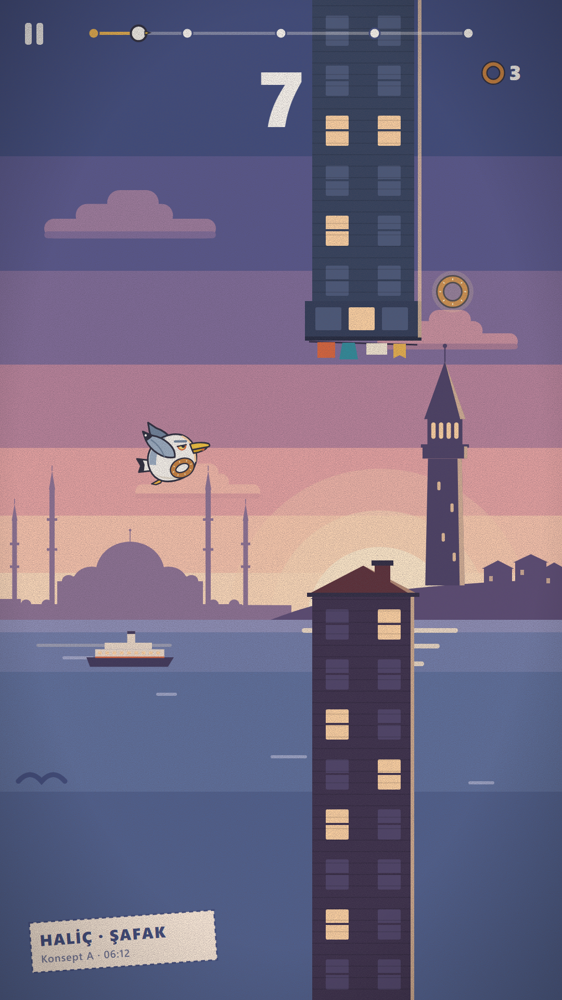
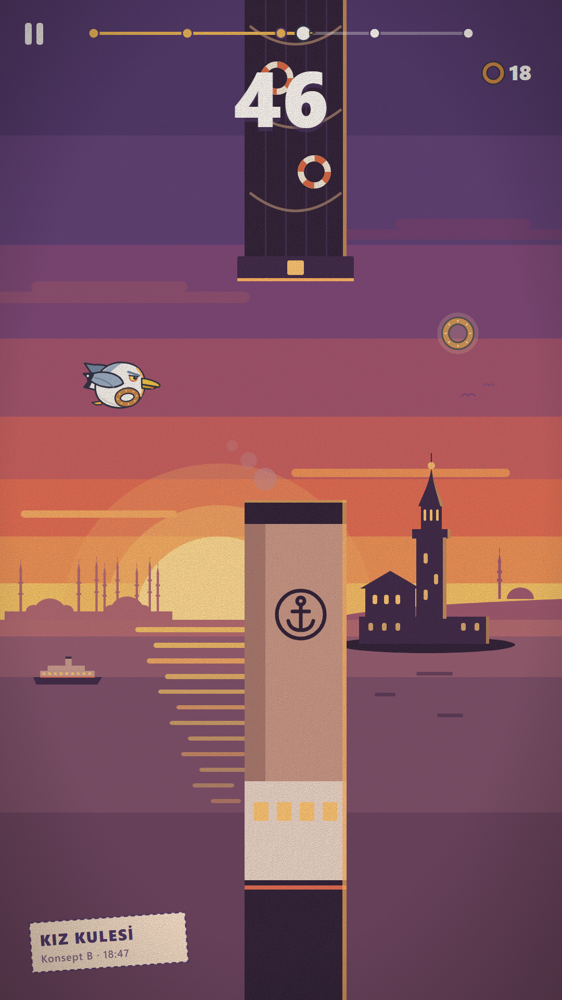
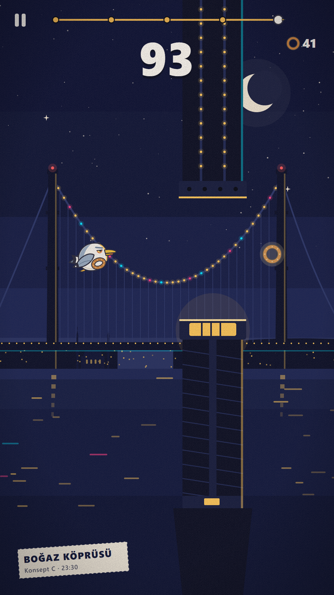

# 02 · Görsel Konseptler

> Martı: Istanbul Flight · Aşama 2 · 21 Ekim 2026
> Referans: [01_urun_konsepti_ve_art_direction.md](01_urun_konsepti_ve_art_direction.md)

## Üretim yöntemi (önemli not)

Bu oturumda **AI görsel üretim aracına erişimim yok.** Bu yüzden üç konsept görseli **elle, vektör illüstrasyon (SVG) olarak** çizdim ve 1080×1920 PNG olarak dışa aktardım. Bunlar AI tarafından üretilmiş görseller değil, gerçek ve düzenlenebilir vektör çizimler.

- **Güçlü yanı:** Modern Kartpostal stilinin düz şekil, sınırlı palet ve temiz kenar ilkesine birebir uyuyorlar. Ölçüler, hex renkler ve katman ayrımı kesin.
- **Sınırı:** Bir illüstratörün elinden çıkmış final kalitesinde değiller. Mimari silüetler sadeleştirilmiş, ışık ve doku basit tutulmuş. Bunlar **sanat yönetimi referansıdır**, final asset değildir.
- Bir AI görsel aracında ya da bir illüstratörle kullanılmak üzere ayrıntılı promptlar ayrıca hazır: [../art/briefs/image_generation_prompts.md](../art/briefs/image_generation_prompts.md)

| Dosya | İçerik |
|---|---|
| `art/concepts/concept_A_safak_halic.png` + `.svg` | Konsept A · Şafak / Haliç |
| `art/concepts/concept_B_gunbatimi_kizkulesi.png` + `.svg` | Konsept B · Gün batımı / Kız Kulesi |
| `art/concepts/concept_C_gece_bogaz_koprusu.png` + `.svg` | Konsept C · Gece / Boğaz Köprüsü |
| `art/palette/palette_sheet.png` + `.svg` | 4 faz + arayüz + Simit paletleri |
| `art/_source/build.js`, `render.sh` | Görselleri yeniden üreten kaynak (sadece sanat aracı, oyun kodu değil) |

---

## 1. Korunan kararlar

| Karar | Durum |
|---|---|
| Oyun adı: Martı: Istanbul Flight | ✅ Korundu |
| Ana karakter: boynunda simit olan tombul martı Simit | ✅ Korundu, anatomisi netleştirildi (bkz. 2.1) |
| Modern Kartpostal, 1950–60 turizm afişi esini | ✅ Bantlı (posterize) gökyüzü, düz şekiller, baskı grain'i |
| Şafaktan geceye ilerleyen uçuş | ✅ Üç konsept üç fazı gösteriyor |
| Bölgeler: Haliç, Galata, Kız Kulesi, Boğaz Köprüsü, Rumeli Hisarı | ✅ A: Haliç + Galata, B: Kız Kulesi, C: Boğaz Köprüsü |
| Cami ve minareler sadece arka planda | ✅ Süleymaniye (A), tarihi yarımada (B), Ortaköy (C) sadece L2'de, düşük kontrastla |
| Faza uyarlanabilir katmanlı arka plan | ✅ Her SVG'de `L0_sky` → `L9_concept_label` adlı ayrı gruplar |

## 2. Önerilen iyileştirmeler (gerekçeleriyle)

### 2.1 Simit'i gerçek İstanbul martısı üzerine kurmak *(uygulandı)*
**Gerekçe:** İstanbul'daki martıların çoğu **sarı bacaklı martı** (*Larus michahellis*). Bu türün kendine özgü işaretleri var: sarı gaga ve alt gagada kırmızı benek, açık sarı iris ve kırmızı göz halkası, sarı bacaklar, gri sırt, siyah kanat uçları ve üstlerinde beyaz "ayna" lekesi. Bunları kullanmak Simit'i jenerik bir çizgi film kuşundan ayırıyor, gerçek bir İstanbul kimliği veriyor. Ayrıca İstanbullunun hemen tanıyacağı bir detay oluyor.
**Değişen:** Gaga `#F2A93B` → `#F2C23B` + benek `#D9643A`. Detaylar: [03_character_simit.md](03_character_simit.md).

### 2.2 Simit halkası 3/4 açıyla *(uygulandı)*
**Gerekçe:** İlk denemede halka gerçekçi biçimde çizildi: arka yarısı boynun arkasında kalıyordu. Ama yandan bakışta **sosis ya da bıyık gibi okundu.** Halkayı hafif 3/4 açıyla, deliği görünür biçimde çizmek fiziksel olarak bir hile, ama simidin her boyutta "simit" olarak okunmasını sağlıyor.

### 2.3 Bölge 3'ün üst engeli: martı sürüsü yerine iskele kazığı ve can simitleri *(uygulandı, test edilmeli)*
**Gerekçe:** 01'deki "martı sürüsü" engelini çizdim ve **okunmadığını** gördüm: dağınık silüetler dikdörtgen hitbox'ı göstermiyor, oyuncu nereye çarpacağını kestiremiyor. Bu da 01'deki "hitbox her zaman dikdörtgen ve net" kuralına aykırı. Yerine koyduğum koyu ahşap iskele kazığında halatlar, kırmızı-beyaz **can simitleri** ve bir fener başlığı var.
**Risk:** Can simidi, toplanabilir simitle aynı şekilde (halka). Renkleri farklı (kırmızı-beyaz ve kahve), üstelik can simidi koyu engel kolonunun içinde duruyor. Yine de ilk oynanış testinde karışıklık olursa can simitleri kaldırılıp sadece halat bırakılmalı.

### 2.4 Vapur bacası: "engel tabanı koyu" kuralına bilinçli istisna
**Gerekçe:** Şehir Hatları vapurunun krem bacası, İstanbullunun en çok tanıdığı nesnelerden biri. Koyuya boyanırsa tanınmaz. Okunabilirlik iki şekilde korunuyor: başlığı (geçidin sınırı) koyu ve kenar ışıklı, krem tonu da gün batımında `#C9957F`'e kısıldı. **Kural güncellemesi önerisi:** *"Engelin uç başlığı her zaman koyu ve kenar ışıklı olmalı. Gövde, simgesel bir nesneyse açık renkli olabilir."*

### 2.5 Gece sahnesi: köprü ışıklarının karakterle çakışması *(gözlem)*
Konsept C'de köprü kablosundaki ışık boncukları Simit'in arkasından geçiyor. Simit'in konturu ve sıcak kenar ışığı onu ayırmaya yetiyor, ama oyunda kalabalık hissi verebilir. **Öneri:** L3 katmanındaki ışıklar oyunda yaklaşık %70 opaklıkta çalışsın, yanıp sönme animasyonu yavaş olsun (≥1,5 sn).

---

## 3. Konsept A · Şafak / Haliç

| | |
|---|---|
| **Saat** | 06:12, skor 7, bölge 1 |
| **Kompozisyon** | Güneş ufukta, sağ-merkezde doğuyor. Galata Kulesi sağda, Beyoğlu tepesinde kahraman simge. Süleymaniye silüeti solda, sadece uzak planda. Simit ekranın sol üçte birinde, engelin önünde. Afiş mantığına uygun olarak ufuk ekranın %62'sinde. |
| **Atmosfer** | Pembe-şeftali bantlı gökyüzü, uyanmamış şehrin mor silüetleri. Evlerde hâlâ yanan birkaç sarı pencere "şehir uyanıyor" hissini veriyor. |
| **Engeller** | **Alt:** kiremit çatılı, bacalı ahşap ev. **Üst:** cumbalı ev cephesi ve altında asılı çamaşırlar (kiremit, turkuaz, krem, hardal). |
| **Ayrışma** | Engeller koyu mor-lacivert taban ve sağ kenarlarında şeftali kenar ışığı. Simit sahnede tek konturlu öğe. Toplanabilir simidin arkasında sıcak bir hale var. |
| **Katmanlar** | L0 gök + güneş · L1 bulutlar + uzak martılar · L2 Süleymaniye · L3 Galata + tepe · L5 su + güneş yansıması · L4 vapur · L6 oynanış · L7 ön plan martısı · L8 HUD · L9 konsept etiketi |

## 4. Konsept B · Gün batımı / Kız Kulesi

| | |
|---|---|
| **Saat** | 18:47, skor 46, bölge 3 |
| **Kompozisyon** | Büyük güneş diski sol-merkezde ufka iniyor. Altında kesik yatay çizgilerle afiş tarzı bir yansıma sütunu. Kız Kulesi sağda, kayalığı ve yan binasıyla tam silüet. Tek bir engel çifti var, böylece kahraman simge kapanmıyor. |
| **Atmosfer** | Mor → mercan → turuncu → hardal bantlar. Doruk an, ödül hissi. |
| **Engeller** | **Alt:** vapur bacası kolonu (koyu başlık, çapa amblemli krem gövde, ışıklı kabin, kırmızı şeritli koyu gövde) ve bacadan çıkan yumuşak duman. **Üst:** iskele kazığı, halatlar, can simitleri, fener başlığı. |
| **Ayrışma** | Simit mor-mercan bandın önünde (orta değer), beyaz gövdesi ve turuncu kenar ışığıyla öne çıkıyor. Kız Kulesi'nin pencereleri ve fener ışığı sıcak sarı. |

## 5. Konsept C · Gece / Boğaz Köprüsü

| | |
|---|---|
| **Saat** | 23:30, skor 93, bölge 5 (sonsuz gece) |
| **Kompozisyon** | Köprünün iki kulesi ekranı çerçeveliyor, ana kablo ekranın ortasına sarkıyor. Hilal ay sağ üstte. Ortaköy silüeti sol kıyıda, çok düşük kontrastla. Kıyılarda ışıklı pencereler. |
| **Atmosfer** | Derin lacivert bantlar, yıldızlar. **Neon sadece ışık detaylarında:** kablo boncuklarının çoğu sodyum sarısı, birkaçı pembe ve camgöbeği. Kule tepelerinde kırmızı uçak ikaz ışığı. Suda kesik ışık yansımaları. |
| **Engeller** | **Üst:** ışık boncuklu askı kablosu kolonu ve sarı kenarlı kelepçe başlığı. **Alt:** balıkçı teknesi direği ve parlayan fener başlığı (arkasında hale). |
| **Ayrışma** | Engeller neredeyse siyah (`#0A0D1F`), başlıklarında net sarı çizgi. Simit'in sağ üst kenarında sodyum sarısı kenar ışığı var, gece rengini kaybetmiyor. |

---

## 6. Konsept görselleri ve oyun sprite'ları arasındaki fark

Bu üç görsel **sanat yönetimi referansıdır.** Doğrudan oyuna konmayacaklar:
- Sahnelerin hepsi tek parça, şeffaf arka planları yok. HUD ve konsept etiketi görselin üstüne basılmış durumda.
- Oyundaki asset'ler bu referanslardan **ayrı ayrı** üretilecek: şeffaf PNG sprite'lar, döşenebilir (tileable) parallax şeritleri ve gri tonlamalı arka plan katmanları.
- Bölmeyi kolaylaştırmak için her SVG'deki katmanlar `id` ile adlandırıldı (`L0_sky`, `L2_far_peninsula`, `L3_hero_galata`, `L6_gameplay`, `obstacle_top_cumba`...). Bir vektör programında (Figma, Affinity, Illustrator) açıldığında katmanlar ayrı gruplar olarak gelir.

## 7. Sahneler arası tutarlılık kontrol listesi

- [x] Simit üç sahnede de aynı kaynak çizimden geliyor, aynı ölçekte (ekran genişliğinin ≈%13'ü).
- [x] Ufuk her sahnede y=1190'da (%62).
- [x] Engel genişliği her sahnede 196 px (≈%18), geçit yüksekliği 380–420 px.
- [x] HUD her sahnede aynı yerde: duraklat sol üst, rota çubuğu üstte, skor üst ortada, simit sayacı sağ üstte.
- [x] Her sahnede tek kahraman simge var (Galata / Kız Kulesi / köprü).
- [x] Her sahnede su var, her fazda tek bir ana ışık rengi var (şeftali / turuncu / sodyum).
- [x] Aynı baskı grain'i (feTurbulence, düşük opaklık) ve hafif vinyet.

## 8. Açık sorular (oynanış testinde netleşecek)

1. Konsept A'daki çamaşırlar geçidin sınırını belirsizleştiriyor mu? (Çamaşırlar başlığın parçası sayılıyor.)
2. Can simidi ve toplanabilir simit karışıyor mu? (bkz. 2.3)
3. Gece sahnesindeki ışık boncukları dikkat dağıtıyor mu? (bkz. 2.5)
4. Skor rakamı üst engellerle çakıştığında okunuyor mu? (Şu an koyu gölgesi var, yeterli görünüyor.)
