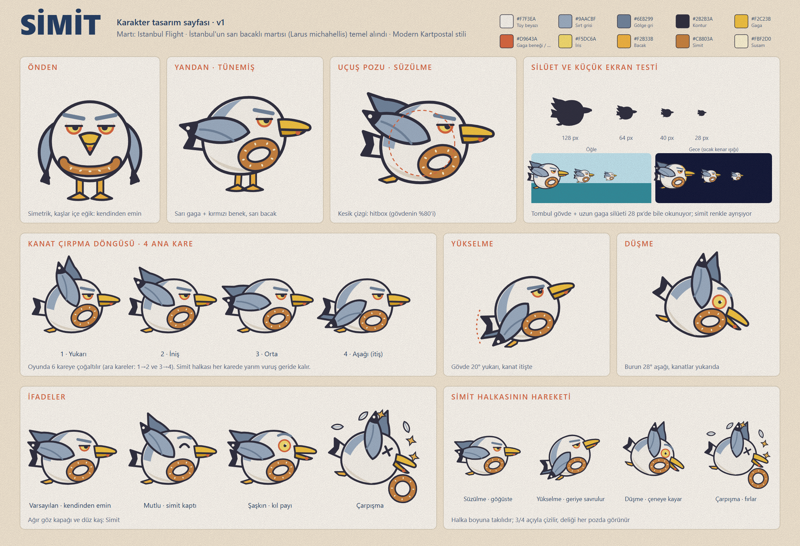

# 03 · Karakter: Simit

> Martı: Istanbul Flight · Aşama 2 · 21 Ekim 2026
> Tasarım sayfası: [../art/character/simit_character_sheet.png](../art/character/simit_character_sheet.png) (vektör kaynağı: `.svg`)

> **Not:** Bu sayfa elle çizilmiş bir vektör illüstrasyon, AI üretimi değil. Bu oturumda görsel üretim aracı yoktu. Final illüstrasyon için bu sayfa bir illüstratöre ya da AI aracına referans olarak verilmeli (prompt: `art/briefs/image_generation_prompts.md`).
>
> Önceki aşamada denenen **pixel art** Simit bir keşif olarak kaldı. Onaylanan yön Modern Kartpostal olduğu için Simit düz vektör ve temiz kenarlı çizildi.

---

## 1. Kimlik

**Simit**, Karaköy–Kadıköy vapurlarında yolcuların elinden simit kapan, herkesin tanıdığı tombul bir **sarı bacaklı martı**. Kendinden emin ve biraz küstah ama sevimli. Boynuna taktığı simit onun hem ganimeti hem madalyası.

**Jenerik kuştan ayıran 5 işaret:**
1. **Ağır göz kapağı ve düz kaş:** Martıların bilinen "sert bakışı" sevimli bir küstahlığa dönüştürüldü. Jenerik çizgi film kuşlarının kocaman masum gözlerinin tam tersi.
2. **Açık sarı iris ve kırmızı göz halkası:** Gerçek *Larus michahellis* detayı.
3. **Uzun sarı gaga ve alt gagada kırmızı benek:** Gerçek tür işareti, en küçük boyutta bile görünen bir renk noktası.
4. **Gri sırt pelerini, siyah kanat ucu ve beyaz ayna lekesi.**
5. **Boyundaki susamlı simit:** İstanbul'un sokak yemeği, karakterin imzası.

## 2. Oranlar (yerel birim, gövde merkezi = 0,0)

| Ölçü | Değer |
|---|---|
| Gövde genişliği | 118 birim (yumurta biçimli, alt kısım daha dolgun) |
| Gövde yüksekliği | 110 birim |
| Toplam genişlik (kuyruk ucu → gaga ucu) | ≈190 birim |
| Gaga uzunluğu | ≈44 birim (gövdenin ~%37'si; silüeti belirleyen öğe) |
| Simit halkası | 46 × 32 birim, göğüste, 3/4 açılı |
| Kontur | 4 birim `#2B2B3A`; gaga, ayak ve halkada 3–3,5 birim |
| Oyunda boyut | 1080 px genişlikte ≈140 px (ölçek 0,72–0,8) |
| Hitbox | Gövde merkezli, yarıçap = gövde yarıçapının %80'i. Gaga, kuyruk ve kanat uçları hitbox dışında kalır (oyuncu lehine) |

## 3. Palet

| Renk | Hex | Kullanım |
|---|---|---|
| Tüy beyazı | `#F7F3EA` | Gövde, baş |
| Göğüs gölgesi | `#E2D9C8` | Alt gövde hilali |
| Sırt grisi | `#9AACBF` | Pelerin, kanat |
| Gölge gri | `#6E8299` | Arka kanat, kaş, tüy çizgisi |
| Kontur / kanat ucu | `#2B2B3A` | Tek kontur rengi |
| Gaga | `#F2C23B` (alt gaga `#D9A21E`) | |
| Benek / göz halkası | `#D9643A` | Kartpostal kiremidiyle aynı renk |
| İris | `#F5DC6A` | |
| Bacak | `#F2B33B` | |
| Simit | `#C8803A`, parlak `#E2A35C`, susam `#FBF2D0` | |

**Faza göre kenar ışığı** (gövdenin sağ üst kenarında 5 birim): şafak `#FFD3A1`, gün batımı `#FFB25B`, gece `#FFC857`. Bu ışık Simit'i her arka plandan ayırır ve sahnenin ışığına bağlar.

## 4. Pozlar

| Poz | Gövde eğimi | Kanat açısı* | Simit halkası (x, y, açı) | İfade |
|---|---|---|---|---|
| Tünemiş (yan) | 0° | kapalı, bacaklar görünür | 22, 26, −18° | Varsayılan |
| Süzülme | 0° | +18° | 22, 26, −18° | Varsayılan |
| Kanat 1 · yukarı | 0° | +62° | 24, 20, −26° | Varsayılan |
| Kanat 2 · iniş | 0° | +28° | 23, 23, −22° | Varsayılan |
| Kanat 3 · orta | 0° | 0° | 22, 26, −18° | Varsayılan |
| Kanat 4 · aşağı (itiş) | 0° | −38° | 21, 30, −12° | Varsayılan |
| Yükselme (dokunuş sonrası) | −20° | −36° (itiş) | 10, 32, +2° *(geriye savrulur)* | Odaklı |
| Düşme | +28° | +58° (kanatlar yukarı) | 32, 14, −36° *(çeneye kayar)* | Şaşkın |
| Çarpışma | +18° | +70° | halka fırlar (gövde dışında) | X göz, açık gaga, tüyler, yıldızlar |

\* Kanadın omuz noktası (2, −4) etrafında dönüşü. Pozitif değer kanat ucunu yukarı kaldırır.

**Halkanın kuralı:** Halka her zaman hareketin **yarım vuruş gerisinde** kalır (ikincil hareket). Yükselişte geriye ve aşağıya, düşüşte çeneye doğru kayar, çarpışmada fırlar ve yuvarlanır. Bu küçük gecikme karaktere ağırlık ve canlılık katıyor.

## 5. İfadeler

| İfade | Göz | Kaş | Gaga | Ne zaman |
|---|---|---|---|---|
| **Varsayılan (kendinden emin)** | Ağır kapak, iris yarım görünür | Düz, hafif içe eğik | Kapalı | Uçuş, menü |
| **Odaklı** | Daha açık kapak, göz bebeği ileri bakar | Daha alçak | Kapalı | Yükselme |
| **Mutlu** | Kapalı "^" göz | Yukarı kavisli | Kapalı | Simit toplama, rekor |
| **Şaşkın** | Büyük yuvarlak iris, küçük göz bebeği | Yüksek kavis | Açık (16°) | Kıl payı, düşme |
| **Çarpışma** | X göz | Yok | Açık (22°) | Çarpma anı, 80 ms hit-stop |

## 6. Küçük ekran ve silüet

- Tasarım sayfasında 128, 64, 40 ve 28 px boyutlarında **tek renk silüet testi** var. Tombul gövde ve uzun gaga, 28 px'te bile martı olarak okunuyor.
- Renkli testte (öğle ve gece zemin) simit halkası ve sarı gaga 40 px'te hâlâ ayrışıyor.
- **Kural:** Detay eklerken silüet testi tekrarlanmalı. Gaga ve gövde oranı korunmalı, kanat silüeti bozmamalı.

## 7. Yapılacaklar ve yapılmayacaklar

- ✅ Tek kontur rengi `#2B2B3A`. Sahnede konturu olan tek öğe Simit.
- ✅ Gaga beneği ve göz halkası aynı kiremit rengini kullanır (marka rengi `#D9643A`).
- ✅ Simidin deliği her pozda görünür.
- ❌ Büyük masum "anime" gözler, uzun kirpikler, pembe yanaklar (jenerik sevimlilik).
- ❌ Kıyafet, fes, şapka gibi aksesuarlar (v1.1'deki şapkalar ayrı bir katman olarak eklenir, temel tasarımı değiştirmez).
- ❌ Gradyanlı ya da 3D gölgelendirme. En fazla bir düz gölge tonu kullanılır.

## 8. Sprite üretimi için hazırlık (sonraki aşama)

Bu sayfa sprite değil, referans. Oyun için ayrıca üretilecekler:

| Sprite | Kare | Not |
|---|---|---|
| `simit_flap` | 6 (4 ana kare + 2 ara kare) | 12 fps döngü |
| `simit_glide` | 1–2 | |
| `simit_rise` / `simit_fall` | 1'er | Kod gövdeyi döndürür; sprite eğimsiz teslim edilir |
| `simit_hit` | 3 | Çarpma, tüy patlaması |
| `simit_splash` | 4 | Suya düşme |
| `simit_idle_menu` | 6 | Kafa sallama, göz kırpma |
| `simit_ring` | Ayrı sprite | Halka ayrı katman olursa ikincil hareket kodla verilebilir. **Önerilen yöntem bu.** |
| `simit_expr_*` | Göz/kaş katmanı ayrı | İfadeler gövdeyi yeniden çizmeden değişir |

Teslim: şeffaf PNG, @3x çözünürlükte 576×480 px tuval (karakter ≈420 px), merkez noktası gövde merkezinde, atlas içinde.
