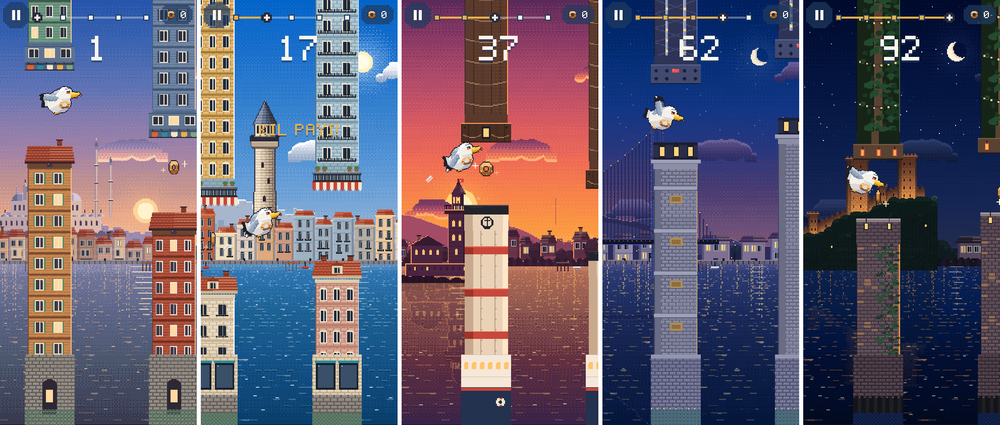
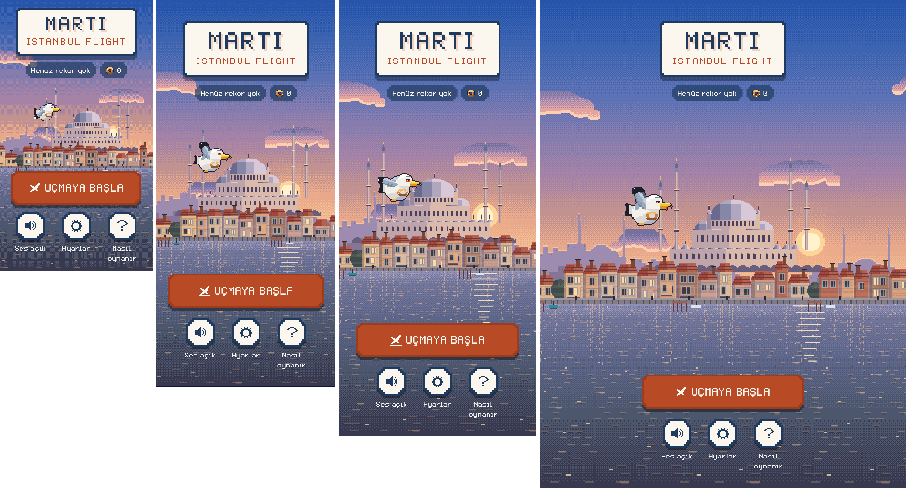
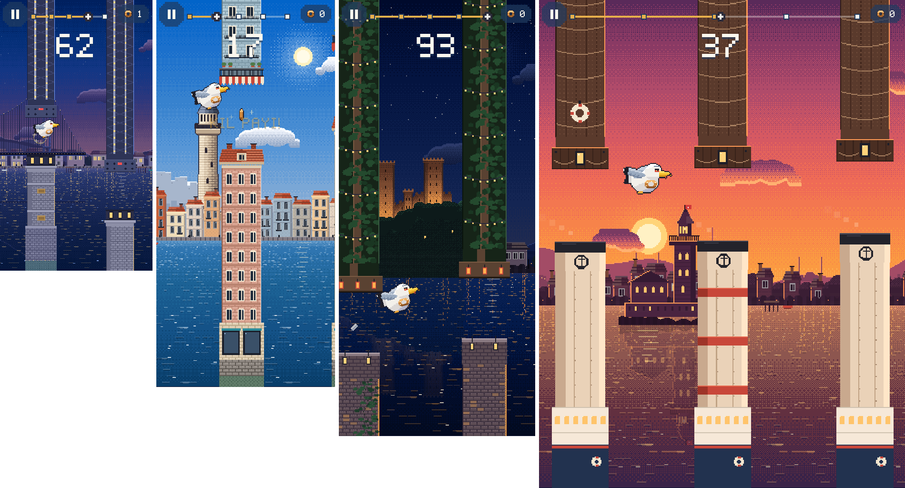
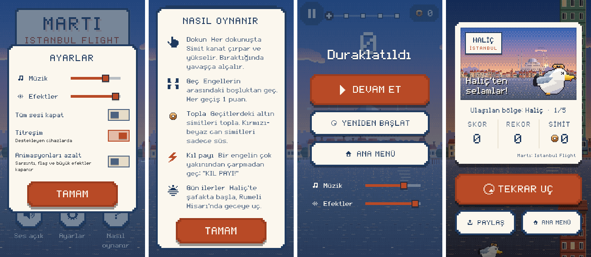
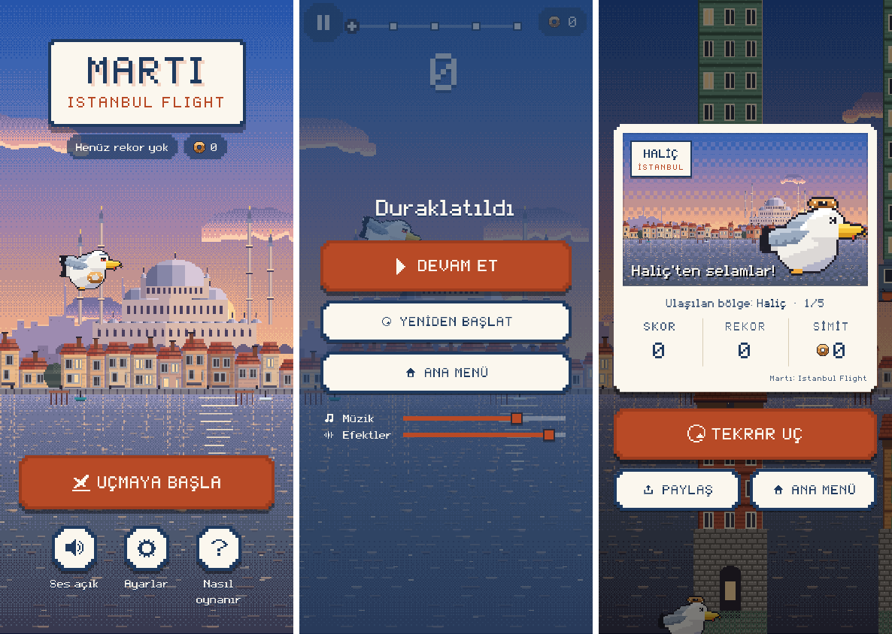

# 08 · Premium pixel art dönüşümü

> **Güncelleme:** Beş bölgenin hepsi gerçek fotoğraf referanslarıyla yeniden çizildi: [09 Galata](09_galata_gercek_referans.md) · [10 Kız Kulesi](10_kiz_kulesi_gercek_referans.md) · [11 Haliç](11_halic_gercek_referans.md) · [12 Köprü](12_kopru_gercek_referans.md) · [13 Rumeli Hisarı](13_rumeli_gercek_referans.md). Bu belgedeki simge ve katman boyutlarının bir kısmı artık geçerli değil; eski dosyalar art/legacy_pixel_v1/ altında.

**Durum:** Pixel art seti oyuna entegre edildi. Analiz temiz, testlerin tamamı geçiyor (95/95), web release derlemesi alınıyor. Ekran görüntüleri gerçek derlemeden alındı.

**Önemli sınır:** Bu ortamda görsel üretim aracı yoktu. Set, `art/_source/pixel/` altındaki Node betikleriyle **piksel piksel programatik** olarak üretildi. Üretimde ton rampaları, Bayer dithering, 1 px kontur ve el ile tanımlı mimari biçimler kullanıldı. Sonuç tutarlı, okunaklı ve tanınabilir; ancak referanstaki elle çizilmiş "premium" detay düzeyinde değil. Bu yüzden **final kalite olarak sunulmuyor**. Final set için promptlar ve teslim boyutları: [art/briefs/pixel_art_prompts.md](../art/briefs/pixel_art_prompts.md). Dosya boyutları ve yolları sabit tutulduğu için final çizimler kod değişmeden yerine konabilir.

Bu görev, docs/01'deki "Modern Kartpostal" vektör kararını kullanıcının isteğiyle değiştiriyor: oyun artık pixel art. Kartpostal teması (pul, kartpostal ekranı, kâğıt renkleri) arayüzde pixel diliyle korunuyor.

---

## 1. Referans analizi ve karşılaştırma

Referans görsel (1536×1024, 5 panel) projeye **kopyalanmadı** ve oyuna tek parça olarak yerleştirilmedi. Görsel sadece tarayıcıda okunarak ölçüldü; geçici kopya silindi. Yapılan ölçümler:

- Her panelin satır ortalaması ve k-means paleti alındı: [art/_source/pixel/reference_palettes.json](../art/_source/pixel/reference_palettes.json).
- Bölge paletleri (`zones.js`) bu ölçümlerden türetildi:
  - Haliç: lavanta / şeftali şafak.
  - Galata: parlak mavi gün ortası.
  - Kız Kulesi: macenta-mercan gün batımı.
  - Köprü: lacivert alacakaranlık.
  - Rumeli: siyah-mavi gece ve sıcak projektör ışığı.

| Konu | Referans | Bu set |
|---|---|---|
| Piksel yoğunluğu | Tek ızgara, yüksek detay | Tek ızgara: 1 px = 4 dünya birimi; arka plan, simge, karakter, engel ve efektlerin hepsinde aynı |
| Işık | Sinematik, ters ışık, kenar ışığı | Bölge başına güneş/ay yönü, kenar ışığı, yanan pencereler, su yansıma sütunu; detay düzeyi daha düşük |
| Mimari | Tanınabilir İstanbul | Galata, Süleymaniye, Kız Kulesi, Boğaz Köprüsü ve Rumeli Hisarı oranları gerçeğe göre sadeleştirildi; ahşap ev, Beyoğlu apartmanı ve yalı üreticileri |
| Doku | Elle yerleştirilmiş piksel kümeleri | Kural tabanlı doku (taş derzi, kiremit, ağaç tacı). Tekrar hissi elle çizimden fazla |

Varlık önizlemeleri (gerçek dosyalardan, büyütülmüş):

- [art/pixel_preview/zones_backgrounds_x2.png](../art/pixel_preview/zones_backgrounds_x2.png): 5 bölgenin birleşik sahnesi
- [art/pixel_preview/simit_sheet_x5.png](../art/pixel_preview/simit_sheet_x5.png) · [obstacle_kits_x3.png](../art/pixel_preview/obstacle_kits_x3.png) · [fx_icons_x4.png](../art/pixel_preview/fx_icons_x4.png) · [rumeli_x4.png](../art/pixel_preview/rumeli_x4.png) · [kizkulesi_x4.png](../art/pixel_preview/kizkulesi_x4.png)

## 2. Asset'ler

Hepsi `assets/images/pixel_art/` altında; kaynak betikler `art/_source/pixel/` altında. Komut: `node art/_source/pixel/build_all.js assets/images/pixel_art`.

```
backgrounds/<halic|galata|kizkulesi|kopru|rumeli>/
    sky 160×298 · sun 96×96 · clouds 256×48 · distant 400×110 · midground 400×140
    waterfront 400×28 · water 128×182 · water_hi 128×182 · ferry 72×28
landmarks/   suleymaniye 180×112 · galata 56×160 · kiz_kulesi 120×118 · bridge 400×196 · rumeli_hisari 240×150
characters/  simit_sheet 288×84 (6×2 kare, 48×42)
obstacles/   kit_<bölge> 372×160 (yerleşimin 1/4'ü)
effects/     fx 256×64 (toplanabilir simit 4 kare, parıltı, tüy, damla, halkalar)
ui/          icons 304×16 (19 ikon)
assets/fonts/MartiPixel.ttf (13,7 KB, 96 glif, Türkçe dahil)
```

| Kaynak betik | Görevi |
|---|---|
| `lib.js` | Canvas, ton rampası, Bayer dithering, kontur, bağımlılıksız PNG kodlayıcı |
| `zones.js` | Bölge paletleri ve ışık yönü |
| `backgrounds.js` | Gök, güneş/ay, bulut, uzak şehir, bina üretici (ahşap / apartman / yalı), kıyı, su, vapur |
| `landmarks.js` | 5 simge |
| `characters.js` | Simit sheet. Gövde her karede sabit, kanat omuz pivotunda döner → titreme yok |
| `obstacles.js` | 5 engel kiti + `lib/game/visual/obstacle_kit_layout.g.dart` üretimi |
| `effects.js` | Efekt atlası ve ikonlar |
| `font.js` | Özgün bitmap font → gerçek TrueType (glyf/cmap4/OS2…). Chrome'un OTS doğrulamasından geçti |
| `preview.js` | Önizleme sayfaları |

Toplam: 58 PNG, diskte 251 KB, çözülmüş hâlde yaklaşık **6,3 MB RGBA**. Eski vektör set yaklaşık 77,8 MB RGBA idi. Eski set silinmedi; pakete girmemesi için `art/legacy_vector_assets/` altına taşındı.

Font kaynağı: indirilmiş bir font **yok**. İzinsiz dosya indirmemek ve lisansı belirsiz dosya eklememek için glifler elle tanımlandı (`font.js`). Font 10 punto = 1 nokta/piksel ölçeğinde. Arayüzdeki boyutlar 5'in katlarına yuvarlandı (10, 15, 20, 25, 30…); 2× ekranlarda her piksel tam sayı fiziksel piksele düşer.

## 3. Bölgeler

| Bölge | Saat | Simge (katman) | Orta plan | Kıyı / su | Engel kiti |
|---|---|---|---|---|---|
| Haliç | şafak | Süleymaniye (kara, orta planın arkasında) | ahşap evler, cumba | ahşap iskeleler, sis bantları | ahşap ev / apartman |
| Galata | gün ortası | Galata Kulesi (kara) | Beyoğlu apartmanları, balkon, tente | Karaköy rıhtımı, vapur | Beyoğlu apartmanı, tente |
| Kız Kulesi | gün batımı | Kız Kulesi (su, yansımalı) | Üsküdar tepeleri ve evler | altın yansıma sütunu, vapur dumanı | vapur bacası ve gövdesi (can simitli) |
| Köprü | akşam | Boğaz Köprüsü (su): portal kuleler, zincir eğrisi kablo, askılar, boncuk ışıklar, mavi aydınlatma | yalılar | ışık yansımaları | köprü ayağı, çelik kafes, ışıklar |
| Rumeli Hisarı | gece | Rumeli Hisarı (kıyı): mazgallı sur, 3 büyük + 2 küçük kule, ağaçlık yamaç | korular, yalılar | ay ve yıldızlar | yosunlu taş iskele, sarmaşık, fener |

- **Tarihi ve dini yapıların hiçbiri engel değil.** Bu yapılar sadece arka planda, çarpışmasız katmanlarda yer alıyor.
- Köprü ve Rumeli bileşimleri birbirinden farklı:
  - Köprü: ekranı yatayda geçen yapı (1600 dünya birimi). Odak noktası sağ kulede.
  - Rumeli: yamaca tırmanan kale kütlesi.
- Köprü geometrisi her ekranda aynı ölçekte çiziliyor (yükseklik sabit, genişlik dünya biriminde). Dar ekranda kule-kablo oranı bozulmuyor, sadece görünen kısım değişiyor.

## 4. Parallax katmanları ve çizim sırası

| Öncelik | Katman | Parallax | Kaynak |
|---|---|---|---|
| 0 | Gök + güneş/ay + yıldız (sky) | 0 | sky, sun |
| 1 | Bulutlar (distant atmosphere) | 0,03 + rüzgâr | clouds |
| 2 | Uzak şehir (distant city) | 0,06 | distant |
| 3 | Kara simgeleri (landmark) | 0,16 | landmarks |
| 4 | Orta plan (midground) | 0,14 | midground |
| 5 | Su + parıltı + yansıma sütunu (water) | 0,5 | water, water_hi |
| 6 | Kıyı şeridi (waterfront) | 0,3 | waterfront |
| 7 | Geçen vapur (foreground ayrıntı) | 0,45 + kendi hızı | ferry |
| 8 | Su/kıyı simgeleri + yansıma | 0,16 | landmarks |
| 9 | Sis | 0,1 | prosedürel piksel bantlar |
| 40–50 | Engeller, toplanabilir simit, efektler, Simit | oyun | kits, fx, simit_sheet |

Çizim kuralları:

- Bütün raster çizimler `FilterQuality.none` ile yapılıyor (`pixelPaint()`).
- Konumlar `snapPx()` ile 4 birimlik ızgaraya oturtuluyor.
- Şeritler +1 birim bindirmeyle döşeniyor; dikiş oluşmuyor.
- Bölge geçişinde arka plan katmanları `Crossfade` ile 2,5 saniyede karışıyor. Aynı anda en fazla 2 bölge çiziliyor.
- Simge geçişi önceki sistemle aynı (fade + yükselme).

## 5. Animasyonlar

- **Simit:** 6 kanat karesi; süzülme, yükselme, düşüş, çarpışma, göz kırpma, oyun sonu ve menüde sürekli kanat çırpma. `SimitAnimator` değişmedi. Pixel'e özgü eklemeler:
  - Konum piksel ızgarasına oturtuluyor.
  - Eğim 7,5° adımlara yuvarlanıyor; döndürülmüş sprite titremiyor.
  - Eski vektör kenar ışığı kaldırıldı.
- **Toplanabilir simit:** 4 karelik dönme ve etrafında dönen iki parıltı. Görsel halka yarıçapı (7,5 px × 4 = 30) toplama yarıçapıyla birebir aynı.
- **Efektler:**
  - Tüy sprite'ı 45° adımlarla dönüyor.
  - Damla sprite'ı var.
  - Toplamada altın halka 4 kare.
  - Kıl payı halkası ızgaraya oturan piksel noktalardan oluşuyor.
  - Kız Kulesi engelinde ve vapurda kare piksel duman var.
- **Su:** iki parıltı katmanı farklı hızlarda kayıyor ve ters fazda soluyor. Ek olarak güneş/ay yansıma sütunu ve suda duran simgelerin dalgalı yansıması var.

## 6. Engeller ve çarpışma

- **Çarpışma geometrisi değişmedi:**
  - Hitbox genişliği 196.
  - Geçit üretimi ve `ObstaclePiecePlan` aynı.
  - Yerleşim sabitleri isim ve değer olarak korundu; sadece 4'ün katlarına oturtuldu (`topCap` 1032, `bottomBase` 1264).
- Atlas 1/4 çözünürlükte; kaynak dikdörtgen yerleşimin 0,25 katı.
- Gövde karoları tam hitbox genişliğinde ve opak. Başlıklar her yandan en fazla 14 birim taşıyor.
- Geçide sadece alt başlığın çarpışmasız süsü giriyor (sınır: halic 28, galata 32, kizkulesi 12, kopru 8, rumeli 12). Bu kurallar mevcut 15 yerleşim testiyle doğrulanıyor.
- Pixel kitlerde ışık zaten renge işlendiği için tint ve ışık maskesi geçişi kaldırıldı. Eski vektör "geçit kenar çizgileri" de kaldırıldı; kenarları sprite'ın kendi konturu gösteriyor.

## 7. Arayüz

`lib/ui/pixel.dart` içindeki parçalar:

- `PixelBorder`: basamaklı köşe çerçeve.
- `pixelBox`: düz dolgu, 2 noktalık çerçeve ve bulanıksız gölge.
- `PixelIcon`: ikon atlası, tam sayı ölçek, sert gölge. Atlas yüklenmezse Material ikona düşer.
- `PixelSwitchTile`, `PixelSliderThumb` ve `pixelSliderTheme`.

| Ekran | Değişiklik |
|---|---|
| Başlık | Pixel pul paneli, MARTI 50 punto, sert gölge; döndürme yok, süzülme 2 noktalık adımlarla |
| Uçmaya Başla ve diğer düğmeler | Basamaklı köşe, kalın çerçeve, sert alt gölge, pixel ikon |
| HUD | Pixel duraklat düğmesi, simit sayacı (oyundaki sprite karesi), kare işaretli bölge çubuğu, "REKOR GEÇİLDİ!" rozeti, döndürülmeyen bölge damgası |
| Duraklatma | Pixel düğmeler, pixel kaydırıcılar, 3-2-1 geri sayım (pixel font) |
| Ayarlar | Material anahtarlar yerine `PixelSwitchTile`; kare tutamaçlı kaydırıcı (40 noktalık dokunma alanı korundu) |
| Nasıl oynanır | Pixel panel; 3 yeni ikon eklendi (pillars, bolt, sunset) |
| Kartpostal | İllüstrasyon artık oyunun pixel katmanlarından kuruluyor (592×370 piksellik kesit). Simit 2× ya da 3× tam sayı ölçekte; pul ve kart basamaklı çerçeveli |
| Yeni rekor | "YENİ REKOR!" damgası 3 sabit ölçek adımıyla basılıyor ve yanıp sönüyor; pixel susam konfetisi (ızgaraya oturan dikdörtgenler) |

Bitmap fontlar döndürüldüğünde bulanıklaştığı için damgalar ve kart artık döndürülmüyor.

## 8. Performans

Kare başı yük önceki vektör sürüme göre arttı. Kaynakları:

- Her katman için birkaç `drawImageRect` çağrısı; şeritler ekran genişliğine göre 2–4 parça.
- Geçiş sırasında katmanlar iki kez çiziliyor.
- Hepsi aynı az sayıdaki küçük atlas üzerinden ve shader gerektirmeyen düz çizimler.
- Su efekti iki ek şerit ve 10 dikdörtgen.
- Oyun sırasında yeni nesne üretilmiyor; efekt havuzu sabit.

Bellek önemli ölçüde düştü: çözülmüş görseller yaklaşık 78 MB'den yaklaşık 6,3 MB'ye indi.

**Ölçülmedi:** gerçek cihazda FPS. Android SDK yok. Headless tarayıcının kare hızı (yaklaşık 17 rAF/sn) bir performans ölçüsü değildir. Cihaz testi açık iş olarak kalıyor (bkz. §11).

## 9. Testler

```
flutter analyze            → No issues found!
flutter test               → 95/95 geçti (All tests passed!)
flutter build web --release → Built build\web
```

Test sayısı aynı kaldı (95). Davranış testlerine dokunulmadı. Asset setinin değişmesi nedeniyle `test/visual_test.dart` içinde 2 test **güncellendi**:

1. **"boyutlar" testi:** eski vektör boyutları (2160×630, 1500×640…) yerine pixel kuralları kontrol ediliyor:
   - Simit sheet = kare × 6×2.
   - Kit atlası yerleşimin 1/4'ünü kapsıyor ve `atlasScale == 1/kArtPx`.
   - Simge piksel boyutu × 4 = `LandmarkLayer.layout`.
   - Gök ve su yükseklikleri dünyayla uyumlu.
   - Her dosya ≤ 512 px.
2. **"dikiş" testi:** eski uzak/kıyı şeritleri yerine her bölgenin distant, midground, waterfront ve water şeritleri kontrol ediliyor. Bu test gerçek bir hata yakaladı: Köprü uzak tepelerinde 2 satırlık dikiş vardı. Hata kaynak betikte düzeltildi.

Dart tarafında ayrıca:

- `debugStartScore` eklendi: sadece `MARTI_DEMO` derlemesinde `?zone=n` ile tur o bölgeden başlıyor (ekran görüntüleri için). Normal derlemede kapalı.

## 10. Ekran görüntüleri (gerçek derleme)

Edge headless'ta DevTools protokolüyle alındı (2× DPR). Bölge çekimleri `MARTI_DEMO` derlemesiyle (otomatik pilot, çarpışma kapalı); arayüz çekimleri normal release derlemesiyle yapıldı.

**Beş bölge, oyun içi (390×844):** Haliç · Galata · Kız Kulesi · Köprü · Rumeli Hisarı



Gerçek referanslı yeniden çizim sonrası (docs/09–13) aynı çekim: [zones_390x844_v2.png](screenshots/pixel/zones_390x844_v2.png) · beş bölgenin kartpostalları: [kartpostallar_5_bolge.png](screenshots/pixel/kartpostallar_5_bolge.png) · yeni rekor damgası (artık doğrulandı): [yeni_rekor_kartpostal.png](screenshots/pixel/yeni_rekor_kartpostal.png) · oynanış kaydı: [oynanis_5_bolge_v2.gif](screenshots/pixel/oynanis_5_bolge_v2.gif)

**Ana menü (320×568 · 375×812 · 412×915 · 768×1024):**



**Oyun içi (320×568 Köprü · 375×812 Galata · 412×915 Rumeli · 768×1024 Kız Kulesi):**



**Arayüz, 320×568 (ayarlar · nasıl oynanır · duraklatma · kartpostal):**



**Akış, 390×844 (menü · duraklatma · kartpostal):**



Bu çekimlerde kontrol edilenler:

- Bulanıklık yok (en yakın komşu).
- Şerit dikişi görünmüyor.
- Simgeler her bölgede görünür.
- 320 px'te taşma yok. İlk denemede kartpostaldaki Simit metnin üstüne biniyordu; tam sayı 2× ölçeğe geçilerek düzeltildi.

## 11. Eksikler ve bilinen sorunlar

- **Final kalite değil:** Set programatik pixel art. Elle çizilmiş final set için: [art/briefs/pixel_art_prompts.md](../art/briefs/pixel_art_prompts.md).
- **Yeni rekor ekranı (güncelleme: sonradan doğrulandı, [yeni_rekor_kartpostal.png](screenshots/pixel/yeni_rekor_kartpostal.png)) — ilk durum:** Otomasyonda puan alınamadığı için ekran görüntüsü yok. Pixel damga animasyonu ve konfeti kodda var, derleniyor. Ancak ne görsel olarak incelendi ne de bir widget testi damgayı arıyor. Testler sadece rekor mantığını (`isNewRecord`) doğruluyor. Bu kısım **doğrulanmamış** sayılmalı.
- **Paylaş düğmesine basılmadı:** Paylaş indirme tetikleyebileceği için tarayıcıda denenmedi. PNG üretimi widget testiyle doğrulanıyor.
- **Cihaz testi yapılmadı:** Gerçek cihazda (Android/iOS) FPS ve dokunma testi yapılmadı.
- **3× DPR'de yazı keskinliği:** 15 puntoluk metinler 3× ekranda 4,5 fiziksel piksele düşüyor ve hafif yumuşayabilir. 10/20/30 punto metinler her DPR'de keskin.
- **Font eksikleri:** Marti Pixel tek ağırlıklı. Eski kalın başlıklar artık renk ve boyutla ayrışıyor. Fontta olmayan nadir karakterler sistem fontuna düşer.
- **Tarayıcı paneli:** Uygulamanın tarayıcı paneli gizliyken sayfa kare üretmiyor. Bu nedenle doğrulama headless Edge ile yapıldı. Bu bir uygulama hatası değil.
- **Web ses logları:** Görev 5'ten kalan yakalanmış `AbortError` logları duruyor; işlevi etkilemiyor.
- **Kapsam:** Başka projelere dokunulmadı. `zar_uygulamasi` (1), `fitness_timer` (5) ve `nobetci-eczane` (20) dosyalarındaki commit edilmemiş değişiklikler bu oturumdan önceye (en geç 19 Ekim) ait.
