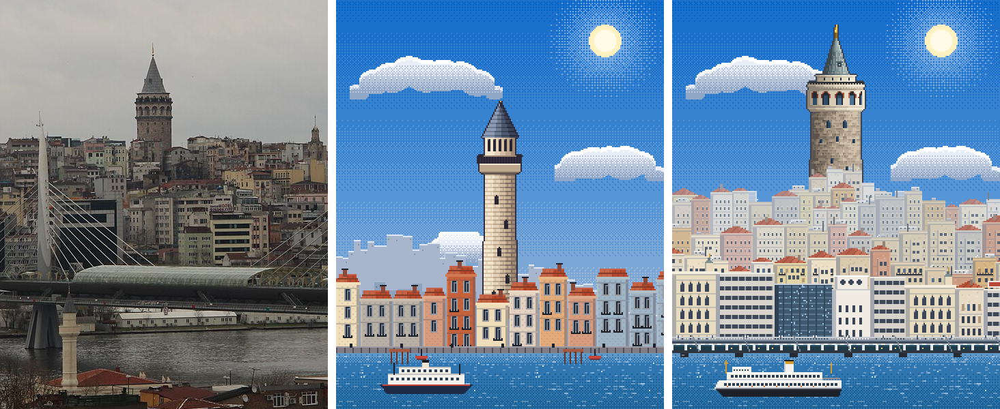
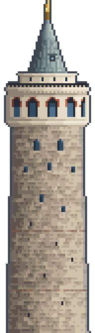
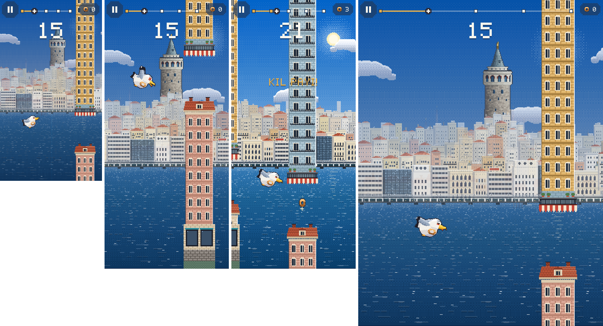

# 09 · Galata: gerçek referanslara dayalı yeniden çizim

**Durum:** Galata bölgesi gerçek fotoğraf ve mimari verilere göre yeniden çizildi ve oyuna entegre edildi. Sonuç **görsel onayını bekliyor**. Diğer dört bölgeye (Haliç, Kız Kulesi, Köprü, Rumeli Hisarı) dokunulmadı.

**Sınırlar:**

- Görsel üretim aracı yok. Pixel art yine `art/_source/pixel/galata.js` ile piksel piksel, kodla çizildi. Fark şu: bu kez her öğe gerçek fotoğraflardan okunan biçim ve oranlara dayanıyor.
- Fotoğraflar web üzerinden (Wikimedia Commons) gerçekten incelendi. Hiçbiri oyuna asset olarak konmadı ve projeye kopyalanmadı.
- Karşılaştırma görselinde yalnızca **CC0** (kamu malı) bir fotoğrafın kırpması kullanıldı. CC BY-SA fotoğraflara sadece bağlantı veriliyor.

---

## 1. Araştırılan kaynaklar

| # | Kaynak | Bakış yönü | Lisans | Kullanılan bilgi |
|---|---|---|---|---|
| 1 | [Ferry Kaptan İlyas Mert in front of the Galata Bridge and tower, March 2024](https://commons.wikimedia.org/wiki/File:Ferry_Kaptan_Ilyas_Mert_in_front_of_the_Galata_Bridge_and_tower,_March_2024_01.jpg) · Calistemon, 2024 | Eminönü kıyısından kuzeydoğuya, Haliç ağzı üzerinden Karaköy'e | CC BY-SA 4.0 | **Kamera açısı.** Galata Köprüsü'nün iki katı (üst güverte ve lambalar, alt kattaki lokantalar), Karaköy'deki büyük ticari yapılar, yamaçta katmanlı apartmanlar, sırttaki kule, kulenin görünen kısmı (alt gövde binaların arkasında) |
| 2 | [Haliç, Metro Köprüsü ve Galata Kulesi 2015](https://commons.wikimedia.org/wiki/File:Hali%C3%A7,_Metro_K%C3%B6pr%C3%BCs%C3%BC_ve_Galata_Kulesi_2015.jpg) · Hamdigumus, 2015 | Tarihi yarımadanın yamacından (Unkapanı–Süleymaniye) Haliç'in karşısına | CC0 | Yamacın siluet biçimi (çatı çizgisi kuleye doğru yükselir), bina yoğunluğu, renkler (krem, beyaz, bej, soluk pembe, kiremit) |
| 3 | [Golden Horn – Galata Tower and the Karaköy shore](https://commons.wikimedia.org/wiki/File:Golden_Horn_-_Galata_Tower_and_the_Karak%C3%B6y_shore.jpg) · Alena Belova for Exhibo, 2020 | Haliç Metro Köprüsü'nden doğuya | CC BY-SA 4.0 | Karaköy kıyısındaki modern cam ofis bloğu ve 1950–70 betonarme hanlar, kule ile kıyı arasındaki yükseklik ilişkisi |
| 4 | [Galata Kulesi (07052023)](https://commons.wikimedia.org/wiki/File:Galata_Kulesi_(07052023).jpg) · HuseynAZE99, 2023 | Kule dibinden yukarı | CC BY-SA 4.0 | **Kule anatomisi.** Koni tabanı ≈ gövde çapının %45'i; üst kat tamburu ≈ %70'i; korkuluklu teras; tuğla halkalı yarım daire kemerler; çıkma silmeler; koni üzerindeki küçük pencere |
| 5 | [An exterior view of the Galata Tower, Istanbul](https://commons.wikimedia.org/wiki/File:An_exterior_view_of_the_Galata_Tower,_Istanbul.jpg) · Maurice Flesier, 2021 | Kule dibinden | CC BY-SA 4.0 | Moloz taş doku, silik yatay hatıllar, gövdede yükselen kemerli küçük pencere dizilimi, gövdenin aşağı doğru genişlemesi |
| 6 | [Karaköy ve Galata Kulesi Günbatımı Silüeti](https://commons.wikimedia.org/wiki/File:Karak%C3%B6y_ve_Galata_Kulesi_G%C3%BCnbat%C4%B1m%C4%B1_Sil%C3%BCeti.jpg) · Hamdigumus, 2013 | Haliç üzerinden | CC0 | Siluetin tanınabilirliği (yalnız kontur ile bile kule ve sırt okunuyor) |
| 7 | [Emin Kul goes to Karaköy](https://commons.wikimedia.org/wiki/File:Emin_Kul.jpg) · Ail Subway, 2011 | Yandan | CC BY 3.0 | **Şehir Hatları vapuru:** uzun beyaz iki katlı gövde, koyu alt gövde, tek baca, iki direk, açık kıç güvertesi |
| 8 | [Sehir hatları, Istanbul (P1100205)](https://commons.wikimedia.org/wiki/File:Sehir_hatlari,_Istanbul_(P1100205).jpg) · Matti Blume, 2019 | Baca yakın çekim | CC BY-SA 4.0 | Baca: beyaz gövde, turuncu-hardal bant. Amblem bilinçli olarak **çizilmedi** (kurumsal işaret) |

Ölçü kaynağı: [Galata Tower, Wikipedia](https://en.wikipedia.org/wiki/Galata_Tower).

- Mimari yükseklik 62,59 m (alemle 66,9 m).
- Dış çap 16,45 m, duvar kalınlığı 3,75 m.
- Seyir terası 51,65 m'de; kule deniz seviyesinden 61 m yükseklikte.
- Konik çatı 19. yüzyılda yıkılmış, 1965–67 restorasyonunda yeniden yapılmış.

Ek kaynaklar: [Galata Tower, castles.nl](https://www.castles.nl/galata-tower) · [Kültür ve Turizm Bakanlığı İstanbul](https://istanbul.ktb.gov.tr/TR-309635/galata-tower.html) · [Ferries in Istanbul, Wikipedia](https://en.wikipedia.org/wiki/Ferries_in_Istanbul).

## 2. Kamera açısı ve mimari analiz

**Kamera:** Eminönü kıyısı (Galata Köprüsü'nün güney ucunun batısı), göz hizasına yakın, kuzeydoğuya; Haliç ağzının karşısındaki Karaköy–Galata yamacına bakıyor (kaynak 1 ve 2). Bu açıdan gerçekten görülen öğeler, önden arkaya:

1. **Galata Köprüsü:** Ekranı yatayda geçiyor.
   - Üst güverte: mavi-gri çelik kiriş, korkuluk, eşit aralıklı lamba direkleri, flamalar, korkuluktaki balıkçılar.
   - Alt kat: cam cepheli lokantalar ve tenteler.
2. **Karaköy kıyısı:** 19. yüzyıl sonu–20. yüzyıl başı ticari yapılar.
   - Krem taş cepheli, ikili kemer pencereli bloklar; köşede küçük kubbeli kule.
   - Çatı katında yuvarlak pencereli beyaz han.
   - 1950–70 betonarme hanlar (yatay bant pencereler, çatı panosu).
   - Koyu cam modern ofis.
3. **Yamaç:** 5–8 katlı sıvalı apartmanlar, basamak basamak.
   - Renkler: krem, beyaz ve bej ağırlıkta; okr, soluk sarı, soluk pembe ve gri az.
   - Çatılar: kırma kiremit ya da düz çatı. Düz çatılarda su deposu, çatı katı, çanak anten ve anten var.
   - Ferforje balkon şeritleri ve cumbalar.
   - Hava perspektifi: arka sıralar pusa doğru açılıyor.
4. **Sırt ve kule:** Kule sırtın en yüksek noktasında. Çatı çizgisi kuleye doğru yükseliyor; kulenin alt gövdesi binaların arkasında kalıyor.
5. **Uzak plan:** Sırtın arkasında pusta seçilen birkaç yüksek blok.

**Kule (48×168 px; 1 px ≈ 0,41 m; gövde 40 px ≈ 16,45 m):**

| Bölüm | Gerçek | Pixel |
|---|---|---|
| Alem | 66,9 − 62,59 ≈ 4,3 m, yaldızlı | 10 px, top ve sivri uç |
| Konik çatı | Kurşun kaplama, dik; taban gövde çapının ≈ %45'i | 26 px yükseklik, 18 px taban; levha dikişleri, küçük çatı penceresi |
| Üst kat tamburu | Çap ≈ %70, küçük pencereler | 28 px genişlik, 4 küçük pencere |
| Seyir terası | 51,65 m'de, demir korkuluk | Koyu korkuluk ve dikmeler, taşkın teras döşemesi |
| Silmeler | Dişli konsollu çıkma | 3 satır, gölgeli |
| Kemerli galeri | Tuğla halkalı yarım daire kemerler, krem taş ayaklar, içeri çekik pencereler | Yaklaşık 6 bölme görünüyor; yarım daire açıklık ve tuğla halka |
| Gövde | Moloz taş, aşağı doğru genişler, silik hatıllar, dağınık kemerli pencereler ve mazgallar | 104 satır; 35→41 px genişler; taş hücre dokusu, 2 hatıl, 2 büyük ve 5 küçük pencere, mazgallar |

Işık: Gün ortası, güneş güneyde (kameranın sağ arkası). Silindir sağdan aydınlık; binaların kameraya bakan cepheleri aydınlık, sola bakan yan yüzleri soğuk gölgede.

## 3. Üretilen yeni pixel art

| Dosya | Boyut | İçerik |
|---|---|---|
| `landmarks/galata.png` | 176×200 | Kule ve tepedeki bina kümesi. Küme kuleyle birlikte hareket eder, böylece kule her konumda tepenin üstünde durur |
| `backgrounds/galata/midground.png` | 400×180 | Karaköy kıyısı ve 3 sıra yamaç apartmanı, döşenebilir |
| `backgrounds/galata/waterfront.png` | 400×28 | Galata Köprüsü (12. satır = ufuk), döşenebilir |
| `backgrounds/galata/distant.png` | 400×190 | Puslu uzak tepe ve yüksek bloklar |
| `backgrounds/galata/ferry.png` | 96×30 | Şehir Hatları vapuru (sola bakar) |

- Kaynak: [art/_source/pixel/galata.js](../art/_source/pixel/galata.js). `build_all.js` bu modülü genel arka plan ve simge üretiminden sonra çalıştırıyor.
- Gök, güneş, bulut ve su değişmedi.
- Engel kiti (Beyoğlu apartmanı) değişmedi.

**Eski görseller yedeklendi:** [art/legacy_pixel_v1/](../art/legacy_pixel_v1/) (Galata arka plan katmanları ve eski kule).

## 4. Karşılaştırma

Soldan sağa: **referans fotoğraf** (kaynak 2, CC0, kırpılmış) · **eski pixel sahne** (Görev 6) · **yeni pixel sahne**.



Yeni kule, 4× büyütülmüş:



**Sorular (yeni sahne için, dürüst değerlendirme):**

1. **Yapı ilk bakışta tanınıyor mu?** Evet. Sivri kurşun koni, korkuluklu teras ve tuğla kemerli galeri bir arada Galata Kulesi'ne özgü. Eski kule deniz fenerine benziyordu: kemer yoktu, koni küttü, gövde düzdü.
2. **Mimari oranlar doğru mu?** Büyük ölçüde doğru:
   - Yükseklik/çap oranı yaklaşık 4,1 (gerçek 66,9 / 16,45 = 4,07).
   - Teras yüksekliğin yaklaşık %79'unda (gerçek %82).
   - Koni ve tambur oranları fotoğraftan ölçüldü.
   - Galeri bölme sayısı ve pencere konumları sadeleştirildi.
3. **Çevre gerçek bölgeye benziyor mu?** Evet; yoğun, basamaklı, sıvalı apartman dokusu, Karaköy'ün büyük ticari yapıları ve Galata Köprüsü var. Gerçeğe göre farklar: binalar daha düzenli ve temiz, çatı karmaşası (anten, depo, çatı katı) daha seyrek, cephe çeşitliliği daha az.
4. **Kıyı ve coğrafi konum tutarlı mı?** Evet. Seçilen kameradan önde köprü, arkasında Karaköy ve tepede kule görünür. Önceki sürümdeki Avrupa tipi tek sıra evler kaldırıldı.
5. **Yanlış veya uydurulmuş detay var mı?**
   - Karaköy blokları belirli binaların birebir kopyası değil; fotoğraflardaki **tiplerin** sadeleştirilmiş örnekleri.
   - Köprü, oyunun yatay kaydırması nedeniyle sonsuz döşeniyor; gerçekte yaklaşık 490 m.
   - Uzak plandaki yüksek bloklar temsilî.
   - Fotoğraflarda kulenin sağında görülen kubbeli küçük kule **eklenmedi**, çünkü hangi yapı olduğunu doğrulayamadım.
6. **En önemli farklar:**
   - Fotoğraftaki doku yoğunluğu (binlerce pencere, kablo, tabela) burada sadeleşmiş.
   - Kule gövdesinin taş rengi fotoğrafta daha gri ve koyu.
   - Galata Köprüsü'nün yüksekliği kıyı şeridinin 12 piksellik sınırı nedeniyle biraz basık.

**Oyun içi (gerçek derleme, 320×568 · 390×844 · 390×844 sonraki an · 768×1024):**



- 320 ve 768 karelerinde kule biraz soluk; çekim anında bölge geçişinin belirme efekti sürüyordu.
- Üçüncü karede kule ekrandan çıkmış durumda.

**Oyun içi bilinen durum:** Simge parallax ile kayıyor ve ekrandan çıkınca sağdan yeniden giriyor. Yeni simge daha geniş (704 birim); bu yüzden Galata bölgesinin bir kısmında kule görünmüyor. Engeller de kuleyi zaman zaman örtüyor. Kulenin daha sık görünmesi istenirse yeniden giriş aralığı kısaltılabilir. Bu bir oynanış kararı olduğu için değiştirmedim.

## 5. Entegrasyon ve teknik

- **Fizik, çarpışma, skor ve animasyonlar:** değişmedi. Engel kiti ve yerleşimi aynı.
- **`LandmarkLayer.layout(Landmark.galata)`:** 224×640 yerine 704×800. `baseOffset` −160: kümenin alt kenarı ufkun 40 px üstünde, sırt binalarının arkasında.
- **Vapur:** `FerryLayer` baca konumunu vapurun genişliğine göre seçiyor (96 px Şehir Hatları vapurunda 55, eski vapurlarda 35).
- **Bellek:** Galata dosyaları toplam ≈ 21 KB (PNG). Çözülmüş hâlde eski Galata setinden yaklaşık 0,3 MB fazla (≈ 0,8 MB toplam).
- **Pixel art kuralları korundu:** 1 px = 4 dünya birimi, en yakın komşu örnekleme, döşenen şeritlerde dikiş yok (dikiş testi geçiyor).

## 6. Test ve derleme

```
flutter analyze             → No issues found!
flutter test                → 95/95 (All tests passed!)
flutter build web --release → Built build\web
```

Boyut testi (simge pikseli × 4 = yerleşim) yeni Galata simgesiyle de geçiyor.

## 7. Diğer dört bölge için standart

Galata onaylanırsa her bölge aynı sırayla yapılacak:

1. **Kaynak:** En az 3 lisanslı fotoğraf (tercihen Commons, CC0 / CC BY / CC BY-SA). En az biri genel görünüm (kamera açısı), biri simgenin yakın çekimi, biri kıyı/çevre olmalı. Bağlantı, yazar, lisans ve bakış yönü tabloya yazılır.
2. **Tek kamera:** Gerçekte tek bir noktadan görülebilen öğeler seçilir; aynı karede görülemeyen yapılar bir araya getirilmez.
3. **Ölçü:** Simgenin gerçek ölçüleri yazılı kaynaktan alınır, oranlar fotoğraftan ölçülür. Pixel ölçeği (m/px) belgelenir.
4. **Katman planı:** Önden arkaya gerçekten görülen sırayla çizilir: kıyı şeridi → ön sıra yapılar → yamaç sıraları → simge ve çevresindeki küme → uzak plan.
5. **Malzeme ve renk:** Paletler fotoğraflardan seçilir. Cephe tipleri (malzeme, pencere düzeni, çatı) fotoğraftaki tiplerden türetilir; rastgele "Osmanlı evi" kullanılmaz.
6. **Karşılaştırma:** CC0 fotoğrafla yan yana kırpma, eski/yeni sahne, oyun içi ekran görüntüleri ve 6 sorunun dürüst yanıtları.
7. **Doğrulanamayan detay çizilmez;** eksikler belgede açıkça yazılır.

Bölgeye özel araştırma başlıkları:

| Bölge | Simge yakın çekimi | Çevre ve kamera |
|---|---|---|
| Haliç | Süleymaniye: 4 minare (2 uzun, 2 kısa; şerefe sayıları), merkezi kubbe ve yarım kubbeler, avlu | Haliç kıyısı, Unkapanı ve Atatürk Köprüsü; Karaköy veya Haliç Metro Köprüsü'nden güneybatıya |
| Kız Kulesi | Adacık, kule gövdesi, fener ve külah, yan bina | Salacak kıyısından ya da Kabataş'tan; Üsküdar silueti; Şehir Hatları vapuru (yakın standart: kaynak 7) |
| Köprü | 15 Temmuz Şehitler Köprüsü: kule portalleri, ana kablo eğrisi, dikey askılar, tabliye | Ortaköy Camii önünden veya Beylerbeyi'nden tek açı; kıyı yalıları |
| Rumeli Hisarı | Saruca Paşa, Halil Paşa ve Zağanos Paşa kulelerinin göreli konumları, yamacı izleyen surlar | Boğaz'dan (vapurdan) ya da Kandilli–Anadoluhisarı kıyısından |
