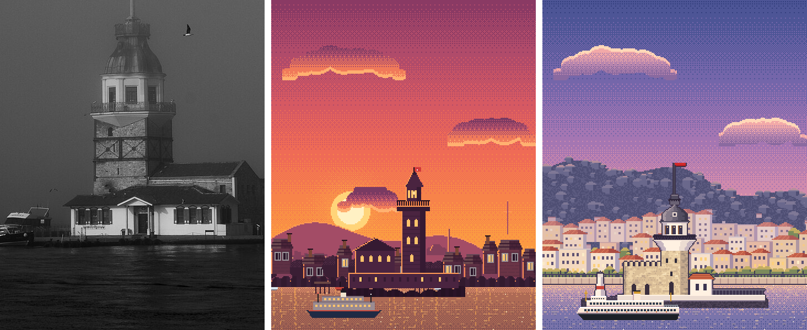
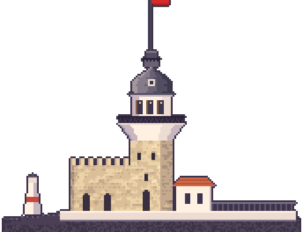
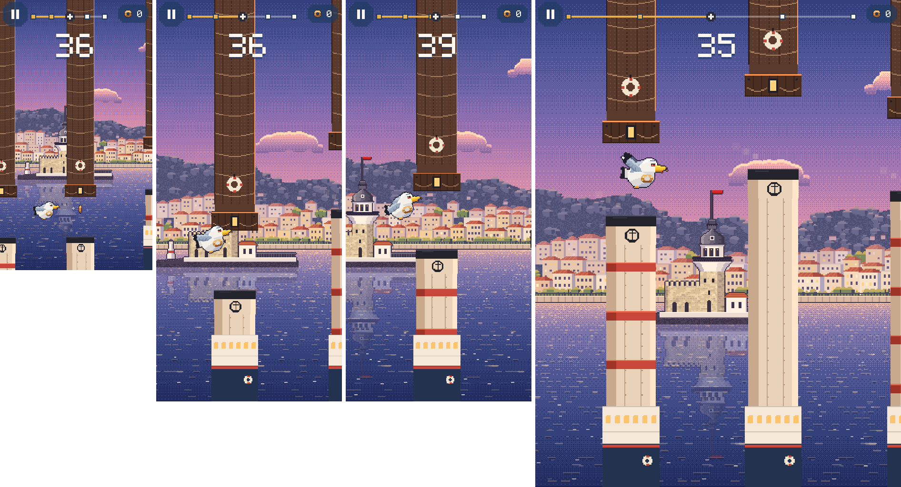

# 10 · Kız Kulesi: gerçek referanslara dayalı yeniden çizim

**Durum:** Kız Kulesi bölgesi [docs/09](09_galata_gercek_referans.md) §7'deki standartla yeniden çizildi ve oyuna entegre edildi; **görsel onayını bekliyor**. Haliç, Köprü ve Rumeli Hisarı değişmedi.

**Sınırlar:**

- Görsel üretim aracı yok. Görseller `art/_source/pixel/kizkulesi.js` ile piksel piksel çizildi.
- Fotoğraflar Wikimedia Commons'ta incelendi; hiçbiri oyuna konmadı.
- Karşılaştırmada yalnızca **CC0** fotoğraf kırpması kullanıldı.
- **Kulenin gerçek yüksekliği için güvenilir yazılı kaynak bulamadım.** Wikipedia'da yükseklik yok. Oranlar fotoğraflardan ölçüldü.

## 1. Kaynaklar

| # | Kaynak | Bakış yönü | Lisans | Kullanılan bilgi |
|---|---|---|---|---|
| 1 | [Istanbul Maiden's Tower (242185703)](https://commons.wikimedia.org/wiki/File:Istanbul_Maiden_S_Tower_(242185703).jpeg) · Alexxx Malev, 2013 | Avrupa yakasından / denizden doğuya | CC BY-SA 3.0 | **Kamera açısı ve Üsküdar ilişkisi:** önde kule, arkada Salacak yamacı. Yamaçta 3–6 katlı, çoğu kiremit kırma çatılı evler var; cepheler beyaz, krem ve pembe. Ayrıca ağaçlı sahil yolu, rıhtım ve tepede koru görülüyor |
| 2 | [İstanbul-Kız-Kulesi](https://commons.wikimedia.org/wiki/File:%C4%B0stanbul-K%C4%B1z-Kulesi.jpg) · Emir Aydemir, Ağustos 2023 (vapurdan) | Güney-güneybatıdan | CC BY-SA 4.0 | **Restorasyon sonrası adacık düzeni:** kayalık uç ve kırmızı-beyaz fener işareti, mazgallı taş burç, kiremit çatılı küçük beyaz yapı, beyaz korkuluklu rıhtım, iskele merdivenleri. Ayrıca kule anatomisi |
| 3 | [Maiden's Tower (Istanbul) – May 22, 2023](https://commons.wikimedia.org/wiki/File:Maiden%27s_Tower_(Istanbul)_-_May_22,_2023.jpg) · HuseynAZE99 | Salacak'tan batıya | CC BY-SA 4.0 | Galerinin aşağı daralan beyaz çok köşeli konsolu, ferforje korkuluk, sekizgen köşk, kurşun kubbe |
| 4 | [Kız kulesi istanbul](https://commons.wikimedia.org/wiki/File:K%C4%B1z_kulesi_istanbul.jpg) · Ahmetyi1maz, 2018 | Kuzeybatıdan, sisli | CC0 | Karşılaştırma görseli. **Restorasyon öncesi**: eski ek bina hâlâ var |
| 5 | [Günbatımı ve Kız Kulesi](https://commons.wikimedia.org/wiki/File:G%C3%BCnbat%C4%B1m%C4%B1_ve_K%C4%B1z_Kulesi.jpg) · Hamdigumus, 2013 | Salacak'tan batıya, ters ışık | CC0 | Silüet: kubbe, fener ve bayrak direğinin oranları |
| 6 | [20230220 Salacaktan Kız Kulesi](https://commons.wikimedia.org/wiki/File:20230220_Salacaktan_Kiz_Kulesi.jpg) · HalitBaris | Salacak'tan | CC BY-SA 4.0 | Restorasyon sırasında iskele içinde (2023 öncesi ile sonrası arasındaki değişimi doğrulamak için) |
| 7 | [Kız kulesi ve martı](https://commons.wikimedia.org/wiki/File:K%C4%B1z_kulesi_ve_mart%C4%B1.jpg) · YamanB, 2023 | Salacak sahilinden | CC BY-SA 4.0 | Adacığın sudan yüksekliği, fener işaretinin konumu |

Yazılı kaynak: [Maiden's Tower, Wikipedia](https://en.wikipedia.org/wiki/Maiden%27s_Tower).

- Üsküdar kıyısına 200 m uzaklıkta, Boğaz'ın güney girişinde küçük bir adacıkta.
- 1763'te taştan yeniden yapılmış; 1832'de II. Mahmud döneminde onarılmış.
- 2021–2023 restorasyonunda betonarme döşemeler hafifletilmiş; Mayıs 2023'te yeniden açılmış.

## 2. Kamera açısı ve mimari analiz

**Kamera:** Avrupa yakasından kalkan bir vapurdan, kulenin güneybatısından kuzeydoğuya bakış (kaynak 1 ve 2). Gerçekten görülen katmanlar, önden arkaya:

1. Kız Kulesi ve adacığı (suda, kıyıdan 200 m önde; yansıması suya düşüyor)
2. Salacak rıhtımı: taş duvar, demir korkuluk, sahil lambaları
3. Sahil yolundaki ağaç dizisi
4. Üsküdar yamacı: 3 sıra ev ve aralarında ağaç kümeleri
5. Tepedeki koru

**Saat:** Gün batımı. Kamera doğuya baktığı için güneş arkada kalıyor; bu yüzden gökte güneş diski ve suda güneş sütunu yok (Dart tarafında `_sunPos`'tan çıkarıldı). Batan güneş Üsküdar cephelerini ve pencerelerini altın rengine boyuyor; doğu göğü pembe-mor.

Eski sürümde güneş kulenin arkasında, ufuktaydı. Bu, Salacak'tan batıya bakan açıya aitti; Üsküdar ise arkada değil kameranın bulunduğu yerde kalıyordu.

**Kule (2023 hâli, gövde 24 px):**

| Bölüm | Fotoğraftaki | Pixel |
|---|---|---|
| Bayrak direği | İnce, uzun; tepede Türk bayrağı | 34 px direk, 10×7 bayrak (ay-yıldız) |
| Fener | Korkuluklu küçük tepe | 8 px genişlik, korkuluk dişleri |
| Kubbe | Kurşun kaplı, şişkin profil, yuvarlak çatı penceresi | 15 satır, şişkin profil, yuvarlak pencere |
| Köşk | Beyaz sekizgen, uzun pencereler, kahverengi doğrama | 3 pencere, sol yüz gölgede |
| Balkon | Ferforje korkuluk, gövdeden taşkın | 38 px genişlik (gövdeden her yana 7 px) |
| Konsol | Beyaz, çok köşeli, aşağı doğru gövdeye daralan | 9 satır, 6→0 px taşkın, yüzey tonları |
| Gövde | Kaba yontma taş, kare plan, küçük kemerli pencereler, kapı | 40 satır, taş hücre dokusu, sağ yan yüz gölgede, köşe ayrıtı |
| Adacık | Kayalık uç ve kırmızı-beyaz fener işareti, mazgallı burç, kiremit çatılı beyaz yapı, rıhtım ve merdiven | Hepsi fotoğraftaki sırayla |

**Vapur:** Galata'daki Şehir Hatları vapuru, gün batımı ışığında.

## 3. Asset'ler

| Dosya | Boyut |
|---|---|
| `landmarks/kiz_kulesi.png` | 172×132 |
| `backgrounds/kizkulesi/` | sky 160×298 · sun 96×96 (boş) · clouds 256×48 · distant 400×150 · midground 400×84 · waterfront 400×28 · water 128×182 · water_hi 128×182 · ferry 96×30 |

- Toplam yaklaşık 21 KB PNG; çözülmüş hâlde yaklaşık 0,94 MB.
- Engel kiti (vapur bacası ve iskele kazığı) değişmedi.
- **Eski sürüm yedeklendi:** `art/legacy_pixel_v1/backgrounds/kizkulesi/` ve `art/legacy_pixel_v1/landmarks/kiz_kulesi.png`.

## 4. Karşılaştırma

Soldan sağa: **referans fotoğraf** (kaynak 4, CC0, 2018, restorasyon öncesi) · **eski pixel sahne** · **yeni pixel sahne**.



Yeni kule ve adacık, 3× büyütülmüş:



1. **İlk bakışta tanınıyor mu?** Evet. Taş gövdenin üstündeki beyaz, aşağı daralan konsollu galeri, ferforje balkon, sekizgen köşk, kurşun kubbe ve bayrak bu yapıya özgü. Eski sürüm sıradan bir fener kulesi silüetiydi.
2. **Oranlar doğru mu?** Fotoğraflardan ölçülen göreli oranlar tutuyor:
   - Balkon genişliği gövdenin yaklaşık 1,6 katı.
   - Köşk ile kubbenin toplam yüksekliği gövdenin yaklaşık %80'i.
   - Mutlak ölçü kaynağı bulunamadı.
3. **Çevre gerçeğe benziyor mu?** Evet. Salacak yamacındaki kiremit çatılı evler, sahil ağaçları, rıhtım ve tepedeki koru kaynak 1 ile tutarlı.
4. **Kıyı ve konum tutarlı mı?** Evet. Kule kıyının önünde, suda duruyor; arkasında Üsküdar var. Güneşin konumu kamera yönüyle tutarlı.
5. **Uydurulmuş detay var mı?**
   - Yamaçtaki evler belirli binaların kopyası değil; fotoğraftaki tiplerden türetildi.
   - Kaynak 1'de yamaçta görülen kubbeli cami **çizilmedi**, çünkü hangi cami olduğunu doğrulayamadım.
   - **Çamlıca Kulesi ve Çamlıca Camii çizilmedi.** Bu açıdan göründüklerini gösteren lisanslı bir fotoğraf bulamadım.
6. **En önemli farklar:**
   - Karşılaştırmadaki CC0 fotoğraf restorasyon öncesine ait (büyük ek bina var); yeni çizim 2023 hâlini (mazgallı burç) gösteriyor.
   - Gövdedeki taş örgü ve köşkün pencere sayısı sadeleştirildi.
   - Yamaç fotoğraftakinden daha düzenli.

**Oyun içi (gerçek derleme, demo modu; 320×568 · 390×844 · 390×844 sonraki an · 768×1024):**



## 5. Entegrasyon

- `LandmarkLayer.layout(Landmark.kizKulesi)`: 480×472 yerine **688×528**, `focus` 0,5, `baseOffset` 88 (değişmedi). Su simgesi olduğu için kıyının önünde, yansımasıyla çiziliyor.
- `background.dart` ve `postcard_overlay.dart`: `kizkulesi` güneş konumu listesinden çıkarıldı.
- Fizik, çarpışma, skor ve animasyonlar değişmedi.
- `art/_source/pixel/build_all.js` modül sırası: backgrounds → landmarks → galata → kizkulesi → …
- `backgrounds.js` artık `waterHi`'yi de dışa aktarıyor. Galata vapuru (`galata.ferry`) renk parametresi alıyor.

## 6. Test ve derleme

```
flutter analyze             → No issues found!
flutter test                → 95/95 (All tests passed!)
flutter build web --release → Built build\web
```
