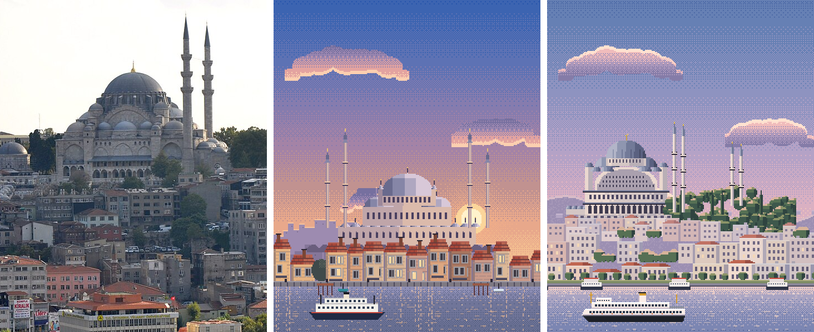
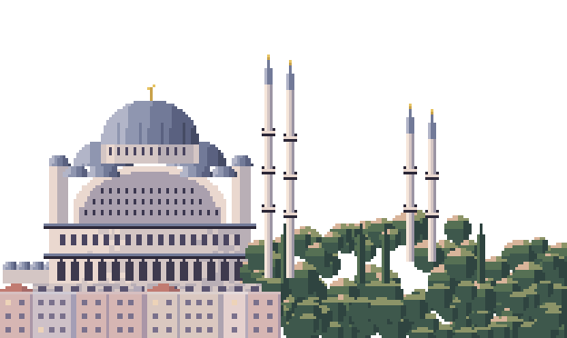
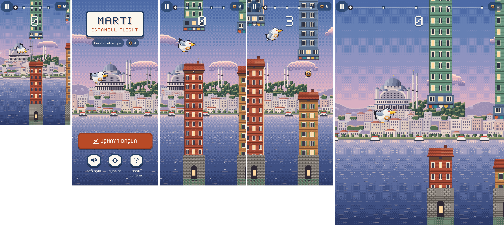

# 11 · Haliç: Süleymaniye ve Üçüncü Tepe, gerçek referanslarla

**Durum:** Haliç bölgesi docs/09 §7'deki standartla yeniden çizildi ve oyuna entegre edildi. **Görsel onayını bekliyor.** Köprü ve Rumeli Hisarı değişmedi.

Haliç oyunun ilk bölgesi. Ana menünün arka planı da bu sahne.

Sınırlar:

- Görsel üretim aracı yok. Bölge `art/_source/pixel/halic.js` ile piksel piksel çizildi.
- Fotoğraflar Wikimedia Commons'ta incelendi. Hiçbiri oyuna konmadı.
- Karşılaştırma görselinde **CC BY 2.0** lisanslı bir fotoğrafın kırpması kullanıldı. Bu lisans atıfla uyarlamaya izin veriyor; atıf aşağıda.
- Süleymaniye için CC0 lisanslı uygun bir uzak görünüm bulamadım.

## 1. Kaynaklar

| # | Kaynak | Bakış yönü | Lisans | Kullanılan bilgi |
|---|---|---|---|---|
| 1 | [View of Süleymaniye Mosque from The Galata Tower](https://commons.wikimedia.org/wiki/File:View_of_S%C3%BCleymaniye_Mosque_from_The_Galata_Tower_(8394977709).jpg) · Jorge Láscar, 2012 | Galata Kulesi'nden güneybatıya, Haliç'in karşısına | CC BY 2.0 | **Kamera ve kompozisyon** (ayrıntı aşağıda) |
| 2 | [Eminönü waterfront with Yeni Cami and Süleymaniye Mosque from Galata Bridge](https://commons.wikimedia.org/wiki/File:Eminonu_waterfront_with_Yeni_Cami_and_Suleymaniye_Mosque_from_Galata_Bridge,_Istanbul_-_Tarik_Kaan_Muslu.jpg) · Tarık Kaan Muslu, 2020 | Galata Köprüsü'nden | CC BY-SA 4.0 | Su seviyesinden bakınca caminin sırttaki yeri, kıyıda Şehir Hatları vapurları, alçak güneşte taş rengi |
| 3 | [Evening in Istanbul](https://commons.wikimedia.org/wiki/File:Evening_in_Istanbul_(15852868549).jpg) · Clay Gilliland, 2014 | Galata Kulesi'nden | CC BY-SA 2.0 | Tarihi yarımada sırtının siluet katmanları |
| 4 | [Pierre Loti hill view panorama](https://commons.wikimedia.org/wiki/File:20110711_Pierre_Loti_hill_view_Istanbul_Turkey_Panorama.jpg) · Ggia, 2011 | Haliç'in yukarısından | CC BY-SA 3.0 | Haliç'in genel coğrafyası, kıyı yeşil alanları |

Kaynak 1'den alınan bilgiler:

- Ana kubbe ve pencereli kasnağı
- Kademeli yarım kubbeler ve küçük kubbeler
- Köşelerde küçük kubbeli payanda kuleleri
- İki katlı revaklar ve büyük kemer alınlığı
- Minare dizilimi: harime bitişik iki uzun minare, sağda avlunun uzak köşesinde iki kısa minare
- Sağ yamaçtaki koru, soldaki külliye kubbeleri, alt yamaçta Unkapanı–Küçükpazar'ın betonarme apartmanları, kıyıda park ve bağlı tekneler

Ölçü kaynağı: [Süleymaniye Mosque, Wikipedia](https://en.wikipedia.org/wiki/S%C3%BCleymaniye_Mosque).

- Ana kubbe yaklaşık 53 m yükseklikte, yaklaşık 26,5 m çapında.
- Kubbenin iki yanında, ana eksende yarım kubbeler var.
- Dört minare avlunun köşelerinde. Uzun ikisi 3 şerefeli ve külahla 76 m. Toplam 10 şerefe olduğundan kısa ikisinin 2'şer şerefeli olduğu çıkarımı yapıldı.
- Harim yaklaşık 58,5 × 57,5 m. Cami Üçüncü Tepe'de, eğimli arazi için büyük alt yapılar üzerinde.

## 2. Kamera ve mimari analiz

**Kamera:** Haliç'in kuzey (Galata–Azapkapı) kıyısından güneybatıya bakıyor (kaynak 1'in yönü, su seviyesine yakın).

Önden arkaya sıra:

1. Kıyı: park şeridi, sahil yolu, bağlı iki katlı gezi tekneleri
2. Alt yamaç: betonarme apartmanlar ve ağaç kümeleri
3. Tepe: Süleymaniye, büyük istinat duvarı üzerindeki terası ve sağdaki koru
4. Arka: puslu tarihi yarımada sırtı

**Saat:** Şafak. Güneş doğuda, kameranın sol arkasında. Caminin kuzeydoğu cephesi pembe-altın ışık alıyor; güneybatı göğü pastel.

Gökte güneş diski ve suda güneş sütunu yok; Dart tarafında `_sunPos`'tan çıkarıldı. Eski sürümde güneş caminin yanında, ufuktaydı. Bu açıdan şafakta bu mümkün değil.

**Süleymaniye** (ölçek yaklaşık 1 m/px; harim 74 px):

| Öğe | Gerçek | Pixel |
|---|---|---|
| Ana kubbe | Kurşun, ≈ 26,5 m çap, pencereli kasnak | 36 px çap, kasnakta pencere dizisi ve payandalar, alem |
| Yarım kubbeler ve küçük kubbeler | Kademeli kubbe yığını | 2 yarım kubbe ve 4 küçük kubbe, ışık doğudan |
| Payanda kuleleri | Köşelerde, küçük kubbeli | 2 kule |
| Cephe | İki katlı revak, geniş kurşun saçaklar, büyük kemer alınlığı | Alt revak kemerleri, iki saçak, üst kat pencereleri, gölgede içeri çekik pencereli kemer |
| Minareler | 2 uzun (3 şerefe), 2 kısa (2 şerefe), sivri kurşun külah | Harime bitişik çift 3 şerefe, uzak çift 2 şerefe ve daha kısa |
| Çevre | Soldaki külliye kubbeleri, sağdaki koru ve selviler, teras istinat duvarı | 4 medrese kubbesi, ağaç kümeleri, 4 selvi, kemerli istinat duvarı |

## 3. Asset'ler

| Dosya | Boyut |
|---|---|
| `landmarks/suleymaniye.png` | 208×124 |
| `backgrounds/halic/` | sky 160×298, sun 96×96 (boş), clouds 256×48, distant 400×140, midground 400×96, waterfront 400×28, water ve water_hi 128×182, ferry 96×30 |

- Toplam yaklaşık 18 KB PNG; çözülmüş hâlde yaklaşık 0,95 MB.
- Engel kiti değişmedi.
- Eski sürüm yedeği: `art/legacy_pixel_v1/backgrounds/halic/` ve `art/legacy_pixel_v1/landmarks/suleymaniye.png`.

## 4. Karşılaştırma

Soldan sağa: **referans fotoğraf** (kaynak 1, Jorge Láscar, CC BY 2.0, kırpılmış), **eski pixel sahne**, **yeni pixel sahne**.



Süleymaniye ve tepe, 3× büyütülmüş:



**1. İlk bakışta tanınıyor mu?** Evet.

- Tanıtıcı bütün: kademeli kubbe yığını, payanda kuleleri ve ikişerli minare çiftleri. Kısa çift avlunun uzak köşesinde, ağaçların arasında yükseliyor.
- Eski sürümde dört minare simetrik olarak kubbenin dört yanına dizilmişti. Bu açıdan gerçek dizilim böyle görünmez.

**2. Oranlar doğru mu?**

- Kubbe çapı / harim genişliği oranı yaklaşık 0,49; fotoğrafta da yaklaşık 0,48.
- Uzun minareler harim yüksekliğinin yaklaşık 2,4 katı; gerçekte 76 m / 30 m ≈ 2,5.
- Küçük kubbe sayısı sadeleştirildi.

**3. Çevre gerçeğe benziyor mu?** Evet.

- Eski sürümün ön sırasındaki ahşap evler, bu yamaçta bulunmayan bir dokuydu; kaldırıldı.
- Yerine fotoğraftaki betonarme apartmanlar ve kıyı parkı geldi.

**4. Kıyı ve konum tutarlı mı?** Evet. Cami terasıyla yamacın üstünde. Kıyıda park ve bağlı tekneler var.

**5. Uydurulmuş detay var mı?**

- Yamaç binaları tip olarak türetildi. Fotoğraftaki belirgin büyük beyaz iş binası çizilmedi (adı belli, tabelalı bir yapı).
- Uzak plandaki sırt temsilî.
- **Beyazıt Kulesi** ve **Yeni Cami** bu açıdan görünebilir ama çizilmedi. Seçilen kadrajda konumlarını fotoğrafla doğrulamadım.

**6. En önemli farklar:**

- Fotoğrafta kubbe yığını çok daha fazla küçük kubbe ve pencere içeriyor.
- Gerçek yamaç daha gri ve daha yoğun.
- Kemer alınlığının iç düzeni sadeleşti.

**Oyun içi** (gerçek derleme, demo modu): 320×568, menü 390×844, 390×844 iki an, 768×1024.



## 5. Entegrasyon

- `LandmarkLayer.layout(Landmark.suleymaniye)`: 720×448 yerine **832×496**. `baseOffset` −176 (alt kenar ufkun 44 px üstünde, orta planın arkasında). `focus` 0,4.
- `background.dart` ve `postcard_overlay.dart`: `halic` güneş konumu listesinden çıkarıldı.
- Fizik, çarpışma, skor ve animasyonlar değişmedi.

## 6. Test ve derleme

```
flutter analyze             → No issues found!
flutter test                → 95/95 (All tests passed!)
flutter build web --release → Built build\web
```
