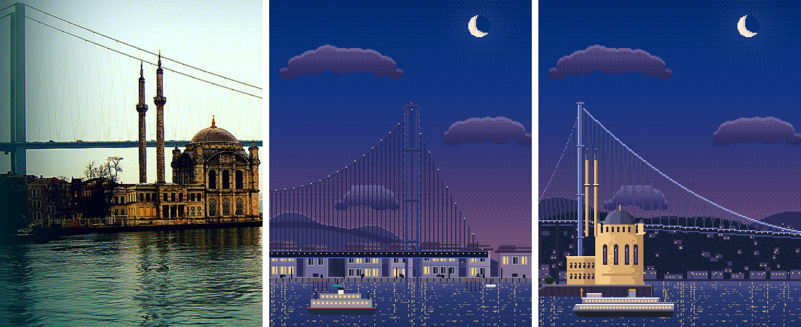
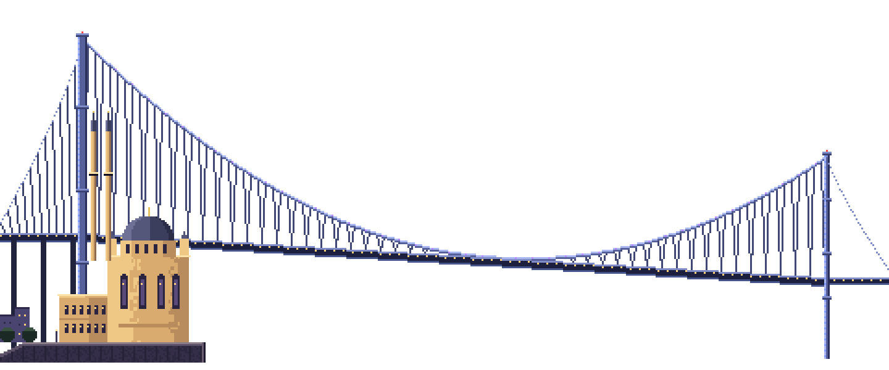
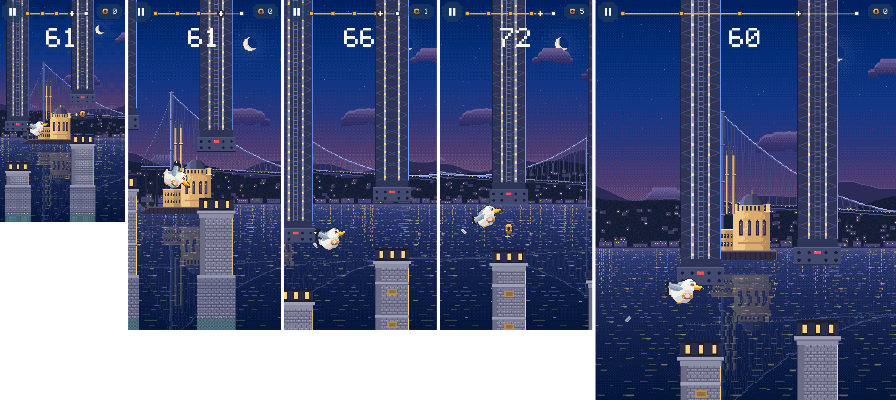

# 12 · Boğaz Köprüsü (15 Temmuz Şehitler Köprüsü) ve Ortaköy: gerçek referanslarla

**Durum:** Köprü bölgesi docs/09 §7'deki standartla yeniden çizildi ve oyuna entegre edildi. **Görsel onayını bekliyor.** Rumeli Hisarı değişmedi.

Sınırlar:

- Görsel üretim aracı yok. Görseller `art/_source/pixel/kopru.js` ile çizildi.
- Fotoğraflar Wikimedia Commons'ta incelendi; hiçbiri oyuna konmadı.
- Karşılaştırmada **CC BY 2.0** lisanslı bir fotoğrafın kırpması kullanıldı; bu lisans atıfla uyarlamaya izin veriyor.

## 1. Kaynaklar

| # | Kaynak | Bakış yönü | Lisans | Kullanılan bilgi |
|---|---|---|---|---|
| 1 | [Ortaköy Mosque and Bosphorus Bridge](https://commons.wikimedia.org/wiki/File:Ortak%C3%B6y_Mosque_and_Bosphorus_Bridge.jpg) · Wajahat Mahmood, 2010 | Ortaköy'ün güneyinden, sudan kuzeye | CC BY 2.0 | Kamera açısı ve kompozisyon (aşağıda) |
| 2 | [Ortakoy-mosque-bosporus-bridge](https://commons.wikimedia.org/wiki/File:Ortakoy-mosque-bosporus-bridge.jpg) · Myriam Thyes, 2016 | Ortaköy meydanından | CC BY-SA 4.0 | Kule anatomisi: iki ince ayak, yatay enine kirişler; caminin barok cephesi, köşe kuleleri, iki ince minare |
| 3 | [Ortaköy Mosque and Bosphorus Bridge, March 2024](https://commons.wikimedia.org/wiki/File:Ortak%C3%B6y_Mosque_and_Bosphorus_Bridge,_March_2024_01.jpg) · Calistemon | Ortaköy meydanından | CC BY-SA 4.0 | Caminin kıyı platformu ve meydanla ilişkisi, köprünün arkada Anadolu yakasına uzanması |
| 4 | [Ortaköy Mosque and 15th July Bridge](https://commons.wikimedia.org/wiki/File:Ortak%C3%B6y_Mosque_and_15th_July_Bridge.jpg) · Maurice Flesier, 2021 | Kıyıdan | CC BY-SA 4.0 | Caminin taş rengi, büyük kemerli pencereler, hünkâr dairesi |
| 5 | [Istanbul Ortaköy Mosque and bridge in 2019 7353](https://commons.wikimedia.org/wiki/File:Istanbul_Ortak%C3%B6y_Mosque_and_bridge_in_2019_7353.jpg) · Dosseman | Yakın | CC BY-SA 4.0 | Minare şerefesi, kubbe kasnağı |

Kaynak 1'den alınan kompozisyon bilgileri:

- Avrupa kulesi solda, yandan bakıldığı için iki ayağı üst üste görünüyor.
- Tabliye kareyi neredeyse yatay geçiyor.
- Ana kablo sağa doğru sarkıyor.
- Cami önde, kıyı platformunda; minareleri tabliyenin üstüne kadar uzanıyor.
- Arkada Anadolu yakasının ağaçlı ve evli yamaçları var.

Yazılı kaynaklar:

- [Bosphorus Bridge, Wikipedia](https://en.wikipedia.org/wiki/Bosphorus_Bridge):
  - Ölçüler: kule 165 m, orta açıklık 1.074 m, toplam 1.560 m, tabliye denizden 64 m, tabliye genişliği 33,4 m.
  - Yapı: çelik kuleler, **eğik askılar**.
  - 1973'te açıldı; uçlarında Ortaköy ve Beylerbeyi var.
  - 2007'den beri renk değiştiren LED aydınlatma (Philips).
- [Ortaköy Mosque, Wikipedia](https://en.wikipedia.org/wiki/Ortak%C3%B6y_Mosque):
  - Garabet ve Nigoğayos Balyan'ın eseri, 1850'lerde yapıldı. Neo-klasik ve Osmanlı barokunun karışımı.
  - Tek kubbe, iki ince minare.
  - Önde iki katlı, U planlı hünkâr dairesi.

**Not:** Talimatta "dikey askı elemanları" geçiyordu. Bu köprünün askıları gerçekte **eğik** (zikzak). Çizim gerçeğe göre yapıldı.

## 2. Kamera ve mimari analiz

**Kamera:** Avrupa kıyısına yakın, Ortaköy'ün güneyinde sudan kuzeye bakış (kaynak 1).

- Önde Ortaköy Camii var, arkasında Avrupa kulesi.
- Orta açıklık sağa doğru uzanıyor. Anadolu kulesi uzakta olduğu için daha küçük; tabliye perspektifle hafifçe alçalıyor.
- En arkada Beylerbeyi–Çengelköy yamaçları ve kıyıdaki yalılar var.

Saat akşam: kule ve kablolarda mavi-mor LED, tabliyede sıcak ışık dizisi, cami projektörle sıcak sarı.

| Öğe | Gerçek | Pixel |
|---|---|---|
| Yakın kule | 165 m, çelik, enine kirişli | 176 px (≈ 0,94 m/px); 4 enine kiriş; LED şerit; uçak ikaz ışığı |
| Tabliye | Denizden 64 m (kulenin %39'u), kutu kesit | Yakın kulede 68 px (%39); koyu kiriş, ışık dizisi |
| Ana kablo | Kule tepelerinden orta açıklığa sarkar | Parabolik sehim; orta noktada tabliyeye yaklaşıyor |
| Askılar | Eğik, zikzak | Her askıda yön değiştiren eğik çizgiler |
| Yan açıklık | Kuleden ankraja inen kablo, yaklaşım viyadüğü | Sola inen kablo, viyadük ayakları |
| Uzak kule | Aynı yapı, perspektifle küçük | 112 px |
| Ortaköy Camii | Barok cephe, büyük kemerli pencereler, köşe kuleleri, kasnaklı tek kubbe, iki ince minare (tek şerefe), önde iki katlı hünkâr dairesi; Ortaköy meydanının denize uzanan **kara çıkıntısının ucunda** | Hepsi; minareler kubbe yüksekliğinin ≈ 1,7 katı. Cami taş rıhtımlı kara parçasının üstünde, minareler kulenin hemen sağında |

## 3. Asset'ler

| Dosya | Boyut |
|---|---|
| `landmarks/bridge.png` | 480×200 |
| `backgrounds/kopru/` | distant 400×110, midground 400×80, waterfront 400×28, ferry 96×30 |

- Gök, ay, bulut ve su değişmedi.
- Engel kiti (köprü ayağı ve çelik kafes) değişmedi.
- Yeni dosyalar toplam ≈ 10,6 KB PNG.
- Eski sürüm yedekte: `art/legacy_pixel_v1/backgrounds/kopru/` ve `art/legacy_pixel_v1/landmarks/bridge.png`.

## 4. Karşılaştırma

Soldan sağa: **referans fotoğraf** (kaynak 1, W. Mahmood, CC BY 2.0, kırpılmış) · **eski pixel sahne** · **yeni pixel sahne**.



Köprü ve cami, 3× büyütülmüş:



1. **İlk bakışta tanınıyor mu?** Evet. Ortaköy Camii'nin önde, köprünün arkada durduğu kompozisyon İstanbul'un en bilinen görüntülerinden biri. Eski sürümde Ortaköy yoktu; tabliye kulenin çok altındaydı ve kulenin dibinde bir ev sırası vardı.
2. **Oranlar doğru mu?** Büyük ölçüde doğru:
   - Tabliye yüksekliği / kule yüksekliği = 0,39 (gerçek 64 / 165 = 0,39).
   - Minare / kubbe oranı fotoğrafla tutarlı.
   - Perspektif oranları yaklaşık; uzak kule %64 boyutta.
3. **Çevre gerçeğe benziyor mu?** Evet. Arkada Anadolu yakasının ağaçlı yamaçları, ışıklı evler ve kıyı yalıları var.
4. **Kıyı ve konum tutarlı mı?** Evet. Avrupa kulesi Ortaköy'ün hemen kuzeyinde, cami kıyıda; köprü Beylerbeyi'ne uzanıyor.
5. **Uydurulmuş detay var mı?**
   - Anadolu yakasındaki evler ve yalılar tip olarak çizildi.
   - **Beylerbeyi Sarayı çizilmedi.** Bu açıdan kadrajdaki yerini doğrulayamadım.
   - Uzak tepeler temsilî.
   - LED renkleri temsilî (sistem renk değiştiriyor).
6. **En önemli farklar:**
   - Caminin barok süslemeleri (cephe kabartmaları, minarelerin başlık biçimli şerefeleri) büyük ölçüde sadeleşti; minareler fotoğraftakinden ince.
   - Fotoğrafta cami kuleye daha yakın, köprü daha soldan başlıyor.

**Oyun içi (gerçek derleme, demo modu; 320×568 · 390×844 üç an · 768×1024):**



Köprü tek ve geniş bir simge (1.920 dünya birimi). Oyuncu ilerledikçe önce Ortaköy ve Avrupa kulesi, sonra açıklık ve Anadolu kulesi geçiyor. Köprü parallax ile sonsuz döşenmiyor.

## 4a. Düzeltme (kullanıcı geri bildirimi)

İlk sürümde cami suyun içindeki bir platformun üstündeydi. Geri bildirim üzerine düzeltildi:

- Cami artık Avrupa kıyısından denize uzanan **Ortaköy meydanı kara çıkıntısının ucunda**, karada duruyor. Çıkıntıda taş rıhtım, meydan lambaları, ağaçlar ve Ortaköy evleri var.
- Cami sola alındı; minareler kaynak 1'deki gibi Avrupa kulesinin hemen sağında. İlk sürümde bir minare kulenin önüne düşüyordu.
- `focus` 0,17 → 0,15.

Görsel dosyaları açık olduğu için kilitliydi; yeni sürümler `_v2` adıyla kaydedildi.

## 5. Entegrasyon

- `LandmarkLayer.layout(Landmark.bridge)`: 1600×784 yerine **1920×800**. `baseOffset` 72 değişmedi. `focus` 0,825 yerine **0,15** (kule ve kara çıkıntısındaki cami).
- `galata.ferry` cam rengi parametresi aldı. Akşam vapurunda pencereler yanıyor.
- Fizik, çarpışma, skor ve animasyonlar değişmedi.

## 6. Test ve derleme

```
flutter analyze             → No issues found!
flutter test                → 95/95 (All tests passed!)
flutter build web --release → Built build\web
```
