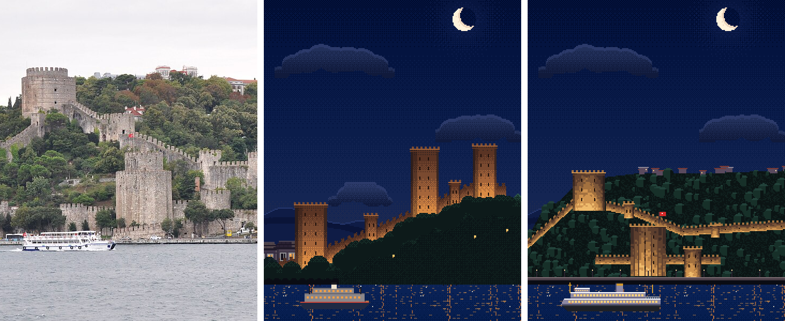
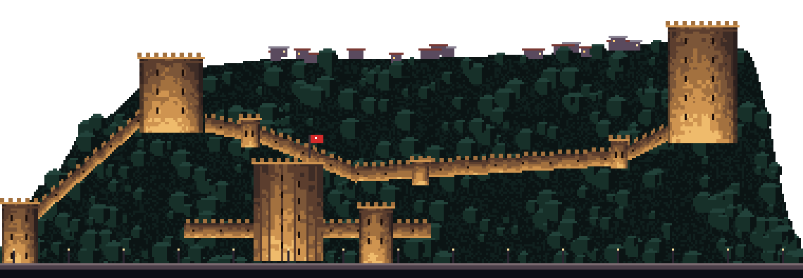
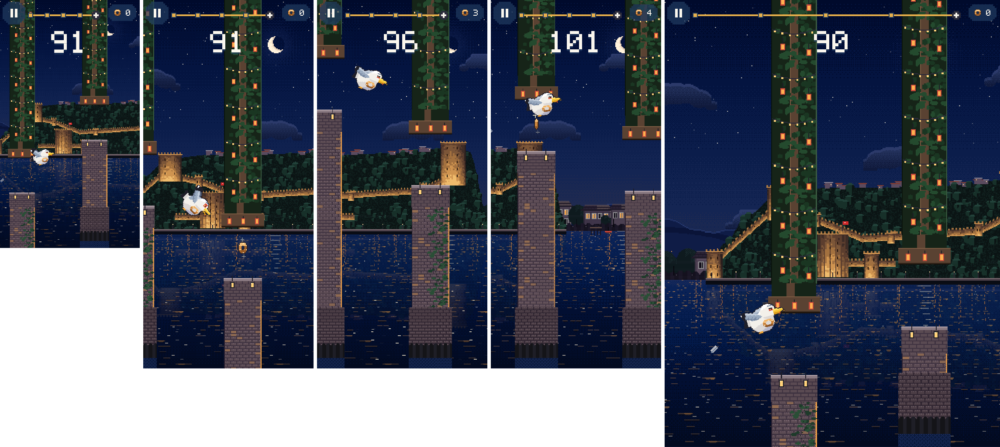

# 13 · Rumeli Hisarı: gerçek referanslarla

**Durum:** Rumeli Hisarı bölgesi docs/09 §7'deki standartla yeniden çizildi ve oyuna entegre edildi. **Görsel onayını bekliyor.** Bu, beş bölgenin sonuncusu.

Sınırlar:

- Görsel üretim aracı yok. Simge `art/_source/pixel/rumeli.js` ile piksel piksel çizildi.
- Fotoğraflar Wikimedia Commons'ta incelendi; hiçbiri oyuna konmadı.
- Karşılaştırmada **CC BY 2.0** lisanslı bir fotoğrafın kırpması kullanıldı; bu lisans atıfla uyarlamaya izin veriyor.

## 1. Kaynaklar

| # | Kaynak | Bakış yönü | Lisans | Kullanılan bilgi |
|---|---|---|---|---|
| 1 | [Rumelihisarı (8393629929)](https://commons.wikimedia.org/wiki/File:Rumelihisar%C4%B1_(8393629929).jpg) · Jorge Láscar, 2012 | Boğaz'dan, doğudan batıya, cepheden | CC BY 2.0 | **Kamera ve bütün yerleşim.** Kulelerin, surların, kıyı surunun, sahil yolunun ve sırttaki evlerin konumları bu fotoğraftan ölçüldü |
| 2 | [Rumeli Hisarı – Otağtepe'den görünüşü](https://commons.wikimedia.org/wiki/File:Rumeli_Hisar%C4%B1_-_Ota%C4%9Ftepeden_G%C3%B6r%C3%BCn%C3%BC%C5%9F%C3%BC.jpg) · Hamdigumus, 2013 | Anadolu yakasındaki Otağtepe'den | CC0 | Surların yamaçta zikzak yapması, kuleler arasındaki yükseklik farkı |
| 3 | [Rumelihisarı as seen from Asia](https://commons.wikimedia.org/wiki/File:Rumelihisar%C4%B1_as_seen_from_Asia.JPG) · İhsan Deniz Kılıçoğlu, 2012 | Anadolu yakasından | CC BY-SA 3.0 | Güneyden kuzeye kule sırası, kıyı ile ilişki, kuzeyde Fatih Sultan Mehmet Köprüsü |
| 4 | [Istanbul waterfront (Rumelihisari)](https://commons.wikimedia.org/wiki/File:Istanbul_waterfront_(Rumelihisari).jpg) · S. Bağrışen / Stegop | Kuzeydoğudan | CC BY 2.5 | Halil Paşa Kulesi'nin kıyıdaki konumu, uzun orta sur, gözetleme kuleleri |
| 5 | [Twierdza Rumeli Istambuł RB1](https://commons.wikimedia.org/wiki/File:Twierdza_Rumeli_Istambu%C5%82_RB1.jpg) | Boğaz'dan | CC BY-SA 3.0 | Mazgallı taçlar, sur dişleri |

Kaynak 1'den ölçülen konumlar:

- Güneyde (solda) tepede **Zağanos Paşa** var.
- Ortada kıyıda on iki köşeli **Halil Paşa** var.
- Kuzeyde (sağda) en yüksek noktada **Sarıca Paşa** var.
- Surlar kıyıdaki küçük kuleden Zağanos'a tırmanıyor, Halil'in arkasına iniyor, orta yamaçtan Sarıca'ya çıkıyor.
- Kıyıda alçak bir deniz suru, sahil yolu ve lambalar var.

Yazılı kaynak: [Rumelihisarı, Wikipedia](https://en.wikipedia.org/wiki/Rumelihisar%C4%B1).

- **Yapım:** 1451–1452, II. Mehmed.
- **Sarıca Paşa (kuzey):** silindir; 28 m yüksek, 23,30 m çaplı.
- **Halil Paşa (orta, kıyıda):** on iki köşeli prizma; 22 m yüksek, 23,30 m çaplı.
- **Zağanos Paşa (güney):** silindir; 21 m yüksek, 26,70 m çaplı.
- **Diğer kuleler:** 1 küçük kule ve 13 gözetleme kulesi.
- **Boyut:** Kuzey–güney 250 m.
- **Konum:** Boğaz'ın en dar yeri, yaklaşık 660 m; Anadoluhisarı'nın karşısında.
- **Çatılar:** Kulelerin kurşun kaplı ahşap konik çatıları günümüze ulaşmamış. Bu yüzden çizimde **çatı yok**, mazgallı taç var.

## 2. Kamera ve mimari analiz

**Kamera:** Boğaz'da bir vapurdan, kalenin doğusundan batıya, cepheden bakış (kaynak 1). Saat gece; surlar projektörle aydınlatılmış, sırttaki evlerin pencereleri yanıyor.

Ölçek yaklaşık 1,4 px/m. Fotoğraftaki her nokta `px = (x_foto − 50) × 0,311`, `yükseklik = (620 − y_foto) × 0,311` ile simgeye taşındı.

| Öğe | Gerçek | Pixel |
|---|---|---|
| Zağanos Paşa | Silindir, 26,7 m çap, tepede | 30 px; sudan 71–101 px; silindir gölgesi, taç silmesi, mazgallar |
| Halil Paşa | On iki köşeli prizma, 23,3 m, kıyıda | 33 px; sudan 4–51 px; 6 görünür yüz bandı; yanında bayrak |
| Sarıca Paşa | Silindir, 28 m, en yüksek | 33 px; sudan 66–116 px |
| Surlar | Mazgallı, yamacı izliyor | 5 sur parçası, 7 px yükseklik, dişli üst kenar, mazgal pencereleri |
| Küçük ve gözetleme kuleleri | 1 + 13 | 5 tanesi görünüyor (kıyıdaki iki kule, sur üstündeki üç kule) |
| Kıyı | Deniz suru, sahil yolu | Alçak deniz suru, yol, lambalar |
| Çevre | İçeride ağaçlar, sırtta evler | Ağaç taçları, kırmızı ve beyaz çatılı evler |

## 3. Asset'ler

| Dosya | Boyut |
|---|---|
| `landmarks/rumeli_hisari.png` | 380×132; yamaç iki uçta kıyıya iner, simge kenarında kesik görünmez |
| `backgrounds/rumeli/ferry.png` | 96×30 Şehir Hatları vapuru, gece |

- Gök, ay, yıldız, uzak ve orta plan ile su katmanları değişmedi (gece seti).
- Engel kiti (yosunlu taş iskele) değişmedi.
- Eski sürüm yedekte: `art/legacy_pixel_v1/landmarks/rumeli_hisari.png` ve `art/legacy_pixel_v1/backgrounds/rumeli/`.

## 4. Karşılaştırma

Soldan sağa: **referans fotoğraf** (kaynak 1, J. Láscar, CC BY 2.0, kırpılmış) · **eski pixel sahne** · **yeni pixel sahne**.



Kale, 3× büyütülmüş:



1. **İlk bakışta tanınıyor mu?** Evet. Yamaca tırmanan mazgallı surlar, tepedeki ve kıyıdaki büyük kuleler bu kaleye özgü. Eski sürümde iki benzer kule bir sırtın üstünde yan yana duruyordu; Halil Paşa'nın çokgen biçimi ve kıyıdaki konumu yoktu.
2. **Oranlar doğru mu?** Kulelerin göreli yükseklik ve genişlikleri Wikipedia ölçüleriyle, konumları fotoğrafla tutarlı. Zağanos en geniş, Sarıca en yüksek, Halil kıyıda.
3. **Çevre gerçeğe benziyor mu?** Evet. Ağaçlarla dolu iç kısım, sırttaki evler, kıyı yolu ve deniz suru fotoğrafla aynı.
4. **Kıyı ve konum tutarlı mı?** Evet. Kale Avrupa yakasında, Boğaz'a bakan yamaçta; kıyıda yol var.
5. **Uydurulmuş detay var mı?**
   - Sırttaki evler tip olarak çizildi.
   - 13 gözetleme kulesinden yalnızca kadrajda seçilebilen birkaçı çizildi.
   - **Fatih Sultan Mehmet Köprüsü çizilmedi.** Seçilen cepheden kadrajın dışında, kuzeyde kalıyor (kaynak 3'te görünüyor).
6. **En önemli farklar:**
   - Fotoğraftaki iç sur ve kapı ayrıntıları sadeleşti.
   - Halil Paşa'nın yüz bantları gerçekteki taş örgüden daha düzenli.
   - Gece aydınlatması temsilî (referans fotoğraf gündüz).

**Oyun içi (gerçek derleme, demo modu; 320×568 · 390×844 üç an · 768×1024):**



## 5. Entegrasyon

- `LandmarkLayer.layout(Landmark.rumeliHisari)`: 960×600 → **1520×528**. `baseOffset` 32 değişmedi. `focus` 0,625 → **0,36** (kıyıdaki Halil Paşa).
- Simge kıyıda olduğu için `LandmarkFrontLayer` ile kıyı şeridinin önünde, yansımasıyla çiziliyor; yansıma soluk.
- Fizik, çarpışma, skor ve animasyonlar değişmedi.

## 6. Test ve derleme

```
flutter analyze             → No issues found!
flutter test                → 95/95 (All tests passed!)
flutter build web --release → Built build\web
```
