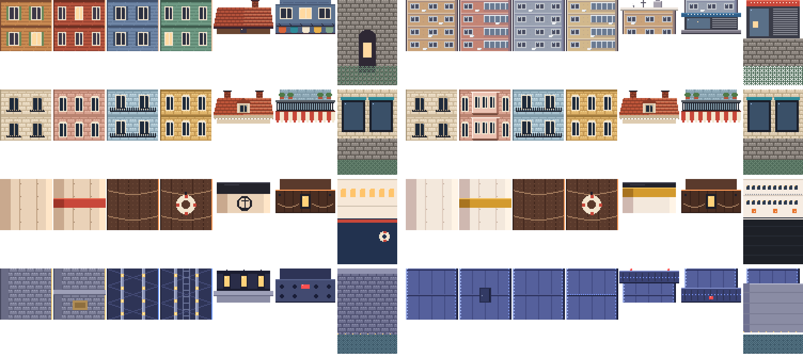
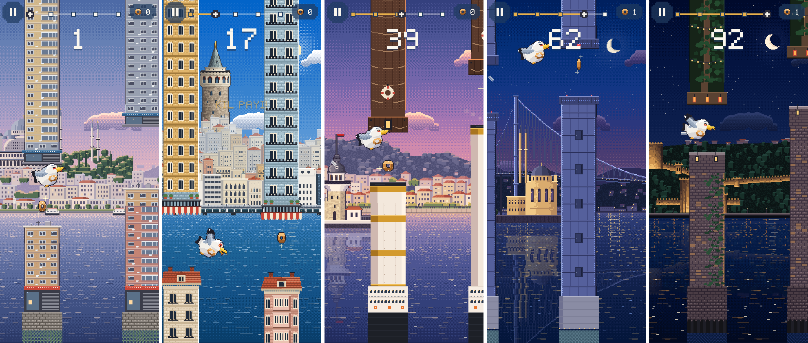

# 14 · Engel kitleri: bölgelerin gerçek yapı tiplerinden

**Durum:** Haliç, Galata, Kız Kulesi ve Köprü engel kitlerinin görünümü bölgelerin gerçek yapı tiplerine göre yenilendi. Rumeli kiti zaten gerçeğe uygun olduğu için değişmedi.

**Çarpışma geometrisi değişmedi:**

- Hitbox genişliği aynı (196 birim).
- Parça yerleşimi (`ObstacleKitLayout`) aynı.
- Alt başlık sınırları aynı: Haliç 28, Galata 32, Kız Kulesi 12, Köprü 8, Rumeli 12.
- Gövde karoları hitbox genişliğinde tamamen opak. Sınırın üstünde yalnızca çarpışmasız süsler var (su deposu, anten, ikaz ışığı).
- Bunları 15 yerleşim testi doğruluyor.

**Tarihi ve dini yapıların hiçbiri engel değil.** Engellerin hepsi sıradan yapılar ve nesneler: apartman, vapur bacası, köprü kulesinin çelik ayağı, kıyı duvarı.

Kaynaklar: Bölgelerin raporlarındaki fotoğraflar (docs/09–13). Engeller o fotoğraflarda görülen yapı **tiplerinden** türetildi; belirli bir binanın kopyası değiller.

## Değişiklikler

| Bölge | Eski | Yeni | Dayanak |
|---|---|---|---|
| Haliç | Ahşap kaplamalı evler, kiremit çatı, çamaşır ipi. Bu yamaçta böyle bir doku yok | **Betonarme apartmanlar:** 12 px'lik katlar, döşeme bantları, alüminyum pencereler, klimalar, kapalı cam balkonlar. Düz çatıda su deposu, çanak anten, anten. Tepeden sarkan engelin ucunda tabelalı, kepenkli zemin kat dükkânı; tabanda dükkânlar ve taş rıhtım | docs/11 kaynak 1: Unkapanı–Küçükpazar yamacı |
| Galata | Cumbasız cepheler | İkinci gövde karosu **cumbalı Beyoğlu apartmanı:** her katta çıkma, saçak ve alt gölgesi, yanlarda kemerli pencereler. Diğer parçalar korundu | docs/09 kaynak 1–3 |
| Kız Kulesi | Krem baca, kırmızı bant, amblem benzeri işaret; lacivert gövde | **Şehir Hatları rengi:** beyaz baca, hardal-turuncu bant, siyah ağız. Amblem bilerek çizilmedi (kurumsal işaret). Tabanda beyaz üst yapı, pencere dizileri, güverte korkuluğu, turuncu can simitleri ve koyu alt gövde | docs/09 kaynak 7–8 |
| Köprü | Altta granit ayak ve fener başlığı, üstte X kafesli çelik | **Düz çelik kutu kesit kule ayağı:** dikey takviyeler, panel ekleri, iki kenarda mavi LED şerit, bakım kapağı. Kapaklarda enine kiriş ve uçak ikaz ışığı; tabanda beton temel | docs/12: Wikipedia ("steel towers"), kaynak 2 |
| Rumeli | Yosunlu taş kıyı duvarı, fenerli ağaç dalları | Değişmedi | docs/13: kıyı duvarları ve ağaçlar fotoğraflarla tutarlı |

**Okunurluk:** İlk denemede iki sorun vardı. Haliç'in soluk beton tonları pastel şafak göğüne karışıyordu. Köprünün koyu çelik ayakları da gece arka planında kayboluyordu. Haliç'te renkler yamaçtaki sıva tonları içinde daha doygun olanlara çekildi ve iki kenara koyu kontur eklendi. Köprüde çelik açıldı ve LED şerit iki kenara konuldu.

## Görseller

Eski ve yeni atlaslar (soldaki sütun eski, sağdaki yeni; satırlar Haliç, Galata, Kız Kulesi, Köprü; 2×):



Oyun içi (gerçek derleme, demo modu, 390×844; Haliç · Galata · Kız Kulesi · Köprü · Rumeli):



## Dosyalar

- Kaynak: [art/_source/pixel/obstacles.js](../art/_source/pixel/obstacles.js). Yeni yardımcılar:
  - `concreteRows` / `concrete`: betonarme cephe, 48 px'de dikişsiz döşenir.
  - `steelLegRows` / `steelLeg`: çelik kutu kesit ayak.
- Eski atlaslar yedekte: `art/legacy_pixel_v1/obstacles/`.
- `lib/game/visual/obstacle_kit_layout.g.dart` yeniden üretildi. İçeriği değişmedi (yerleşim ve sınırlar aynı).

## Test ve derleme

```
flutter analyze             → No issues found!
flutter test                → 95/95 (All tests passed!)
flutter build web --release → Built build\web
```
