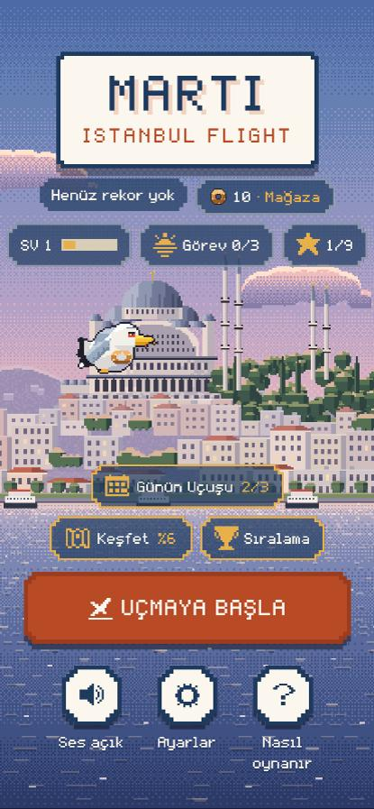
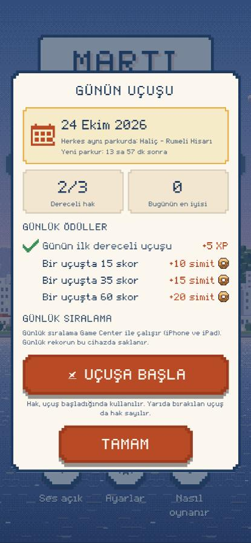
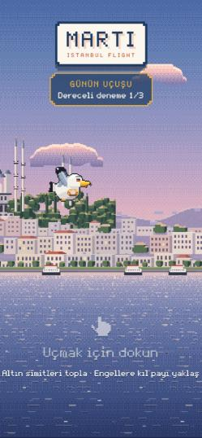

# Phase 2.5: Günün Uçuşu (Daily Challenge)

> Dal: `feature/phase2-5-daily-challenge` (Phase 2.4 dalının üzerine) · Sürüm önerisi: **1.5.0+7** (hazır, **yüklenmedi**) · Tarih: 24 Ekim 2026

## 0. Yayın güvenliği

| Konu | Durum |
|---|---|
| App Store sürüm kaydı | 1.4.0 (6) bağlı, "Prepare for Submission". **Bu fazda dokunulmadı**; App Review'a gönderilmedi |
| TestFlight | Bu fazda **hiçbir şey yüklenmedi** (son derleme 1.4.0 (6)) |
| Bu faz | Yalnızca `feature/phase2-5-daily-challenge` dalında |
| App Store Connect | Günlük tablo **oluşturuldu** (24 Ekim 2026, kullanıcı onayıyla): "Prepare for Submission". İncelemeye gönderilmedi (§8) |
| iOS imza / Codemagic | Değişmedi (yeni yetenek ya da entitlement yok; Game Center zaten açık) |

## 1. Mimari analiz (güncel depo)

| Sistem | Bulgu | Phase 2.5'te |
|---|---|---|
| `IstanbulFlightGame` | Tek durum makinesi; sabit adımlı (1/120 sn) simülasyon, `maxFrameDt` 1/20 | Aynı motor. Mod `runMode` (`RunMode` enum) ile seçilir; fizik, çarpışma, çizim ortak |
| Engel üretimi | `GapGenerator.next(score)`: geçit yüksekliği **o anki skora**, ilk engel **ekran genişliğine** bağlı; `dart:math Random` | Klasik yol **hiç değişmedi**. Günlükte yalnızca sıraya bağlı yeni üretici (§3) |
| Rastgelelik | Oynanış: `_random`, `_pickupRandom` (klasik). Görsel: `FxLayer` `Random(5)`, ortam sesleri `Random(11)`, arka planlar kendi tohumlarıyla | Görsel rastgelelik zaten ayrı; günlük parkur kendi PRNG'sini kullanır, hiçbirini okumaz/değiştirmez |
| Bölge geçişleri | `DayCycle` skorla (15/35/60/90) | Aynı (zoneSequence v1 = klasik sıra) |
| `GameServices.emit` | progress → gameCenter → dinleyiciler | Aynı; `RunStarted` artık mod ve challengeId taşır, yeni `RunAbandoned` |
| `PlayerProgress` / `ProgressController` | v3, `settleRun` idempotent | v4: `dailyChallenge` alanı; günlük hesap aynı `settle` içinde, aynı tek yazmada |
| Günlük görevler | Yerel gün (`dayKeyFor`, toLocal) | Değişmedi. Günün Uçuşu **UTC** gününü kullanır (§6); ödül defterleri ayrı |
| Game Center (Phase 2.4) | Native GameKit köprüsü; kalıcı kuyruk `game_center_v1`; `GcScorePolicy`; haftalık tabloda "dönem açık mı / skor önceki döneme mi ait" kontrolü | **Doğrulandı ve yeniden kullanıldı.** Kuyruk v2'ye genişledi (günlük bekleyen skorlar kalıcı); native'e dönem okuma ve dönem eşleştirme eklendi |
| Phase 2.4 gerçek durumu | Kod tamam, testleri geçiyor; 2 tablo + 9 başarım ASC'de "Prepare for Submission"; **gerçek cihazda hiç denenmedi** (TestFlight kurulumları hesap sorunu yüzünden engelli) | Tamamlanmış varsayılmadı: günlük tablo da gerçek cihaz testine kadar NOT RUN (§11) |
| Overlay sistemi | `modal` + faz → overlay kümesi | Yeni `Overlays.daily`; hazır ekranına şerit; oyun sonuna günlük panel |

## 2. Oyun modu tasarımı

`RunMode { classic, dailyRanked, dailyPractice }` (`lib/challenge/daily_challenge.dart`).

| | Klasik | Dereceli (Günün Uçuşu) | Antrenman |
|---|---|---|---|
| Parkur | Klasik üretici (aynen) | Günün parkuru | Günün parkuru |
| Kuşun x'i | Ekranın %30'u (170–420) | Sabit 300 (her ekranda aynı) | Sabit 300 |
| İlk engel | Ekran genişliği + 260 | Kuşa 1100 birim (her ekranda aynı) | Aynı |
| Rekor | `best_score_v1` (klasik) | Günün en iyisi (`dailyChallenge`), klasik rekor **değişmez** | Değişmez |
| Hak | – | Günde 3 | Sınırsız |
| Günlük ödül | – | Evet (tek seferlik) | Hayır |
| XP / görev / keşif | Evet | Evet (normal uçuş gibi) | Evet |
| Game Center | Tüm zamanlar + haftalık | **Yalnızca** günlük tablo | Hiçbiri |

Tek motor: `_prepareRun()` uçuş başında modu kesinleştirir; `_spawnIfNeeded` günlükte parkurdan, klasikte eski üreticiden engel alır. Günlükte engel konumları her adımda çift duyarlıklı parkur koordinatından hesaplanır (`DailyCourse.leftOf`); Flame'in 32 bit `Vector2`'sinde birikmiş yuvarlama olmaz.

## 3. Deterministik parkur algoritması

- **PRNG:** `DailyRng` = Mulberry32. 32 bitlik çarpım 16 bitlik yarımlarla yapılır, böylece platformun tam sayı genişliğinden bağımsızdır. Çıktısı JavaScript referansıyla birebir aynı (test).
  - `dart:math Random(seed)` kullanılmadı: algoritması Dart sürümleri arasında değişebilir.
- **Tohum:** `FNV-1a("istanbul_flight/daily/v{sürüm}/{YYYY-MM-DD}/{aday}")`.
- **Akışlar:** geçitler `hash("gaps:{seed}")`, simitler `hash("pickups:{seed}")`. Her engel için simit akışından her zaman iki sayı çekilir; simit olsa da olmasa da akış hizalı kalır.
- **n. engel** (v1), klasik kurallarla aynı:
  - geçit yüksekliği = klasik eğride skor n'nin geçidi;
  - merkez güvenli bantta, önceki merkeze en fazla 430 birim uzaklıkta;
  - simit %45 olasılıkla, ulaşılabilir bandın orta %70'inde; ilk engelde simit yok.
- **Bağımsız olanlar:** kare hızı, ekran genişliği, oyuncunun skoru, görsel efektler ve erişim sırası (80. engeli önce istemek sonucu değiştirmez).
- **Rastgele oyun içi olay:** oynanışta yok. Vapur, martı ve bulutlar yalnızca görseldir ve kendi tohumlarıyla çalışır.
- **Tanım** (`DailyChallengeDefinition`): `challengeId` (`daily_2026_10_24`), `dateUtc`, `seed`, `generatorVersion`, `candidate`, `validatedDepth`, `difficultyProfile` (`standard`), `zoneSequence` (0–4), `rewardPolicy` (v1).

## 4. Oynanabilirlik doğrulaması

`CourseValidator`, seçimden önce iki kontrol yapar:

1. **Kurallar:** geçit güvenli bantta mı, ardışık kayma ≤ 430 mu, simit ulaşılabilir bantta mı.
2. **Erişilebilirlik simülasyonu:**
   - Oyunla aynı fizik (yerçekimi, çırpma hızı, düşüş sınırı, tavan) ve aynı daire–dikdörtgen çarpışma geometrisiyle, kuşun ulaşabileceği **bütün** (yükseklik, hız) durumları sabit adımla ilerletilir.
   - Saniyede 20 karar noktasında her durum için "çırp / çırpma" denenir.
   - Hiç durum kalmazsa parkur o engelde fiziksel olarak geçilemez.
   - **Kabul koşulları:**
     - 100 engelin hepsi geçilebilir olmalı (son bölge 90'da başlar);
     - en dar anda kuşun güvenli yükseklik aralığı ≥ 24 birim olmalı (piksel hassasiyeti isteyen geçiş yok).
   - Süre: parkur başına ~0,12 sn (test makinesi). Uygulama açılışında ayrı bir isolate'ta hesaplanır (`DailyGenerators.prepare`), ilk ekran beklemez.
   - Önce basit bir otomatik pilot denendi; insan dışı zamanlama gerektiren durumlarda yanılıp parkurların %90'ını haksız yere reddettiği için bırakıldı.

**Deterministik seçim kuralı:**
- Aday 0, 1, … 15 sırayla denenir; doğrulamayı **ilk geçen** seçilir.
- Hiçbiri geçmezse yedek seçilir: kurallara uyan, en derine ulaşan (eşitlikte en geniş aralıklı) aday.

**365 günlük ölçüm (24.10.2026'dan itibaren):**
- 354 günde aday 0, 11 günde aday 1 seçildi.
- Hiçbir gün yedeğe düşmedi.
- 100 rastgele tohumun 98'i doğrudan geçti.

Örnek: 12 Aralık 2026'nın ilk adayı dar boğaz yüzünden elenir (test).

## 5. Tohum ve üretici sürümü

- `DailyGenerators.schedule = [('2026-01-01', 1)]`.
- Yeni bir üretici sürümü yalnızca uygulamanın yayımlandığı günden **sonraki** bir UTC gününden itibaren takvime eklenir. Böylece süren bir günün parkuru uygulama güncellense de değişmez.
- Eski sürümlerin kodu silinmez. Bilinmeyen sürüm sessizce başka parkur üretmez, hata verir (test).
- **Altın değer testi:** 24 ve 25 Ekim 2026'nın tohumları, ilk 5 geçit merkezi ve ilk 8 simit konumu sabitlendi. Üretici kodu yanlışlıkla değişirse test kırılır.
- Kayıt, ilk dereceli denemede kullanılan `seed` ve `generatorVersion`'ı saklar (tanılama ve denetim için).

## 6. Günlük deneme kuralları ve tarih güvenilirliği

**Deneme yaşam döngüsü:**
- "Uçuşa başla" yalnızca "uçmak için dokun" ekranına geçirir. Hak, **ilk dokunuşta** (uçuş gerçekten başlayınca) harcanır.
- Harcanan hak aynı anda diske yazılır (`started`).

| Durum | Ne olur |
|---|---|
| Çarpışma | `finished`: skor, günlük rekor, ödüller |
| Duraklat → Ana menü / Yeniden başlat | `abandoned` (`RunAbandoned`): hak harcanmış, skor yok |
| Uygulama uçuşta kapandı | Açılışta `interrupted` (`recoverDaily`): hak geri gelmez, geç gelen sonuç yok sayılır |
| Aynı uçuş iki kez başlatma / bitirme | `duplicate` / yok sayılır (`runId`) |
| Hak bitti, yine "dereceli" | Uçuş **antrenmana** döner, oyun sonunda nedeni yazılır |

**Gün:** UTC (her yerde aynı anda başlar ve biter; İstanbul'da 03:00). Kalan süre UTC gece yarısına göre hesaplanır.

**Saat koruması (sunucu yok):**
- Kayıt, dereceli oynanan en ileri günü tutar (`highWaterDay`). Cihaz tarihi bunun gerisindeyse dereceli kapanır (`rolledBack`); antrenman açık kalır.
  - Saati geri alıp hak ya da ödül yenilenemez.
- Game Center'a bağlıyken günlük tablonun Apple sunucusundaki açık dönemi okunur (`loadOccurrence`; dönemin başlangıcı (`startDate`) ve süresi (`duration`)).
  - Dönem 00:00 UTC'de başlayan 24 saatlik bir dönemse ve cihazın günü farklıysa dereceli kapanır (`mismatch`). Saati ileri alıp yarının parkuru dereceli oynanamaz.
  - Bu bilgi duvar saatinden bağımsız bir kronometreyle 10 dakika geçerli sayılır: gece yarısını geçen eski bilgi yanlışlıkla kilitlemesin.
  - Tablo farklı kurulduysa (ör. İstanbul gece yarısı) bilgi yok sayılır: kilitlemez, yalnızca gönderim yapılmaz.
- **Çevrimdışı:** dereceli oynanır; haklar ve ödüller yerelde işlenir; Game Center skoru kuyruğa girer (§7).

**Bilinen sınır:** Game Center'sız ve çevrimdışıyken cihaz saatini **ileri** almak tespit edilemez. Oyuncu ileri günlerin haklarını ve yerel ödüllerini (günde en fazla 45 simit + 5 XP) erkenden alabilir; sonra geri dönemez (dereceli kilitlenir). Küresel sıralamaya etkisi yoktur (§7). Tam koruma sunucu tarafı zaman ve doğrulama gerektirir.

## 7. Günlük skor ve Game Center

**Kayıt** (`DailyChallengeRecord`, challenge başına):
- denemeler (runId, durum, skor, başlangıç);
- kalan hak;
- günün en iyisi ve en iyi uçuşun kimliği;
- tamamlanma zamanı (son hak bitince);
- alınan ödüller;
- Game Center durumu: `none` / `pending` / `submitted` / `expired` / `notEligible`.

**Klasik rekordan ayrım:**
- Günlük uçuş `best_score_v1`'e yazmaz ve klasik "YENİ REKOR"u tetiklemez (test).
- Uçuş içindeki "rekor geçildi" rozeti günlükte günün en iyisine göre çalışır.

**Gönderim politikası:**
- Dereceli skor → **yalnızca** `istanbul_flight_daily_challenge`.
- Antrenman → hiçbir tablo.
- Klasik → eskisi gibi tüm zamanlar ve haftalık tablo (test).

**Uygunluk:**
- `GcScorePolicy` aynen geçerli: geliştirme yardımı yok; skor geçilen engel sayısına eşit; süre fiziğe uygun; skor ≤ 9999.
- Uçuş, challenge'ın UTC günü içinde bitmiş olmalı.

**Kuyruk:**
- `game_center_v1` v2: challenge başına en iyi bekleyen skor **kalıcı**. Haftalıktan farklı olarak uygulama kapansa da korunur, çünkü her skor kendi gününe bağlıdır.
- Tekrar denenir: girişte, her uçuş sonunda ve uygulama öne gelince.
- 2 günden eski bekleyenler düşer.

**Dönem eşleştirme (native):**
- Skor, challenge gününün 00:00 UTC'si `occurrenceStartMs` olarak gönderilir.
- GameKit'ten yüklenen tablonun açık döneminin `startDate`'i (Apple sunucu saati) bundan 120 sn'den fazla farklıysa skor gönderilmez (`expired`).
- Sonuçlar:
  - eski günün skoru yeni günün tablosuna gitmez;
  - saati ileri alınmış cihazın "yarın" skoru bugünün tablosuna gitmez (test).
- **Apple belgesi** (`GKLeaderboard`): tekrarlayan tablo `loadLeaderboards(IDs:)` ile yüklenip örnek üzerinde `submitScore(_:context:player:)` ile gönderilir. `startDate` ve `duration`, açık dönemin skor kabul ettiği aralığı tanımlar. Dönemler çakışamaz; en kısa 5 dakika, en uzun 30 gündür.

**Hile koruması:** Yalnızca istemci tarafı tutarlılık kontrolüdür. Değiştirilmiş bir istemci ya da jailbreak'li cihaz Game Center'a uydurma skor gönderebilir. Sunucu tarafı doğrulama yoktur ve tam koruma olduğu iddia edilmez.

## 8. Game Center günlük tablo kurulumu (App Store Connect; OLUŞTURULDU)

> 24 Ekim 2026, kullanıcı onayıyla App Store Connect API üzerinden oluşturuldu. Kimlik `717468f8-9c7b-400c-b8c5-e438aa0ac046`, sürüm 1 "Prepare for Submission". API'den doğrulanan değerler: `RECURRING`, başlangıç `2026-10-27T00:00:00Z`, süre `PT24H`, kural `FREQ=DAILY;INTERVAL=1`.

| Alan | Değer |
|---|---|
| Tür | **Recurring Leaderboard** |
| Reference Name | Günün Uçuşu |
| Leaderboard ID | `istanbul_flight_daily_challenge` |
| Score Format | Integer · Submission: **Best Score** · Sort: **High to Low** · Score Range: 0–9999 |
| Start Date and Time | **27 Ekim 2026 00:00 UTC** (ASC saat dilimi **GMT+0** seçilmeli; İstanbul saatiyle 03:00) |
| Duration | **1 gün** (24 saat) |
| Restarts Interval | **Her 1 gün** |
| Yerelleştirme (TR) | Ad: "Günün Uçuşu" · Ek: "puan" (haftalık tabloyla aynı) · Açıklama: günlük sıfırlanma |
| Yerelleştirme (EN) | Name: "Daily Flight" · Suffix: "points" / "point" |
| Görsel | Yok (isteğe bağlı) |

**Not:** API, birim ekinin başındaki boşluğu kırptı (haftalık tabloda arayüzden girildiği için " puan"). Game Center skoru "12puan" biçiminde gösterirse ek arayüzden " puan" olarak düzeltilmeli.

- Haftalık tablodan farklı olarak başlangıç **UTC** gece yarısıdır. Uygulama da UTC gününü kullanır.
- Yanlış saat dilimiyle kurulursa günlük skorlar hiç gönderilmez (güvenli taraf) ve saat denetimi devre dışı kalır.
- Tablo, 1.5.0 sürümüyle birlikte incelemeye eklenmelidir (Game Center bileşenleri ilk kez bir uygulama sürümüyle gönderilir).
- Tablo oluşturulana kadar GameKit `unknown_leaderboard` / `not_configured` döner: skor kuyrukta kalır ve oyun etkilenmez.

## 9. Ödül ekonomisi

| Ödül | Miktar | Koşul |
|---|---|---|
| Günün ilk dereceli uçuşu | +5 XP | İlk tamamlanan dereceli uçuş |
| Galata eşiği | +10 simit | Bir uçuşta 15 skor |
| Kız Kulesi eşiği | +15 simit | Bir uçuşta 35 skor |
| Boğaz eşiği | +20 simit | Bir uçuşta 60 skor |

**Önerilen eşiklerden (25/50/100) değişiklik ve gerekçe:**
- Mevcut eşikler 100 skoru gerektiriyordu. 100, son bölge sınırını (90) aşar ve günlük görevlerin en zor tek uçuş hedefinden (45) iki kat yüksektir.
- Yeni eşikler bölge sınırlarına eşit: oyuncu hedefi haritadan tanır.
- Günde en fazla 45 simit + 5 XP. Bu miktar, en zor günlük görev seti (3 görev, 30 simit) ile aynı mertebede kalır ve en ucuz görünüm (50 simit) yine birkaç günde alınır.

**Kurallar:**
- Her ödül challenge başına bir kez (`claimed`). Farklı denemelerde aynı eşik tekrar ödül vermez.
- Mevcut cüzdana yazılır (`xp`, `bonusSimits`); yeni cüzdan yok. Bakiye negatife düşmez.
- Görev ödül defterinden (`rewardedMissions`) ayrı: çift sayım yok.
- Dereceli uçuş normal bir uçuş olarak XP ve görev ilerlemesi de kazandırır. Bu uçuş başına ilerlemedir, günlük ödül değildir.
- Seri (streak) ya da her gün oynama zorunluluğu yok. Oynanmayan gün için ceza yok.

## 10. Arayüz

| Ekran | İçerik |
|---|---|
| Ana menü | Keşif/Sıralama satırının üstünde "Günün Uçuşu · 3/3" (takvim ikonu, atlasa eklendi). Küçük ekranlarda boşluklar, logo ve ana düğme biraz küçüldü (320×568 dahil taşma yok) |
| Günün Uçuşu | Tarih (UTC), parkur tanıtımı, yeni parkura kalan süre (saniyelik güncelleme), dereceli hak, günün en iyisi, 4 günlük ödül (alınanlar işaretli), günlük sıralama, "Uçuşa başla". Hak bitince: 0/3, en iyi skor, sıralama, "Antrenman yap". Saat sorunu varsa uyarı |
| Günlük sıralama | Game Center bağlıysa dünya ve arkadaşlar, oyuncunun kendi satırı, kapanış saati. Bağlı değilse ya da cihazda Game Center yoksa açıklama: **uydurma sıra gösterilmez** |
| Uçmak için dokun | "GÜNÜN UÇUŞU · Dereceli deneme 2/3" ya da "Antrenman · sıralamaya sayılmaz" |
| Oyun sonu | Kartpostal: "EN İYİ" (günün), "GÜNÜN REKORU!" damgası ve konfeti, altbilgi "Günün Uçuşu · 24 Ekim 2026". Panel: deneme n/3, günün en iyisi, kalan hak, önceki denemeye göre fark, kazanılan ödüller, sıralama satırı. Sıralama satırı yalnızca skor gönderildikten sonra Game Center'dan yüklenen gerçek sırayı gösterir; aksi hâlde durumu yazar. Düğmeler: "Yeniden dene · n hak" ya da "Antrenman yap", Paylaş, Ana menü |
| Paylaşım metni | "İstanbul Flight — Günün Uçuşu (24.10.2026): … Skor · Simit" (sıralama iddiası yok) |
| VoiceOver | Menü girişi: "Günün Uçuşu, 3 / 3 dereceli hak"; düğmeler etiketli (test) |

## 11. Veri kalıcılığı ve geçiş

**PlayerProgress v4** (aynı anahtar `progress_v2`): yeni alan `dailyChallenge` (`records`, `highWaterDay`). v3 kaydı her şeyiyle korunur; günlük kayıt boş başlar (test).

**Korunanlar:**
- rekor (`best_score_v1`, ayrı anahtar);
- XP, seviye, simit bakiyesi, günlük görevler, başarımlar;
- satın alınmış ve seçili görünüm;
- keşif albümü ve yedeği;
- Game Center kuyruğu (v1 → v2: `dailyPending` yoksa boş).

**Yedek:** `daily_challenge_backup_v1`. Alanı tanımayan eski bir sürüm (1.4.0) ana kaydı yazarsa denemeler ve alınan ödüller yedekten geri gelir; haklar ve ödüller ikinci kez açılmaz (test).

**Saklama politikası:**
- Son 30 challenge kaydı tutulur, daha eskiler silinir. Ödüller zaten profile işlenmiştir, sıralama Apple'dadır.
- İkinci oyuncu profili yok.

**Bozuk kayıt:**
- Bozuk alanlar atlanır, diğerleri okunur.
- Bilinmeyen deneme durumu **harcanmış** sayılır (hak geri verilmez).
- Geçersiz challenge kimlikleri atılır.

## 12. Otomatik test sonuçları

`flutter analyze`: **No issues found.** · `flutter test`: **308 / 308 geçti** (234 mevcut + 74 yeni).

| Dosya | Test | Kapsam |
|---|---|---|
| `test/daily_challenge_test.dart` | 19 | PRNG'nin JS referansıyla eşliği, 32 bit taşma, aynı/farklı tohum, erişim sırası, UTC günü, altın değerler, kural ihlali yok, 14 gün geçilebilirlik, imkânsız ve dar parkur reddi, aday seçimi, isolate eşliği, sürüm takvimi, bilinmeyen sürüm hatası, kimlik ayrıştırma |
| `test/daily_rules_test.dart` | 36 | 1./2./3. deneme ve hak bitimi, hakkın anında kaydı, kapanma, yarıda bırakma, çift başlatma/bitirme, başlatılmamış sonuç, antrenman, gün değişimi, saati geri/ileri alma, Apple günü uyuşmazlığı, çevrimdışı, dönem biçimi, kalan süre, günlük rekor ve fark, tek seferlik ödüller, görev defteri ayrımı, negatif bakiye, klasik ayrım, JSON, v3 geçişi, yedekten geri yükleme, bozuk kayıt, 30 gün saklama, Game Center (yalnızca günlük tablo, antrenman yok, çevrimdışı kuyruk ve sonra gönderim, dönem değişimi, saat ileri, uygunsuz uçuş, gönderim tekrarı, dönem okuma, GameServices bağlantısı), GcRecord v2 |
| `test/daily_game_test.dart` | 9 | Oyun motorunda **30/60/120 FPS** aynı olaylar; **3 ekran genişliğinde** aynı olaylar; klasik/görsel RNG bağımsızlığı; oyundaki parkur = tanımdaki parkur, sabit mesafe; hak dokunuşta harcanır; klasik rekor korunur; yarıda bırakma; hak bitince antrenman + bildirim; menüden klasik |
| `test/daily_ui_test.dart` | 10 | Menü girişi ve ekran öğeleri, hazır şeridi ve hak harcanması, 0/3 + antrenman, saat uyarısı, Game Center dünya listesi ve internet hatası, VoiceOver, günlük oyun sonu ve "yeniden dene"; 320×568 / 375×667 / 430×932'de taşma yok |

**Mevcut testlerde yapılan değişiklikler:**
- `discovery_test` iki satır: kayıt sürümü beklentisi `PlayerProgress.version` (4).
- `game_center_test` bir beklenti: kayıt `v2` ve boş `dailyPending`.
- Test sahtelerine (`FakeGameCenterApi`) günlük dönem desteği, `TestServices`'e saat parametresi eklendi.

Web derlemesinde (375×812) menü, günlük ekran, hazır şeridi ve günlük oyun sonu görsel olarak kontrol edildi.
- Piksel fontunda olmayan "→" ve "—" karakterleri çıkarıldı.
- İki satıra kırılan "GÜNÜN EN İYİSİ" etiketi "EN İYİ" yapıldı.

## 13. Gerçek iPhone test planı (hepsi NOT RUN)

Önkoşul: 1.5.0 TestFlight'ta (kullanıcı onayıyla) ve günlük tablo ASC'de oluşturulmuş.

| # | Test | Beklenen |
|---|---|---|
| 1 | 1.4.0'dan güncelle (silme) | Rekor, XP, simit, görünüm, albüm, başarımlar aynı; menüde "Günün Uçuşu 3/3" |
| 2 | Günün Uçuşu ekranı | Tarih UTC günü; geri sayım İstanbul 03:00'e; ödüller ve sıralama |
| 3 | İki cihazda (ya da sil-kur) aynı gün | İlk 10 engel aynı yerde (ekran kaydıyla karşılaştır) |
| 4 | Dereceli uçuş → çarp | Kalan hak 2; günün en iyisi; ilk uçuş +5 XP; Game Center'da günlük tabloda skor |
| 5 | Uçuşta uygulamayı kapat (çoklu görevden at) → aç | Deneme "kesildi" sayılır; harcanan hak geri gelmez, skor sayılmaz |
| 6 | Duraklat → Ana menü | Hak harcandı; skor yok |
| 7 | Uçak modunda dereceli uçuş → interneti aç | Skor aynı gün içinde gönderilir; ertesi gün açılırsa gönderilmez |
| 8 | Ayarlar'dan tarihi 1 gün geri al | Dereceli kilitli uyarısı; antrenman açık |
| 9 | Tarihi 1 gün ileri al (Game Center açık) | Uyuşmazlık uyarısı; dereceli kapalı |
| 10 | 3 hak bitince | 0/3, "Antrenman yap"; antrenman skoru tabloya gitmez |
| 11 | Game Center'dan çıkış | Oyun ve günlük mod aynen; sıralama yerine açıklama |
| 12 | VoiceOver açık | Menü girişi ve düğmeler okunur |
| 13 | iPhone SE (4,7") | Menü ve günlük ekran taşmaz |
| 14 | Gece 03:00 (UTC değişimi) | Yeni parkur, 3 yeni hak; dünün rekoru kayıtta |
| 15 | Game Center → günlük tablo (Apple ekranı) | Skor "12 puan" biçiminde (Apple birim ekinin baş boşluğunu siliyor; "12puan" görünürse ek değiştirilmeli, §8) |

## 14. Bilinen güvenlik sınırları

1. **Sunucu yok:**
   - Çevrimdışı ve Game Center'sız cihaz saati ileri alınırsa yerel günlük haklar ve ödüller erkenden açılabilir. Sıralamaya etkisi yok.
   - Değiştirilmiş istemci Game Center'a uydurma skor gönderebilir.
2. **Doğrulayıcı kayan nokta hesabı** kullanır. Teorik olarak iki farklı mimaride bir adayın sınırda farklı değerlendirilmesi mümkündür (IEEE-754 temel işlemler deterministik; sınır vakası pratikte beklenmez). Oyun içi parkur seçilen tohumdan tamamen tam sayı PRNG ile üretilir.
3. **Kayıt silme:** Uygulama silinip kurulursa yerel kayıt gider ve o günün hakları yeniden açılır. Game Center'da gün başına en iyi skor tutulduğu için sıralama şişmez.
4. **Gece yarısını geçen uçuş:** challenge gününde bitmezse sıralamaya gönderilmez (`expired`); yerel rekor ve ödüller işlenir.

## 15. Sonraki faz önerileri

- Sunucu tarafı zaman ve skor doğrulaması (ör. CloudKit ya da hafif bir API ile imzalı uçuş özeti).
- Günün parkuru için tekrar izleme (ghost) ve en iyi uçuşun yeniden oynatılması (deterministik motor buna hazır).
- Haftalık "Günün Uçuşu" özeti ve rozet başarımları (seri zorunluluğu olmadan).
- Zorluk profilleri (hafta sonu "kolay", ayın ilk günü "zor"): yeni üretici sürümüyle.
- Android'de (Google Play Games) günlük tablo; bu faz kapsamı dışında.

## Ekran görüntüleri (web derlemesi, 375×812)

| Menü | Günün Uçuşu | Uçmak için dokun |
|---|---|---|
|  |  |  |
