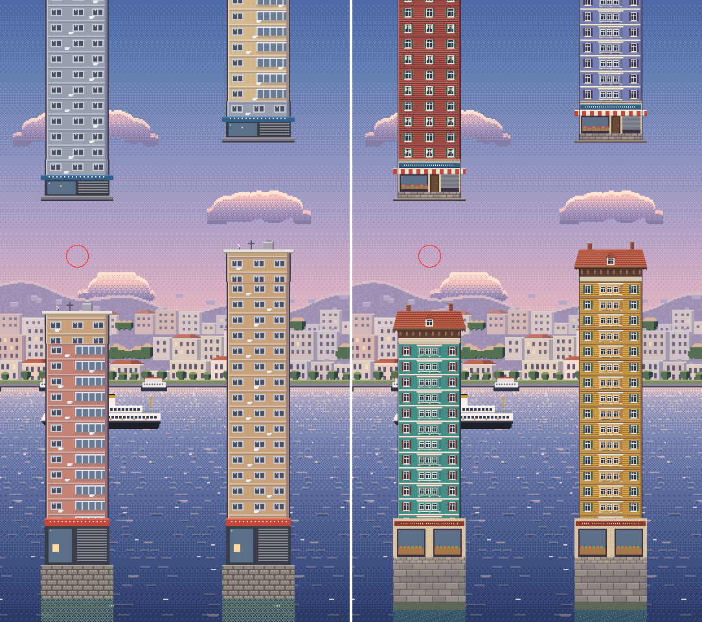
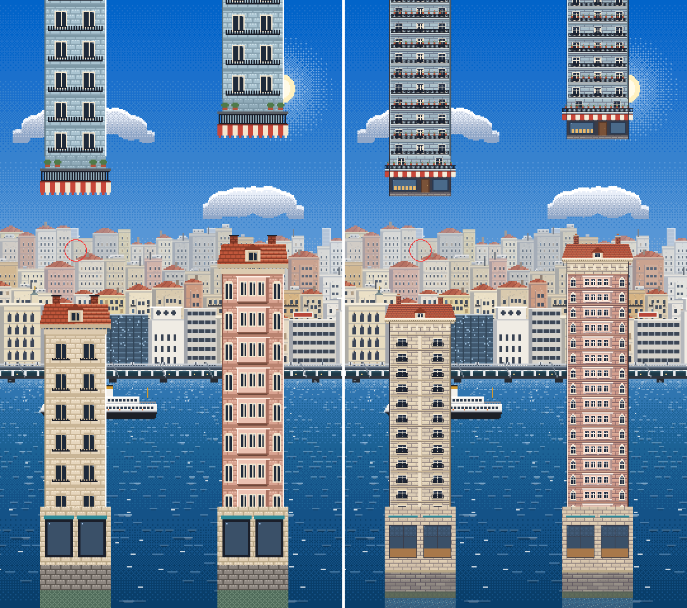
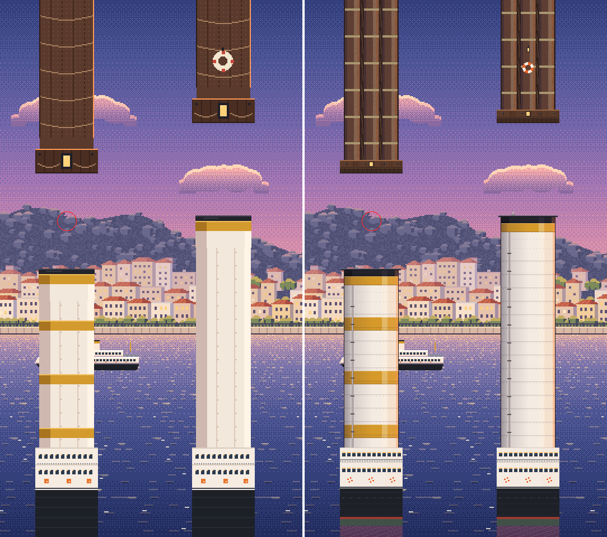
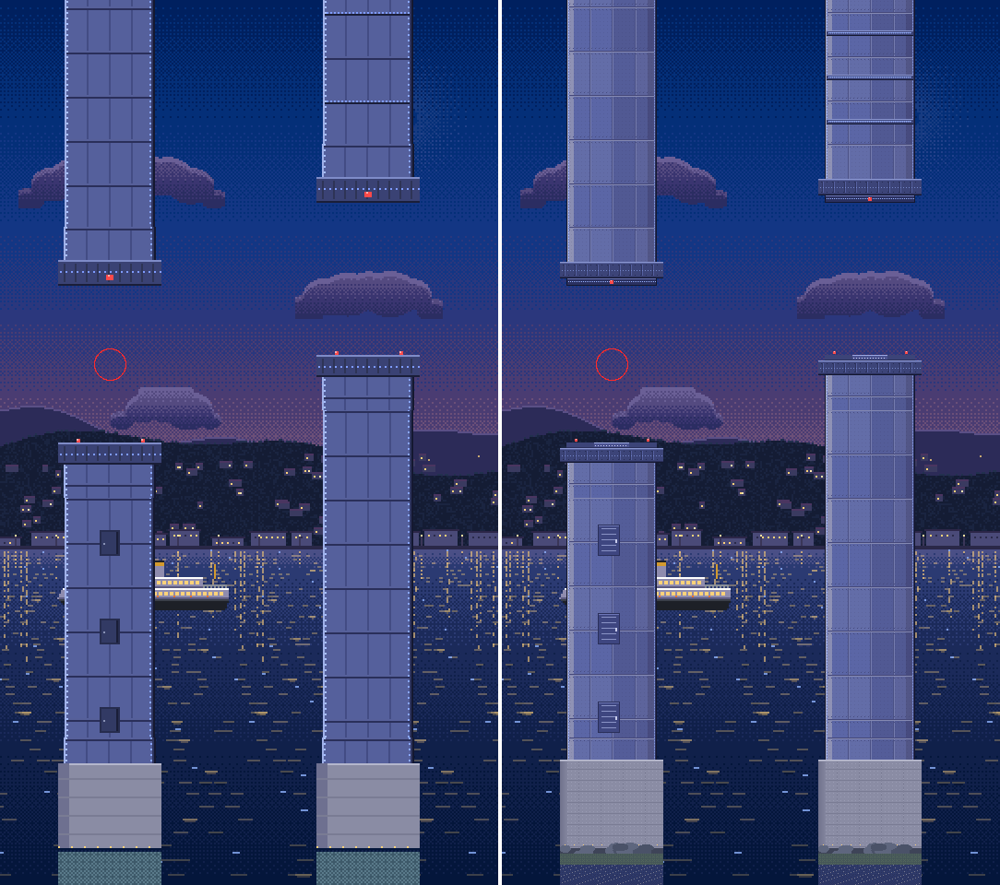
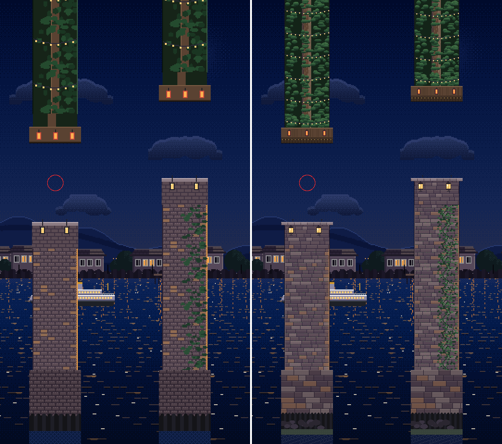
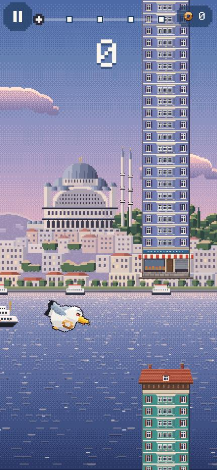
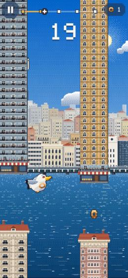
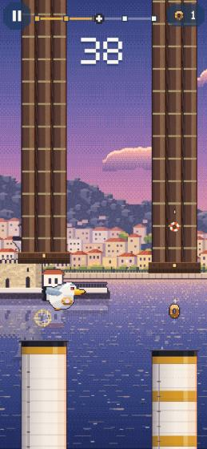
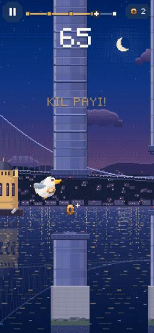
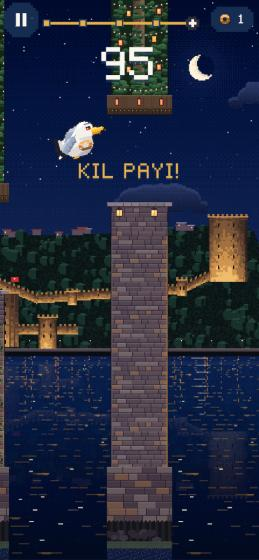

# 18 · Engel görselleri (v3) ve geçit dengesi

**Dal:** `feature/obstacle-art-gap-balance` (`feature/phase2-5-daily-challenge` üzerinden).
**Durum:**
- `flutter analyze`: temiz.
- `flutter test`: 320/320 geçti.
- Web derlemesinde beş bölge 390×844 ekranda denendi; konsolda hata yok.
- Gerçek cihaz testi yapılmadı. TestFlight'a yükleme ve App Store'a gönderim de yapılmadı.

Bu çalışmada yeni bir oyun sistemi eklenmedi. Fizik, skor, kayıtlar, görevler, XP, keşif, mağaza, kozmetikler ve Game Center değişmedi.

## 1. Mevcut durumun analizi

### Görseller

Engel atlasları 1/4 çözünürlükteydi: atlasın 1 pikseli 4 dünya birimine denk geliyordu. iPhone'da dünya yüksekliği (1920 birim) yaklaşık 2500 ekran pikseline yayıldığı için bir atlas pikseli 5–6 ekran pikseli ediyordu. Kaba blok hissinin asıl nedeni buydu. Gövde karosu 49 piksel genişliğindeydi; bir pencere 2–3 piksele, bir balkon 1 piksellik bir çizgiye sığmak zorundaydı.

### Geçitler

Kuş fiziği ve geçit ölçüleri:

| Ölçü | Değer |
|---|---|
| Çırpışın zirve yüksekliği (v²/2g = 880²/5200) | 149 birim |
| Kuşun çarpışma çapı | 68 birim |
| Tek çırpış yayının kapladığı yükseklik | ~217 birim |
| Eski en dar geçit | 265 birim |
| Eski en dar geçitteki pay | yalnızca **48 birim** |

Eski kurallarda iki sorun daha vardı:
- Geçit skor başına 1,6 birim daralıyor ve 47. skorda en dar haline ulaşıyordu. Kız Kulesi'nin ortasından itibaren oyunun geri kalanı bu en dar geçitle oynanıyordu.
- Ardışık iki geçit arasında, yönden bağımsız 430 birime kadar dikey sıçrama vardı. Oysa çırparak tırmanmak, süzülerek düşmekten zordur. Art arda büyük zikzaklar (yukarı-aşağı-yukarı) da serbestti.

### Ölçüm yöntemi

Erişilebilirlik simülasyonu (`CourseValidator.explore`) oyunla aynı fiziği ve çarpışma geometrisini kullanıyor. Saniyede 20 karar noktasında kuşun ulaşabileceği bütün durumları izliyor.

"Bant", bir engelin yanında kuş merkezinin bulunabileceği yükseklik aralığıdır. Bu aralık küçüldükçe geçiş daha fazla piksel hassasiyeti ister. Ölçüm 120 parkur üzerinde, her parkurda 100 engelle yapıldı.

| Ölçüt | Eski denge | Yeni denge |
|---|---|---|
| İçinde geçilemeyen ya da 24 birimden dar bir an olan parkur | **4/120** | **0/120** |
| Parkurun en dar anı: en kötü / %10 / ortanca | 0 / 46 / 78 | 91 / 115 / 128 |
| Engel başına bant: ortanca / en dar %5 | 138 / 97 | 185 / 147 |
| Bandı 90 birimden dar engeller | %3,0 | %0 |

Ölçüm, tek tek değiştirilerek de tekrarlandı:
- Yalnızca kayma kuralları yeniyken (eski geçit eğrisiyle) sonuç neredeyse eskisiyle aynı: 4/120, en kötü an 0. Haksız anları asıl azaltan şey **geçit eğrisi**.
- Yön ve zikzak kuralları en kötü durumu yine de iyileştiriyor. En kötü parkurun en dar anı bu kurallarla 90 birim, eski tek kayma sınırıyla 77 birim.

## 2. Sayısal denge: eski ve yeni değerler

Bütün değerler `lib/game/config.dart` içinde, anlamlı alan adlarıyla duruyor (`GameConfig`).

| Alan | Eski | Yeni | Neden |
|---|---|---|---|
| Geçit yüksekliği | Doğrusal: 340 − 1,6 × skor, en az 265 | `gapCurve`: bölge sınırlarında noktalar 0 → **370**, 15 → **350**, 35 → **330**, 60 → **310**, 90+ → **300** | Her bölge kendi daralma hızıyla geliyor. En dar geçit (300), bir çırpış yayından 83 birim geniş; eskiden bu pay 48 birimdi. |
| En dar geçit | 265 (47. skordan itibaren) | 300 (90. skordan itibaren) | Kalıcı en dar hale artık 47. skorda değil, Rumeli'de geçiliyor. |
| Ardışık kayma | ±430 | Yukarı **330** (`maxGapRise`), aşağı **390** (`maxGapDrop`) | Tırmanmak düşmekten zor. Aşağı yön görece serbest bırakıldı. |
| Zikzak | Sınırsız | 260 birimden büyük bir sıçramadan sonra (`bigShift`) sınırlar **×0,6** (`afterBigShiftScale`) | Art arda iki büyük ters sıçrama oluşmuyor. |
| Güvenli bant (HUD / su) | 230 / 230 | Değişmedi | |
| Yatay engel aralığı (`obstacleSpacing`) | 560 | **600** | İki engel arasındaki boş koridor 364'ten 404 birime çıktı (+%11). En yüksek hızda (440) iki engel arası süre 1,27 sn'den 1,36 sn'ye uzadı. Üst sınırı görüş mesafesi belirliyor: kuş bir engelin ortasındayken sıradaki engelin ağzı en uzun iPhone ekranında (9:19,5) görünmeli. Bu en fazla ~620 birime izin veriyor. Game Center hile denetimi aralığı config'ten okuduğu için kendiliğinden uyumlu. Günlük v1 560'ta dondurulmuş durumda; v2 600 kullanıyor. |
| Hız: başlangıç / tavan / skor başına | 340 / 440 / 2,5 | Değişmedi | Zorluk artışı hızda korundu. |
| Fizik: yer çekimi, çırpış, hitbox | Değişmedi | Değişmedi | Fizik değiştirilmedi. |

Skor başına geçit karşılaştırması:

| Skor | 0 | 15 | 35 | 47 | 60 | 90+ |
|---|---|---|---|---|---|---|
| Eski | 340 | 316 | 284 | 265 | 265 | 265 |
| Yeni | 370 | 350 | 330 | 322 | 310 | 300 |
| Fark | +30 | +34 | +46 | +57 | +45 | +35 |

**Simit yerleşimi:** Bir geçit öncekinden 260 birimden fazla kaydıysa, simit artık bandın kuşun geldiği tarafa yakın yarısına konuyor. Böylece oyuncu simit için kendini karşı duvara atmak zorunda kalmıyor. Küçük kaymalarda eski kural geçerli: bandın orta %70'i. Bu yerleşim `PickupRules.positionInBand` içinde ve aynı sayıda rastgele sayı çektiği için rastgele sayı akışı değişmiyor.

**Küçük ekranlar:** Dünya yüksekliği her ekranda 1920 birim, bu yüzden geçit ve kuş ölçüleri ekrandan bağımsız. Ekran daraldıkça yalnızca görünür genişlik azalıyor. En uzun iPhone ekranında bile kuş bir engelin ortasındayken sıradaki engelin geçit ağzı görünüyor. Bu durum 9:19,5 (en uzun iPhone), 320×568, 375×667 ve 3:4 oranlarında test edildi.

**Oynanışta beklenen fark:** Oyun hâlâ daralıyor; Haliç'ten Rumeli'ye geçit 70 birim küçülüyor ve hız artışı aynı. Ama "çok dar, teknik olarak geçilebilir" anlar artık üretilmiyor. Ölümler zamanlama hatasından geliyor: kuşun ulaşabileceği bant hiçbir engelde 80 birimin altına düşmüyor. Bu iddiayı testler 40 parkurda 100'er engelle doğruluyor.

## 3. Günün Uçuşu ile uyum

Günlük parkurlar her cihazda aynı olmak zorunda. Bu yüzden eski üretici bozulmadı:

- **Üretici v1 donduruldu** (`LegacyGapBalanceV1`). 9 Kasım 2026 dahil günler eski dengeyle aynen üretiliyor. Bunu altın değer testleri doğruluyor.
- **Üretici v2**, klasik modun yeni kurallarını (`GapRules`) kullanıyor ve takvime göre **10 Kasım 2026'dan itibaren** geçerli.
- Doğrulama artık sürüme göre yapılıyor (`DailyCourse.centerRange`). v2 için de altın değer testi eklendi.
- 60 günlük örnekte ilk aday tohumu reddedilen gün sayısı: v1'de 1, v2'de 0.

## 4. Görseller: değişen sprite'lar

Değişen dosyalar:
- Beş engel atlası: `assets/images/pixel_art/obstacles/kit_*.png`.
- Üretilen yerleşim dosyası: `lib/game/visual/obstacle_kit_layout.g.dart`.
- Kaynak: `art/_source/pixel/obstacles.js`.
- Eski atlaslar yedekte: `art/legacy_pixel_v2/obstacles/`.

Teknik değişiklikler:
- **Çözünürlük 2×:** 1 piksel artık 2 dünya birimi. Gövde karosu 49 piksel yerine 98 piksel, kat yüksekliği 24 piksel.
- **Atlas iki satır:** Kullanılmayan boş ışık maskesi satırı kaldırıldı. Atlas 744×320 yerine **400×260 px** ve beş atlasın toplamı 68 KB. Çizim çağrısı sayısı değişmedi, dolayısıyla performans maliyeti yok.
- **Yerleşim değişmedi:** Gövde genişliği 196, başlık taşması 14, başlık sınırları (Haliç 28, Galata 32, Kız Kulesi 12, Köprü 8, Rumeli 12) aynı. **Hitbox'lar değişmedi.**

| Bölge | Eski | Yeni |
|---|---|---|
| **Haliç / tarihi yarımada** | Betonarme apartman, düz çatı, su deposu | Fener–Balat tipi renkli sıra evler: ahşap bağdadi (hardal, kiremit kırmızısı) ve sıvalı (camgöbeği, lavanta) cepheler. Her katta **cumba** (konsollar, saçak, üç pencere), yeşil ve kahverengi **panjurlu** pencereler. **Kiremit çatı** (eskimiş kiremitler, güneş yönünde ışık), beşik çatılı çatı penceresi, tuğla **bacalar**, ahşap saçak konsolları. Alt uçta bakkal dükkânı (tabela, çizgili tente, manav kasaları, kepenk, taş subasman). |
| **Galata** | Taş cephe, iki baca | Tonları blok blok değişen **kesme taş**. Alınlıklı ve kemerli, kilit taşlı pencereler; **ferforje balkonlar** (dikmeler, süs, saksılar); cumbalı Beyoğlu apartmanı; pilastrlar ve kat silmeleri. Çatıda kiremit, toprak külahlı iki **baca**, çatı penceresi, dişli korniş, friz kartuşları. |
| **Kız Kulesi / Üsküdar** | Düz beyaz baca, düz kahverengi blok | **Vapur bacası** silindir gölgeli: soldan mor gölge, sağdan gün batımı kenar ışığı. Levha ekleri, perçin dizileri, buhar borusu, hardal bant, isli siyah ağız ve dudak. **İskele kazıkları:** üç yuvarlak ahşap kazık, lif dokusu, halat sargıları ve aralarında çapraz kuşaklar; cıvatalı başlık kirişi ve fener; varyantta can simidi. |
| **Boğaz Köprüsü** | Düz çelik ayak | Kutu kesit ayak: ton farklı paneller, perçin dizileri, takviyeler, iki kenarda LED şerit. Bakım kapağında merdiven basamakları. Bir varyantta iki yatay LED kuşak. Başlıklarda ana kablo **eyer yuvası**, kaburgalı **portal kirişi**, uçak ikaz ışıkları. Tabanda kalıp izli beton temel ve kayalar. |
| **Rumeli Hisarı** | Düzenli tuğla görünümlü duvar | **Düzensiz örgülü taş duvar:** satır satır değişen blok boyları, harçta yosun, sağdan fener ışığı. Daha dolgun sarmaşık; kapak taşları; büyük, ışığı taşa vuran duvar fenerleri. **Çınar:** benekli kabuk, üç tonlu yaprak kümeleri, ışık zinciri; varyantta yaprağa ışık düşüren dört fener. Çay bahçesi çardağı kirişi. |

**Bilinçli tercihler:**
- **Rumeli:** Hisar'ın kendisi ya da kulesi engel yapılmadı. Tarihi ve dini yapıların engel olarak kullanılmaması kuralı bu kararı gerektiriyor; Hisar arka planda duruyor. İstenen "taş duvar ve kule" hissi, sahil duvarının taş işçiliği ile veriliyor.
- **Haliç:** docs/14'te bu kit Unkapanı yamacının betonarme apartmanlarına çevrilmişti. Bu istek üzerine Haliç kıyısının Fener–Balat tipi ahşap ve cumbalı evlerine döndü. Bu yapı tipi de aynı kıyıda gerçekten var.

## 5. Okunurluk ve hitbox uyumu

- **Gövde sütunları her yerde opak:** Başlıkların sınır altında, üst başlıkta ve tabanda hitbox sütunlarında **şeffaf piksel yok**; yani görselsiz hitbox yok. Bu kuralı yeni piksel testi doğruluyor ve iki gerçek kusur yakaladı, ikisi de düzeltildi:
  - Galata kornişinde diş aralarında delikler vardı.
  - Köprü tabanında kayalar arasında boşluklar vardı.
- **Sınır üstü yalnızca küçük süs:** Hitbox'ın üstünde kalan, çarpışmasız bölgede yalnızca küçük süsler var (baca, ikaz ışığı, düdük). Bu bölge gövde genişliğinin %30'undan azını kaplıyor. "Çarpmadım ama öldüm" yönünde bir yanıltma yok.
- **Taşan saçaklar oyuncunun lehine:** Gövdenin dışına 7 piksel taşan saçaklar ve korkuluklar çarpışmaya dahil değil, bu sapma oyuncunun lehine. Bu, önceki sürümle aynı kural.
- **Göğe karşı okunurluk:** Gövde kenarlarında koyu kontur ve ışık/gölge şeridi var. Renkler bölge göğünden ayrışacak doygunlukta seçildi.
- **Dikişsiz döşeme:** Gövde karoları dikeyde dikişsiz döşeniyor; bu da test ediliyor. Sarmaşık ve yaprak kümeleri karo kenarında karşı kenara devam ediyor.

## 6. Testler

| Komut | Sonuç |
|---|---|
| `flutter analyze` | No issues found |
| `flutter test` | 320/320, All tests passed |
| `flutter build web --release --dart-define=MARTI_DEMO=true` | Derlendi. Beş bölge tarayıcıda 390×844'te oynatıldı; konsolda hata yok. |

Yeni ya da güncellenen testler:

`test/obstacle_balance_test.dart` (yeni):
- Gövde karolarının tamamen opak olması ve başlık ile tabanda hitbox sütunlarının boşluksuz olması.
- Sınır üstü süslerin %30'dan az yer kaplaması.
- Gövde karolarının dikişsiz döşenmesi.
- Bölge ve varyant çeşitliliği: A/B varyantları farklı, her karoda en az 12 renk, beş kit birbirinden farklı.
- Erişilebilirlik: 40 parkur × 100 engel, hepsi geçilebilir ve en dar bant ≥ 80 birim.
- Eski dengeye göre ortanca en dar an en az 30 birim daha geniş.
- Klasik üreticinin güvenli bant ve kayma sınırları (3000 geçit).
- Bölge eğrisi.
- Simit yerleşimi (büyük sıçrama ve küçük kayma).
- Küçük ekran görüş mesafesi.
- En dar geçidin kuş çapının 4 katından geniş olması.

Güncellenen testler:
- `test/logic_test.dart`: Yön sınırları, zikzak kuralı, eğri noktaları, monotonluk ve en dar geçidin çırpış yayından en az 70 birim geniş olması.
- `test/daily_challenge_test.dart`: v1 altın değerleri değişmedi; v2 altın değerleri eklendi. Ayrıca sürüm takvimi, iki sürümün kural uyumu ve aday seçimi için bir v1 günü (29 Eylül).
- `test/visual_test.dart`: Engel atlası ölçeği (1/2) ve iki satırlı atlas boyutu.

## 7. Görseller

Eski | yeni karşılaştırmaları (atlas önizlemesi, arka plan üzerinde, dünya/2 çözünürlük; kırmızı daire kuşun hitbox'ı):







Oyun içi (web derlemesi, demo modu, 390×844):

    

Önizlemeyi yeniden üretmek için:

```
node art/_source/pixel/obstacles.js
node art/_source/pixel/preview_obstacles.js assets/images/pixel_art cikti.png art/legacy_pixel_v2/obstacles
```

## 8. Bilinen riskler

1. **Klasik rekorlar kolaylaştı.** Geçitler genişlediği için yeni sürümdeki skorlar eski sürümden ortalama daha yüksek olacak. Game Center klasik tablosunda eski ve yeni sürüm skorları karışacak. Henüz halka açık bir sürüm olmadığı için etkisi sınırlı.
2. **Günlük parkur sürüm ayrımı.** 10 Kasım'dan itibaren yeni sürüm v2 parkuru, 1.5.0 (7) ise v1 parkuru üretir. İki sürüm aynı günü oynarsa günlük sıralamada farklı parkurların skorları karışır. 1.5.0 (7) TestFlight hesap sorunu nedeniyle hiçbir testçiye ulaşmadı, bu yüzden gerçek etkisi beklenmiyor. Yine de yeni sürüm yayımlanırken eski sürüm kullanımdan kalkmalı.
3. **Gerçek cihaz testi yapılmadı.** Piksel yoğunluğu ve okunurluk iPhone ekranında doğrulanmalı. Özellikle şunlara bakılmalı: Galata'nın küçük pencereleri, Köprü ayağının gece göğüne karşıtlığı ve 320 pt genişliğindeki ekranlar.
4. **Arka plan kıyı binaları (uzak katmanlar) değiştirilmedi.** Bu çalışma engellerle sınırlı.

Haliç kitinin yapı tipi değişti, ama oyundaki metinlerde Haliç engellerine bir atıf yok (kontrol edildi). Bu yüzden bu değişiklik ek bir güncelleme gerektirmiyor.
