# 19 · Phase 2.6: Genişleyen İstanbul (dört yeni bölge, dinamik engeller, hava durumu, performans)

> **Dosya adı:** İstekte `docs/18_phase2_6_expanded_istanbul.md` geçiyordu. 18 numara engel ve geçit raporunda kullanıldığı için bu rapor 19 numaralı.
>
> **Dal ve sürüm:**
> - Dal: `feature/phase2-6-expanded-istanbul`, `feature/phase2-5-daily-challenge` (`000c24f`) üzerine açıldı.
> - Sürüm önerisi: **1.6.0**. Son derleme 1.5.0 (8) TestFlight'ta; App Store'da 1.4.0 kaydı "Prepare for Submission" durumunda.
> - TestFlight'a yükleme, App Review gönderimi ve yayın **yapılmadı**.

## 0. Yapılanlar ve kalanlar

| Aşama | Durum |
|---|---|
| 2.6.1: Yeni bölge altyapısı | **Tamam.** Kalıcı bölge kimlikleri, "hazır" bayrağı, rota listesi, Günün Uçuşu sınırı, albüm ve migration kuralları |
| 2.6.1: Ortaköy | **Tamam.** Gök, uzak plan, orta plan, kıyı, su, vapur, simge (cami + köprü), engel kiti (1 px = 2 birim), keşif kartı. Oyun içinde ve testlerde doğrulandı |
| 2.6.2: Emirgan, Dolmabahçe, Üsküdar | **Tamam.** Her biri için gök, uzak plan, orta plan, kıyı, su, vapur, simge, engel kiti ve keşif kartı (§3a). Dokuz bölgenin hepsi rotada. Önizleme aracıyla tam sahne olarak doğrulandı; oyun içi web kontrolü bu turda yapılamadı (§12) |
| 2.6.3: Dinamik engeller, hava durumu, bölge sesleri | **Kısmen tamam (§6a–§6c).** Martı sürüsü ve rüzgâr kuşağı: klasik modda, skor 120'den sonra, ölçülerek. Hava: yağmur, sis, rüzgârlı (yalnızca görsel). Yeni ses: yağmur. Vapur engeli, sallanan nesne ve vapur düdüğü **yapılmadı** (gerekçe §6a) |
| 2.6.4: Performans ölçümü ve iPhone testleri | **Masaüstü ölçümleri ve iyileştirmeler tamam (§8); bir sızıntı bulundu ve düzeltildi. iPhone testi yapılmadı (NOT RUN, plan §11).** |

## 1. Mevcut mimari analizi

| Sistem | Bulgu | Phase 2.6 kararı |
|---|---|---|
| Bölgeler | `zones` listesi (`day_cycle.dart`). Kalıcı kayıtlar (`discoveredZones`, rozetler, bölge rekorları, keşif `firstSeen`) bölgenin **listedeki sırasını** anahtar olarak kullanır | Sıra kalıcı kimlik: yeni bölgeler hep sona eklenir, sıra hiç değişmez. `Zone.available` hazır olmayan bölgeyi rotadan çıkarır |
| Geçiş | `zoneIndexForScore` + `DayCycle` palet geçişi | Yalnızca rotadaki bölgeler (`routeZones`). `maxZone` parametresi Günün Uçuşu rotasını sınırlar |
| Asset | `GameArt.load` bütün `ObstacleKitId` ve `Landmark` değerlerini yüklüyordu | Yalnızca rotadaki bölgeler yüklenir (`routeKits`, `routeLandmarks`). Eksik dosya null kalır ve kodla çizilen yedek kullanılır (test) |
| Engel üretimi ve deterministik RNG | `GapGenerator` (klasik) ve `GapGenerator.seeded` (günlük v2) | Değişmedi. Yeni bölgeler aynı geçit eğrisini kullanır; 90'dan sonra en dar geçit 300'de sabit |
| Günün Uçuşu | `zoneSequence` [0..4]. Ama `DayCycle` skora göre bölge değiştiriyordu: 150'den sonra günlük parkur Ortaköy görünümüne geçecekti | `DayCycle.updateScore(maxZone: zoneSequence.last)`: günlük v1/v2 Rumeli'de kalır. Parkur (geçitler, simitler) zaten değişmiyordu |
| Keşif albümü | `discoveryZones[i]` sıra numarasıyla okunuyordu; albüm ödülü "bütün rozetler" koşuluna bağlıydı | Kart bölge kimliğiyle bulunur (`discoveryZoneOf`); albüm yüzdesi rotadaki kartlarla hesaplanır; ödül koşulu ilk beş rozete sabitlendi |
| Beş bölge varsayımı (UI) | Rota çubuğu, kartpostal "n/5", harita, albüm, profil listesi, "n. durak" etiketleri | Hepsi rotaya bağlandı. "n. durak" artık rotadaki sırayı gösteriyor (Ortaköy 6. durak; bölge kimliği 6 ama sıra tesadüfen aynı). Testler bunu yakaladı |
| Ortam sesi | `ambienceForZone`: 0–2 liman, diğerleri rüzgâr | Ortaköy, Dolmabahçe, Üsküdar: liman; Emirgan: rüzgâr. Müzik değişmedi |
| Parallax | Bölge başına 9 katman, 1 px = 4 birim (arka plan); engeller 1 px = 2 birim | Aynı ölçekler korundu |

Bu analizde bulunan ve düzeltilen hatalar (yeni bölge eklenince ortaya çıkacaklardı):
1. `settleRun`, ulaşılan bölgeye kadar **bütün sıra numaralarını** keşfedilmiş sayıyordu. Ortaköy'e (6) ulaşan oyuncu, rotada olmayan Emirgan'ı (5) da keşfetmiş ve onun XP'sini almış olurdu. Artık yalnızca rotadaki bölgeler sayılıyor.
2. 1.0.0 kayıt geçişi, keşfedilen bölgeleri rekordan türetiyordu. Rekoru 150'nin üstündeki eski bir oyuncu, Ortaköy'ü hiç görmeden keşfetmiş sayılırdı. Türetme artık ilk rotayla sınırlı.
3. Yeni bölgenin arka plan klasörü `pubspec.yaml`'da yoktu: görseller pakete girmiyordu (oyunda ilk denemede gökyüzü ve orta plan boş geldi). Klasör eklendi. Rotadaki her bölgenin klasörünün pubspec'te olduğunu doğrulayan bir test de eklendi.
4. Ortaköy ile Boğaz Köprüsü'nün harita işaretleri üst üste biniyordu: cami köprünün Avrupa ayağının dibinde, aralarında ~7 harita pikseli var. Ortaköy işareti kaydırıldı ve gerçek konumuna ince bir çizgiyle bağlandı (`markerDx/markerDy`); koordinat değişmedi.

## 2. Rota planı

Mevcut beş bölgenin eşikleri ve sırası **değişmedi**. Yeni bölgeler Rumeli Hisarı'ndan sonra "ikinci gün" olarak eklendi: Boğaz'ın kuzeyinden güneye dönüş, sabahtan akşamüstüne.

| Kimlik | Bölge | Eşik | Saat ve atmosfer | Durum |
|---|---|---|---|---|
| 0–4 | Haliç → Galata → Kız Kulesi → Boğaz Köprüsü → Rumeli Hisarı | 0 / 15 / 35 / 60 / 90 | Şafak → gece | Değişmedi |
| 5 | **Emirgan** | **120** | **Bahar sabahı** | **Rotada** |
| 6 | **Ortaköy** | **150** | **Açık öğle, canlı deniz** | **Rotada** |
| 7 | **Dolmabahçe** | **180** | **Öğleden sonra güneşi** | **Rotada** |
| 8 | **Üsküdar** | **210** | **Yumuşak akşamüstü** | **Rotada** |

- **Bölge süresi:** Eşik aralığı 30 puan; en yüksek hızda 30 puan yaklaşık 41 saniye.
- **Geçit:** En dar geçit 300'de kalır; zorluk artırılmadı.
- **Emirgan açıldı (2.6.2):** Ortaköy'ün kimliği ve eşiği değişmedi; Emirgan Rumeli ile Ortaköy arasına girdi. `available` bayrağı bundan sonraki bölgeler için duruyor.
- **Ortaköy'ün iki kez görünmesi:** Ortaköy Camii, Boğaz Köprüsü bölgesinin (akşam) simgesinde zaten küçük olarak vardı. Ortaköy bölgesi onu yakın plan ve gündüz gösterir; köprü bölgesinde köprü, Ortaköy'de cami öne çıkar. Üsküdar için de aynı ilke geçerli: Kız Kulesi bölgesinin arkasında Salacak yamacı var; Üsküdar bölgesi Mihrimah Sultan Camii ve iskele meydanına odaklanır.

## 3. Ortaköy: mimari referanslar ve tasarım

**Büyük Mecidiye (Ortaköy) Camii.** Yalnızca kaynaklarda doğrulanan bilgiler kullanıldı; tarihler kaynaklar arasında tartışmalı olduğu için kartta da öyle yazıldı.
- **Yapım:** Sultan Abdülmecid'in isteğiyle yapıldı. Mimarları Garabet ve Nigoğos Balyan (baba-oğul).
- **Tarih:** Tamamlanma yılı kaynaklarda 1854 ya da 1856 (bazı kaynaklar 1853–1856).
- **Üslup:** Neo-Barok, 19. yüzyıl eklektik.
- **Silüet:** Tek kubbe kasnak üstünde, iki ince tek şerefeli minare, hünkâr kasrı, iki kat büyük kemerli pencereler, köşe payeleri.
- **Sonraki tarihi:** 1894 depreminde hasar gördü; 1960'ta başlayan onarımda kubbe yenilendi, 1969'da yeniden ibadete açıldı.

Kaynaklar:
- [Ortaköy Mosque, Wikipedia](https://en.wikipedia.org/wiki/Ortak%C3%B6y_Mosque)
- [Kültür Envanteri: Büyük Mecidiye Camii](https://kulturenvanteri.com/en/yer/ortakoy-camii/)
- [Archnet: Büyük Mecidiye Camii](https://archnet.org/sites/2012)
- [Structurae: Ortaköy Mosque](https://structurae.net/en/structures/ortakoy-mosque)

Köprünün ölçü ve askı düzeni için [docs/12](12_kopru_gercek_referans.md) kullanıldı: tabliye denizden 64 m, eğik (zikzak) askılar.

**Kompozisyon** (`art/_source/pixel/ortakoy.js`): Kamera Ortaköy meydanının güneyinde, sudan bakıyor.
- **Ön plan:** Cami, meydanın denize uzanan çıkıntısında. Solda hünkâr kasrı ve iki minare; minare uçları tabliyenin altında.
- **Arka plan:** Köprünün Avrupa kulesi (portal kirişleri), ana kablo ve ondan inen zikzak askılar, tabliye.
- **Geri plan:** Ortaköy–Kuruçeşme yamacı ve Yıldız korusu. Karşıda pus içinde Beylerbeyi–Çengelköy tepeleri ve uzakta Çamlıca kulesi.
- **Işık:** Öğle ışığı sağ üstten; taşta soğuk mavi gölgeler, sıcak beyaz ışıklar.

**Engeller (Ortaköy kiti).** Cami engel yapılmadı; tarihi ve dini yapıların engel olmaması kuralı sürüyor. Engeller Ortaköy çarşısının 19. yüzyıl kagir sıra evleri:

| Parça | İçerik |
|---|---|
| Gövde A | Taş-tuğla almaşık örgü (8 px kesme taş + 4 px tuğla, 12 px'de tekrar), Neo-Barok kavisli alınlıklı ve kilit taşlı pencereler, Fransız balkonları, ortada niş |
| Gövde B | Krem sıvalı Neo-Barok cephe: pilastrlar, kıvrım süslü orta pencere, saksılı ferforje balkon |
| Üst gövdeler | Gri-pembe almaşık; mint sıva, beyaz çerçeve, yeşil panjur |
| Alt başlık | Tuğla bacalar ve parapet vazoları (sınırın üstünde, çarpışmasız), kiremit önünde balüstrat, modilyonlu korniş, girlandlı friz ve öküzgözü pencere |
| Üst başlık | Kumpir dükkânı: tabela, çizgili tente, kumpir ve malzeme vitrini, kapı, waffle vitrini, taş subasman |
| Taban | Kemerli dükkân katı, beyaz kesme taş rıhtım, döküm babalar |

Hitbox kuralları aynı: gövde 98 px tam opak, başlık sınırı 32 birim, taşma 14 birim. Piksel testi iki boşluk yakaladı (tabela kenarı, tente dalgaları); ikisi düzeltildi.

## 3a. Emirgan, Dolmabahçe, Üsküdar (2.6.2): referanslar ve tasarım

Kartlarda yalnızca kaynaklarda doğrulanan bilgiler kullanıldı. Doğrulanamayan ayrıntılar (Mihrimah Sultan'ın şerefe sayısı, meydandaki çeşmenin bilgileri) ne kartlara ne de rapora yazıldı.

**Emirgan (bahar sabahı)** — kaynaklar: [Emirgan](https://en.wikipedia.org/wiki/Emirgan), [Emirgan Park](https://en.wikipedia.org/wiki/Emirgan_Park), [İstanbul Lale Festivali rehberi](https://istanbul.com/tr/blog/seasonal-picks/istanbul-tulip-festival-2026-emirgan-park-guide).
- **Bilgiler:**
  - Adını 1635'te Revan'ı IV. Murad'a teslim eden Emir Güne Han'dan alır.
  - Korudaki Sarı, Pembe ve Beyaz köşkler Hidiv İsmail Paşa döneminde, 1870'lerde yapıldı. Sarı Köşk'ü Sarkis Balyan tasarladı.
  - Koru Nisan'da İstanbul Lale Festivali'ne ev sahipliği yapar.
  - Şerifler Yalısı 18. yüzyıldan kalmadır; Avrupa yakasının ayakta kalan en eski yalısıdır.
- **Simge:** Korunun yamacı, fıstık çamları, açmış erguvanlar, Sarı Köşk (iki katlı, ahşap, geniş saçaklı, oymalı alınlıklı). Önde dalgalı lale tarhları ve sahil yolu.
- **Engeller:** Yalı tipinden türetildi; tarihi yalılar engel yapılmadı.
  - Gövdeler: aşı boyalı ve beyaz yalılar; dikey ahşap kaplama, boydan boya çıkma, ahşap kafes, sardunyalar.
  - Üst gövdeler: pembe erguvan ve beyaz erik ağacı.
  - Başlıklar: geniş saçaklı kırma çatı, saçak altı sarkıtlar; lale dolu taş saksı.
  - Taban: kemerli kayıkhane.

**Dolmabahçe (öğleden sonra)** — kaynaklar: [Dolmabahçe Palace](https://en.wikipedia.org/wiki/Dolmabah%C3%A7e_Palace), [Kültür Envanteri](https://kulturenvanteri.com/en/yer/dolmabahce-sarayi/), [T.C. Kültür ve Turizm Bakanlığı](https://www.ktb.gov.tr/EN-113763/dolmabahce-palace.html).
- **Bilgiler:**
  - Abdülmecid yaptırdı; yapımı 1843'te başladı. Tamamlanma 1853 ya da 1856 olarak geçer; kartta "1850'lerde" yazıyor.
  - Garabet ve Nigoğayos Balyan'ın eseridir.
  - Tören Salonu'nun kubbesi 36 m yüksekliktedir.
  - Tören Salonu'nda 750 lambalı, yaklaşık 4,5 tonluk bir avize asılıdır.
  - Saat Kulesi'ni II. Abdülhamid yaptırdı; Sarkis Balyan'ın tasarımıyla 1890–1895 arasında yapıldı.
- **Simge:** Sarayın deniz cephesi (güneyde Mabeyn, ortada yüksek Tören Salonu ve kurşun kubbesi, kuzeyde Harem), iki kat kemerli pencereler, sütunlar, alınlıklar, balüstrat ve vazolar. Önde mermer rıhtım, ferforje korkuluk ve deniz kapıları; güney ucunda Saat Kulesi. Cephe birebir kopya değil; oranları ve bölümleri korunarak sadeleştirildi.
- **Engeller:** Saray ve kule engel değil.
  - Gövdeler: mermer rıhtım ayakları; oymalı panolar, yaldız rozetler, madalyon, duvar fenerleri.
  - Üst gövdeler: cadde çınarları, benekli kabuklarıyla öğleden sonra ışığında.
  - Başlıklar: yaldızlı fenerler, ferforje korkuluk; mermer saksı.
  - Taban: suya inen basamaklar ve ferforje kapılar.
  - Önizlemede beyaz ayaklar beyaz saray cephesinin önünde kayboluyordu; mermer daha sıcak ve koyu bir tona çekildi.

**Üsküdar (akşamüstü)** — kaynaklar: [Mihrimah Sultan Mosque, Üsküdar](https://en.wikipedia.org/wiki/Mihrimah_Sultan_Mosque,_%C3%9Csk%C3%BCdar), [Üsküdar Belediyesi](https://www.uskudar.bel.tr/en/main/pages/mihrimah-sultan-mosque/315).
- **Bilgiler:**
  - Mimar Sinan, Mihrimah Sultan için yaptı; 1543–44 ile 1548 arası.
  - Tek kubbeli harimi üç yarım kubbe destekler.
  - Önünde geniş bir çift revak vardır; cami yükseltilmiş bir set üzerinde durur ve iki minarelidir.
  - İskeleye yakınlığından "İskele Camii" diye anılır.
  - Minarelerden birinde oyma bir güneş saati vardır.
- **Simge:** Set ve merdiven, eğimli saçaklı dış revak ve ince sütunlar, iç revak kemerleri ve kubbecikleri, kasnaklı merkezi kubbe ve yan yarım kubbeler, iki minare (şerefe sayısı doğrulanamadığı için tek şerefeyle). Solda vapur iskelesi, sağda çınarlar.
- **Uzak ve orta plan:** Uzakta Çamlıca tepesi ve kulesi; orta planda yamaç evleri ve serviler.
- **Engeller:** Cami engel değil.
  - Gövdeler: üst katları ahşap evler; çıkmalı ve kafesli/panjurlu iki tip, pencere önü saksıları.
  - Üst başlık: kesme taş zemin katta kemerli simitçi.
  - Taban: kagir dükkânlar ve rıhtım.

**Engel kiti testlerinin yakaladığı kusurlar (düzeltildi):**
- Görselsiz hitbox: Dolmabahçe korniş dişleri ve basamakları, Üsküdar saçak sarkıtları.
- Fazla az renk: Emirgan ve Üsküdar karoları; yıpranmış tahta tonları, saksılar ve panjurlar eklendi.

**Harita:** Üsküdar işareti Kız Kulesi'ne çok yakındı; kuzeydoğuya kaydırıldı ve gerçek konuma çizgiyle bağlandı. Yeni test: rotadaki her işaret çifti en az 14 harita pikseli uzakta.

## 4. Üretilen asset'ler

| Bölge | Simge (px) | Engel kiti | Arka plan klasörü | Toplam |
|---|---|---|---|---|
| Ortaköy | 320×200 | 400×260 | 9 katman | ~58 KB |
| Emirgan | 320×140 | 400×260 | 9 katman | ~30 KB |
| Dolmabahçe | 400×140 | 400×260 | 9 katman | ~28 KB |
| Üsküdar | 320×180 | 400×260 | 9 katman | ~28 KB |
| **Dört yeni bölge** | | | | **~144 KB** |

- **Üretim:** Bütün görseller kodla, piksel piksel üretildi: `ortakoy.js`, `emirgan.js`, `dolmabahce.js`, `uskudar.js`, `obstacles.js` ve ortak `backgrounds.js`. Geçici yer tutucu ya da SVG yok.
- **Yeniden üretim:** `node art/_source/pixel/build_all.js assets/images/pixel_art`. Dört bölge de eklendi.
- **Önizleme:** `preview.js` ve `preview_obstacles.js` dört bölgeyi de çiziyor. `zoneShot(..., { landmark: true })` simgeyle birlikte tam sahne çizer: arka plan, simge ve oyundaki yerleşim kuralıyla engel çiftleri.

**Bilinen görsel sınırlar:**
- Köprü kulesi düz gri; Köprü bölgesindeki LED'li kule kadar ayrıntılı değil.
- Simge suya büyük, keskin bir yansıma bırakıyor. Bu, kıyı simgelerinin mevcut yansıma kuralı; Ortaköy'de simge geniş olduğu için yansıma daha belirgin.

## 5. Zorluk parametreleri (önceki / yeni)

| Parametre | Önceki | Yeni |
|---|---|---|
| Geçit eğrisi | 370 → 300 (90'da) | Aynı; 150'de de 300 |
| Kayma, zikzak, aralık (600), hız | docs/18 | Aynı |
| Yeni bölgeye özel zorluk | – | Geçitler aynı. Skor 120'den sonra klasik modda dinamik engeller (§6a) |
| Dinamik engel (2.6.3) | – | Başlangıç skoru 120; koridor başına sürü %20, rüzgâr %16; iki dinamik engel arasında en az 2 boş koridor |

## 6. Günün Uçuşu uyumluluğu

- **Parkur:** Üretici v1/v2 ve parkurlar değişmedi; altın değer testleri geçiyor.
- **Görünüm:** Günlük uçuşun bölge görünümü Rumeli'de kalıyor (`maxZone`). Yeni bölgeler günlük yarışın görünümünü sürüm ortasında değiştirmiyor.
- **Dinamik engeller:** Günün Uçuşu'nda **yok**. Günlük parkur aynı kaldığı için yeni üretici sürümü (v3) gerekmedi. Günlüğe eklenmesi ileride ayrı bir karar: yeni sürüm, takvimde ileri bir tarihten itibaren.
- **Hava:** Günün Uçuşu'nda hava hep açık; her oyuncu aynı görüntüyü görür (test).

## 6a. Dinamik engeller (2.6.3)

**Yapılanlar:**

| Engel | Davranış | Görünüm |
|---|---|---|
| **Martı sürüsü** | Sağdan Simit'e doğru, kaydırmadan %35 hızlı uçar; Simit'in hizasına koridorun (iki engel arası) ortasında gelir. Konumu yalnızca koridorun kuşa uzaklığına bağlı (zamandan ve kare hızından bağımsız). Geçidin üst ya da alt kenarına 80 birim taşar, 2,6 saniyelik dönemle ±22 birim salınır. Geçit belirgin kayıyorsa (>60) kuşun **terk ettiği** tarafta durur. Ekrana girerken bir kez martı çığlığı | Üç koyu sırtlı martı (Simit beyaz; karışmasın), yandan, Simit'e dönük, üç kareli kanat çırpışı ve arkada hız çizgileri. Görsel ~180×88; çarpışma kutusu 144×62 (kanat ucuna sürtmek affedilir) |
| **Hava akımı (rüzgâr)** | Kuş koridordayken dikey ivme: kenarlarda 0, ortada en fazla ±400 birim/s², sin² eğrisiyle yumuşakça artıp azalır (ani itme yok). Yönü önceden görünür | Akımın yönünde kemerlenen 7 rüzgâr şeridi (yükselen akımda yukarı, alçalan akımda aşağı); kemer, ivmeyle aynı eğri. Şeritlerde kuşa doğru akan kesikler ve savrulan yapraklar |

**Kurallar:**
- Yalnızca **klasik mod**, skor **120**'den (ikinci gün bölgeleri) sonra. Günün Uçuşu'nda yok.
- Ayrı rastgelelik (`hazardRandom`): her koridorda tam 3 sayı çekilir; geçit üreticisinin dizisi değişmez.
- Fizik adımı aynı (1/120 s); rüzgâr ivmesi sabit adımın içinde uygulanır, çarpışma aynı adımda. Kare hızından bağımsız (test: 30/60/120 FPS).
- Engellerin önünde çizilir (öncelik 41), simit ve efektlerin arkasında.

**İlk deneme ve yeniden tasarım:** İlk sürümde sürü (koridorda duran küçük beyaz martılar) tehlike olarak anlaşılmadı; rüzgâr (koridorda sabit ivme, dikey oklar) doğal görünmedi ve hissettirmedi (yerel deneme, kullanıcı geri bildirimi). Yukarıdaki tablo yeniden tasarlanmış hâli.

**Adalet ölçümü** (`CourseValidator.explore(hazardAt:)`): Oyunla aynı fizik, çarpışma ve zaman kuralıyla kuşun ulaşabileceği bütün durumlar izlenir. Sürü deliği "en dar aralıktan" düşülür: kuş deliğin üstünden ya da altından geçmek zorunda olduğu için büyük parça sayılır.

| 80 parkur, 230 engel | En dar | %10 | Ortanca | Geçilemeyen |
|---|---|---|---|---|
| Dinamik engelsiz | 120 | 129 | 137 | 0 |
| Sürü + rüzgâr | 101 | 125 | 136 | 0 |

Not: Simülatör her 6 adımda karar verir ve hız kutularını budar; tek ölçüm gerçek bandın gürültülü bir **alt sınırı**dır. İlk taramada 2 parkurda 63 ve 79 görüldü. Daha sık kararla (3 adım) bu parkurlar düzeldi, başka parkurlar (biri dinamik engelsiz skor 88'de) dar göründü: darlık ölçüm gürültüsüydü. Keşfedilen her durum gerçek bir dokunuş dizisiyle ulaşılabilir olduğu için iki ölçümün (6 ve 4 adım) engel başına büyüğü de geçerli bir alt sınırdır. Tablo bu birleşik ölçümle; test eşiği 90.

**Yapılmayanlar ve gerekçe:**
- **Hareketli vapur engeli:** Geniş ve yatay hareketli bir engel, geçit/koridor modelinin dışına çıkar; adil ölçümü ayrı bir simülasyon ister. Vapurlar arka planda dekor olarak kalıyor.
- **Sallanan nesne** (avize, fener, tabela): Engel kitlerine bağlı ve tarihî yapıların engel olamayacağı kuralıyla çakışma riski var. Ayrı tasarım turu gerekir.
- İstek "hepsini agresif açma" diyordu; iki mekanik yeterince çeşitlilik sağlıyor ve ölçüldü.

## 6b. Hava durumu (2.6.3, yalnızca görsel)

| Bölge | Olası hava |
|---|---|
| Haliç (şafak) | Sis |
| Galata, Boğaz Köprüsü, Üsküdar | Yağmur |
| Kız Kulesi, Dolmabahçe | Hep açık |
| Rumeli Hisarı (gece) | Sis |
| Emirgan, Ortaköy | Rüzgârlı (erguvan yaprakları / taze yapraklar) |

- **Olasılık:** Bölgeye girişte %40 (ilk bölge tur başında). Seçim görsel rastgelelikle yapılır; oynanış rastgeleliği okunmaz.
- **Oynanışa etkisi yok:** Fizik, engel ve çarpışma aynı. "Rüzgârlı" hava yalnızca görseldir; fiziği etkileyen rüzgâr kuşağıdır (§6a).
- **Okunabilirlik:** Katman engellerin **arkasında** çizilir (öncelik 39 < 40, test). Sis ve yağmur hiçbir engeli örtmez.
- **Maliyet:** Nesne üretimi yok; bütün parçacıklar sıradan ve zamandan hesaplanır. Yağmur 48 damla, rüzgâr 24 yaprak + 6 çizgi, sis 8 bant. Geçiş 2 saniyelik yumuşak sönümle.
- **Geliştirme:** Web demoda `&weather=rain|fog|windy` her bölgede o havayı gösterir (yalnızca demo derlemesi).

## 6c. Bölge sesleri (2.6.3)

- **Yeni:** `assets/audio/amb_rain.wav`, hafif yağmur. `art/_source/build_audio.js` ile prosedürel üretildi (filtrelenmiş gürültü + seyrek damla tıkırtısı). Özgün, dış kaynak yok, lisans gerekmez. Diğer ses dosyaları bayt düzeyinde aynı kaldı (doğrulandı).
- **Seçim:** Yağmurda yağmur sesi, rüzgârlı havada mevcut rüzgâr sesi, açık ve sisli havada bölgenin mevcut ortam sesi (liman: dalga ve martı). Ses ayarları ortam sesine olduğu gibi uygulanır.
- **Tekrar:** Ortam sesi bölge değişince bir kez değişir; aynı ses tekrar başlatılmaz.
- **Yapılmadı:** Vapur düdüğü. Tek seferlik efekt olarak sık tekrar riski var; zamanlama kuralı ayrı tasarım ister.

## 7. Keşif albümü ve migration

**Yeni kartlar:** Her kartta yer, konum, özet ve dört kısa bilgi var (§3, §3a). Hedefler:

| Durak | Bölge | Hedefler (simit) |
|---|---|---|
| 6 | Emirgan | Ulaş (+10); Emirgan'da 6 simit (+15); tek uçuşta Emirgan'da 15 engel (+20) |
| 7 | Ortaköy | Ulaş (+10); Ortaköy'de 6 kıl payı (+15); tek uçuşta 170 puan (+20) |
| 8 | Dolmabahçe | Ulaş (+10); Dolmabahçe'de 6 kıl payı (+15); tek uçuşta 200 puan (+20) |
| 9 | Üsküdar | Ulaş (+10); Üsküdar'da 6 simit (+15); tek uçuşta 230 puan (+20) |

Keşif hedefleri artık rota sırasıyla işleniyor; oyun sonu özetinde Emirgan, Ortaköy'den önce gelir.

**Ödül dengesi:**
- İlk rotanın toplamı 210 simit; değişmedi.
- Yeni bölgelerin her biri en fazla 45 simit.
- Bütün albüm mağaza toplamının yarısından az (test).

**Eski oyuncu için kurallar** (`test/expanded_istanbul_test.dart`):
- **Albüm yüzdesi:** Rotadaki bütün kartlar üzerinden hesaplanır. İlk rotayı bitirmiş oyuncu %100'den 5/9'a (%55) iner, çünkü dört yeni kart %0.
- **Geri alınmayanlar:** Rozetler, kartpostallar, hedef ödülleri, albüm tarihi (`albumCompletedAt`), İznik görünümü, başarımlar, XP.
- **Albüm ödülü (İznik Martısı):** Koşulu ilk rotanın beş rozeti. Ödülü almış oyuncu korur; yeni oyuncu aynı koşulla alır; yeni bölgeler gerekmez.
- **Yeni bölgelere ilk ulaşma:** Yalnızca o bölgelerin kartları, "ulaş" ödülleri ve bölge başına 25 XP ilk keşif verilir (Ortaköy'e ulaşan oyuncu yolda Emirgan'ı da keşfeder). Eski ödül ve başarımlar tekrar verilmez; aynı uçuş ikinci kez işlenmez.
- **Kayıt biçimi:** Değişmedi; yeni alan ya da sürüm yok. Bozuk kayıtta geçersiz bölge kimlikleri atılmaya devam eder.

## 8. Performans (2.6.4)

**Gerçek cihaz ölçümü yapılmadı; 60 FPS iddiası yok.** Aşağıdakiler masaüstünde yapılan ölçümler ve hesaplar. Cihaz ölçümü §11'deki planla yapılmalı.

**Görsel yükü** (açılışta yüklenen her şey; `flutter test tool/perf_bench_test.dart`):

| Grup | Dosya | PNG | Çözülmüş (RGBA) |
|---|---|---|---|
| Ortak (Simit, görünümler, efekt, simgeler) | 13 | 42 KB | 1,48 MB |
| 1. gün: Haliç, Galata, Kız Kulesi, Köprü, Rumeli | 51 | 130 KB | 6,54 MB |
| 2. gün: Emirgan, Ortaköy, Dolmabahçe, Üsküdar | 44 | 114 KB | 5,76 MB |
| **Toplam** | **108** | **286 KB** | **13,8 MB** |

- Ses dosyaları toplam 3,2 MB (yağmur 345 KB).
- **Tembel yükleme: yapılmadı, gerek görülmedi.** İkinci gün bölgeleri 5,8 MB ve 44 küçük PNG; en eski desteklenen iPhone için küçük. Önceki tahmin (dört bölge < 4 MB) yanlıştı; ölçülen 5,8 MB. Cihazda açılış süresi belirgin uzarsa yeniden değerlendirilir (§11 P1).

**Kare başına işlem** (1170×2532, 1800 kare, masaüstü JIT; oyun güncellemesi + çizim komutlarının kaydı, GPU raster **hariç**; iki turun ikincisi):

| Sahne | Güncelleme ort. | Kayıt ort. | Kayıt p95 |
|---|---|---|---|
| Haliç, açık | 0,02 ms | 0,14 ms | 0,25 ms |
| Ortaköy, açık + sürü/rüzgâr | 0,03 ms | 0,19 ms | 0,34 ms |
| Ortaköy, rüzgârlı + sürü/rüzgâr | 0,03 ms | 0,28 ms | 0,51 ms |
| Üsküdar, yağmur + sürü/rüzgâr | 0,03 ms | 0,26 ms | 0,46 ms |
| Rumeli, sis | 0,02 ms | 0,22 ms | 0,37 ms |

- Bütçe 16,7 ms (60 FPS). Ölçülen CPU tarafı bunun çok altında, ama GPU, gerçek cihaz ve AOT derlemesi bu ölçüme girmiyor. p99 değerleri (1–1,7 ms) çöp toplama gürültüsü.
- **İyileştirmeler:** Martı kareleri bir kez kaydedilip yeniden kullanılıyor (martı başına ~45 dikdörtgen → 1 çizim). Rüzgâr şeritlerinin sabit izi tek yol (~360 dikdörtgen → 1 çizim). Yağmur üç yola toplanıyor (144 → 3 çizim). Yağmurlu sahnede kayıt süresi ~%28 düştü (0,36 → 0,26 ms). Görüntü değişmedi (karşılaştırmalı kareler).
- **Bulunan hata (düzeltildi):** Tehlike görünümleri, bağlı oldukları engel ekrandan çıkınca kaldırılmıyordu; uzun bir turda birikiyorlardı (3 dakikada 27). Ekranda görünmüyorlardı ve oynanışı etkilemiyorlardı, ama her kare döngüye giriyorlardı. Artık engelle birlikte kalkıyorlar; regresyon testi var.
- **Nesne sayısı:** 3 dakikalık uçuşta dünya bileşenleri ≤ 30, tehlike görünümleri ≤ 3 (test).

## 9. Test sonuçları

| Komut | Sonuç |
|---|---|
| `flutter analyze` | No issues found |
| `flutter test` | **362 / 362** (2.6.4 sonrası) |
| Oyun içi kareler (2.6.3) | Oyun gerçek asset'lerle test ortamında kare kare çizildi (1080×1920): sürü, rüzgâr kuşağı, yağmur, sis. Tarayıcıda yalnızca Emirgan görüldü (skor 135); panel arka plana geçince oyun yine duraklattı |
| Web derlemesi (demo, 390×844) | 2.6.1: Ortaköy oynanışı, Rumeli → Ortaköy geçişi, kartpostal, harita, keşif kartı ve baştan sona tur kontrol edildi. 2.6.2: derleme başarılı, ama tarayıcı paneli arka planda kaldığı için oyun açılır açılmaz kendini duraklattı. Emirgan, Dolmabahçe ve Üsküdar oyun içinde görülemedi; aynı asset'lerle önizleme aracında tam sahne olarak kontrol edildi |

Yeni ve güncellenen testler:
- **`test/expanded_istanbul_test.dart` (yeni, 12 test):**
  - Eski oyuncunun JSON kaydının aynen okunması.
  - Albüm yüzdesinin 5/9'a inmesi ve hiçbir şeyin geri alınmaması.
  - Ortaköy'e ulaşan eski oyuncu: yalnızca Emirgan ve Ortaköy kartları ve ödülleri, rota sırasıyla; eski başarım ve albüm ödülü yok; çift kayıt yok.
  - Yeni oyuncunun albüm ödülünü beş rozetle alması.
  - 1.0.0 geçişinin sınırlanması.
  - Bozuk uçuş değerinin kırpılması.
  - Rota tanımları (dokuz bölge, sıra ve eşikler).
  - Harita işaretlerinin birbirinden en az 14 piksel uzak olması.
  - Rotadaki her bölgenin kartı, kiti ve simgesi olması.
  - Pubspec klasörleri.
  - Eksik asset yedeği; yalnızca asset listesindeki dosyaların istenmesi.
- **`logic_test`:**
  - Eşikler (120 / 150 / 180 / 210).
  - Kalıcı bölge kimlikleri ve artan eşikler.
  - Günün Uçuşu gün döngüsünün Rumeli'de kalması.
  - Rota çubuğu (9 durak).
- **`visual_test`, `obstacle_balance_test`:** Dört yeni kit için piksel düzeyinde hitbox, dikişsiz döşeme ve çeşitlilik; rotadaki asset'ler.
- **`discovery_test`, `discovery_ui_test`, `progression_ui_test`:** Rotaya bağlı kart sayıları, albüm yüzdesi, ödül dengesi, harita konumu.
- **`test/hazards_weather_test.dart` (yeni, 11 test, 2.6.3):**
  - Sürünün kaydırmadan hızlı yaklaşması ve kuşun hizasına koridor ortasında gelmesi; hava akımının kenarlarda 0, ortada tam ve sıçramasız olması.
  - Planlayıcı: aynı tohum → aynı dizi; her çağrı tam 3 sayı.
  - Skor 120 öncesi dinamik engel yok; sonrasında ikisi de çıkıyor ve aralarında bekleme var.
  - Belirgin kaymada sürünün terk edilen tarafta durması (50 tohum).
  - Sürü çarpışma kutusu görselden küçük; salınım sınırlı ve dönemli.
  - `hazardAt` verilmezse simülasyon sonucu birebir aynı (günlük doğrulama değişmedi).
  - 30 parkur 230 engele kadar sürü + rüzgârla geçilebilir, en dar bant ≥ 90.
  - Hava seçimi bölge seçeneklerine bağlı; hava katmanı engellerin arkasında; yağmur sesi dosyası kayıtlı.
- **`test/hazards_game_test.dart` (yeni, 3 test):** Uzun uçuşta bileşen ve tehlike görünümü birikmemesi (performans regresyonu). Klasikte skor 120 sonrası sürü ve rüzgâr çıkıyor, dizi 30/60/120 FPS'te aynı. Günün Uçuşu'nda 130 engel boyunca hiç dinamik engel yok ve hava hep açık.

## 10. Ekran görüntüleri

Oyun içi (web derlemesi, demo modu, 390×844):

| | |
|---|---|
| 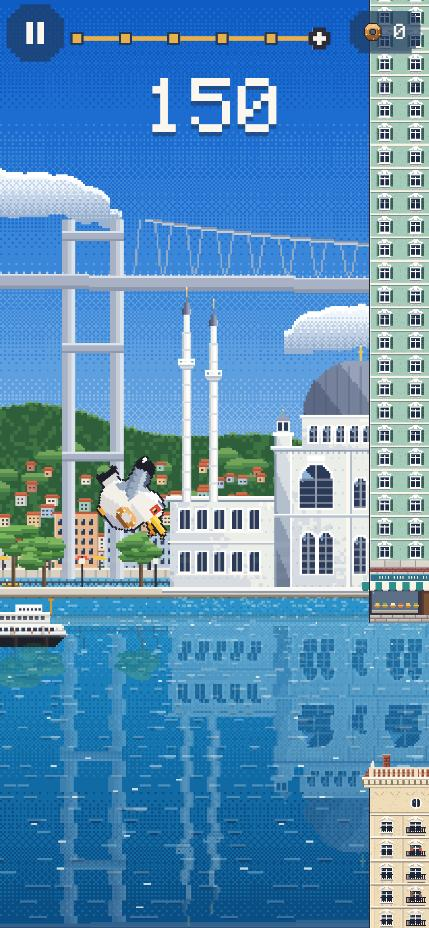 | 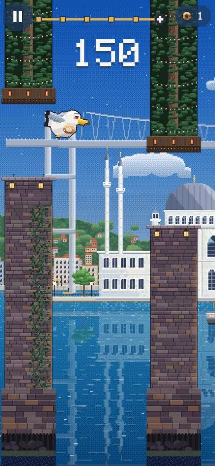 |
| Ortaköy'de oynanış | Rumeli → Ortaköy geçişi (eski engeller kendi kitleriyle kalır) |
| 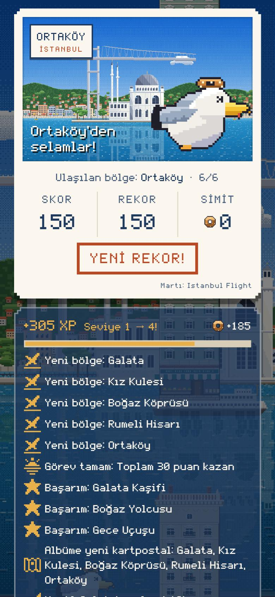 | 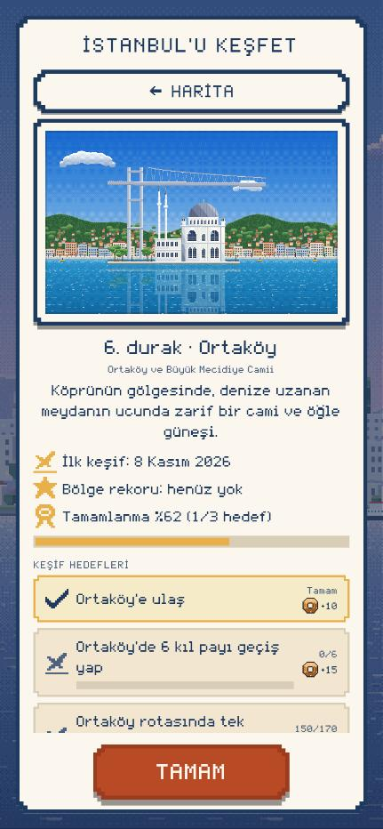 |
| Kartpostal: "Ortaköy · 6/6" | Keşif kartı: 6. durak, hedefler |

Diğerleri:
- [Harita](screenshots/phase2_6/04_harita.png): Ortaköy işareti kaydırılmış, çizgiyle bağlı.
- [Kart bilgileri](screenshots/phase2_6/06_kesif_bilgileri.jpg).
- [Menü](screenshots/phase2_6/07_menu.jpg): "Rekor: Ortaköy · 150".
- [Köprü ve Ortaköy arka planları yan yana](screenshots/phase2_6/08_kopru_ve_ortakoy_arka_plan.png).
- [Ortaköy engelleri](screenshots/phase2_6/09_engeller_ortakoy.png), [yakın](screenshots/phase2_6/10_engel_yakin.png).
- [Simge ×3](screenshots/phase2_6/11_simge_ortakoy_x3.png).

Emirgan, Dolmabahçe, Üsküdar (2.6.2; önizleme aracı, oyundaki yerleşim kurallarıyla tam sahne):

| | | |
|---|---|---|
| 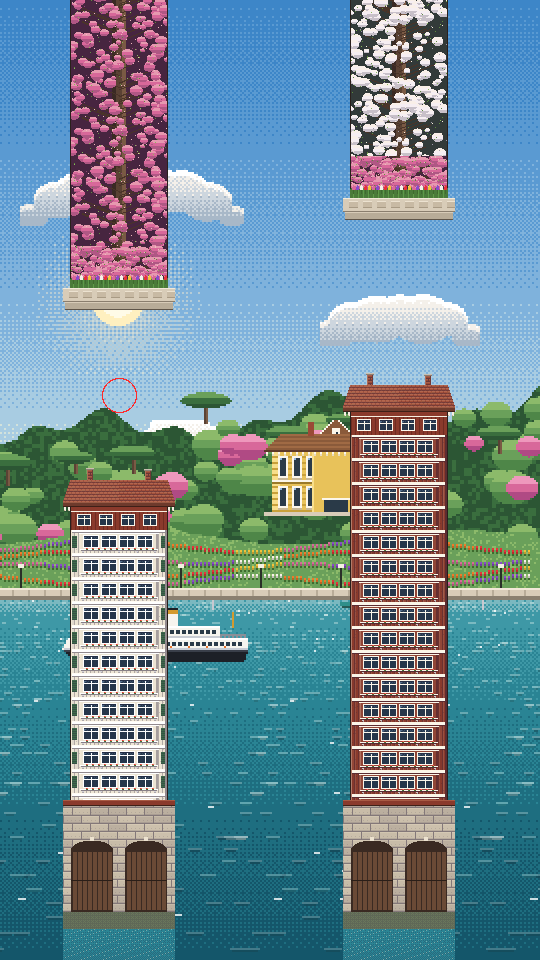 | 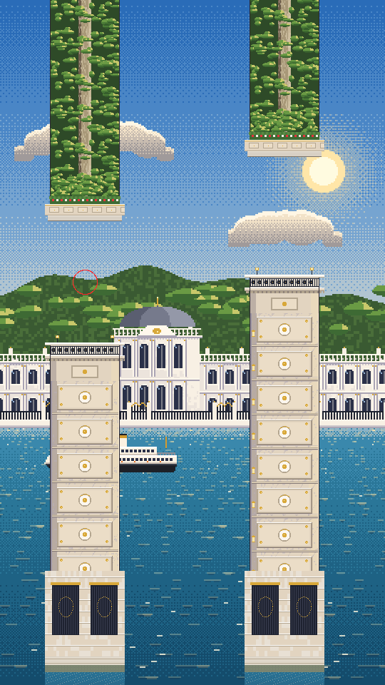 | 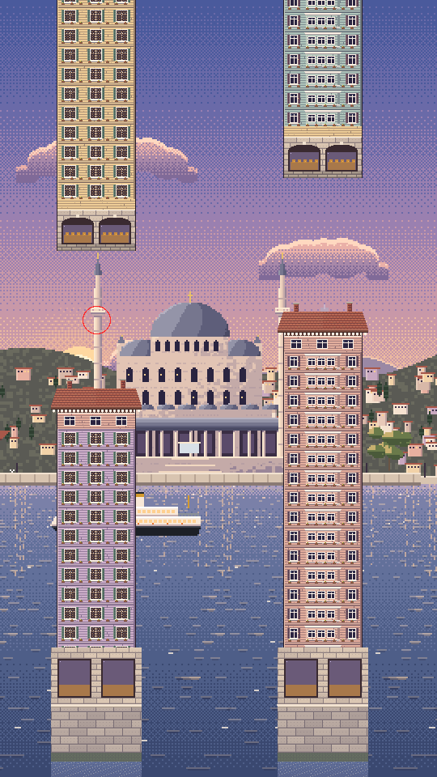 |
| Emirgan: erguvan ve erik ağaçları, yalılar, kayıkhaneler | Dolmabahçe: mermer rıhtım ayakları, çınarlar | Üsküdar: ahşap katlı evler, simitçi |

- [Üç bölgenin arka planı yan yana](screenshots/phase2_6/12_arka_plan_emirgan_dolmabahce_uskudar.png).
- Simgeler ×3: [Emirgan](screenshots/phase2_6/simge_emirgan_x3.png), [Dolmabahçe](screenshots/phase2_6/simge_dolmabahce_x3.png), [Üsküdar](screenshots/phase2_6/simge_uskudar_x3.png).

Dinamik engeller ve hava (2.6.3; oyunun kendisi, gerçek asset'lerle test ortamında çizilen kareler, 1080×1920):

| | | |
|---|---|---|
| 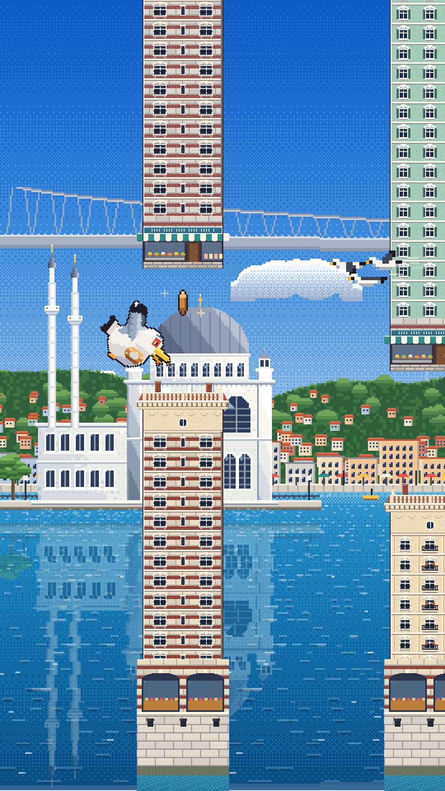 | 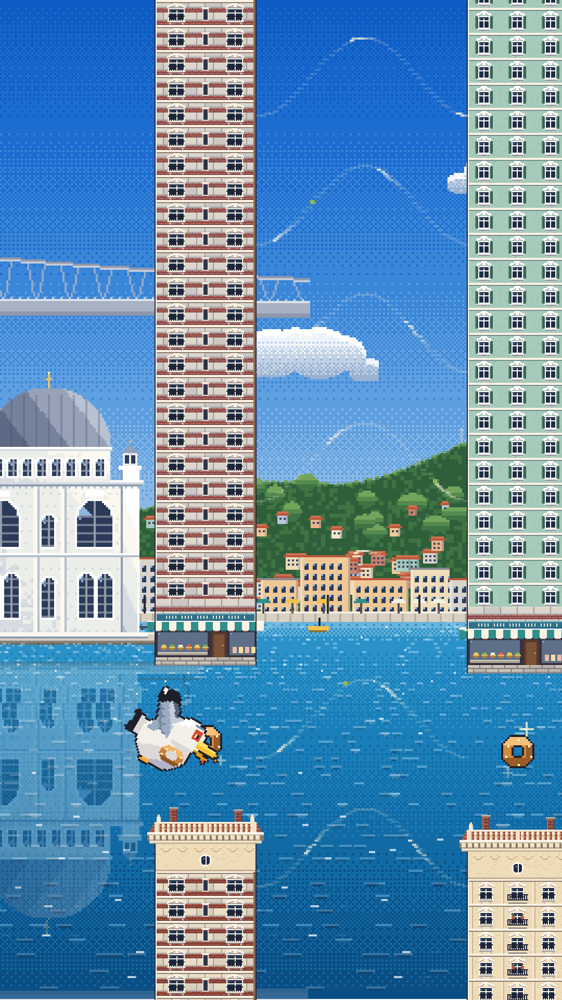 | 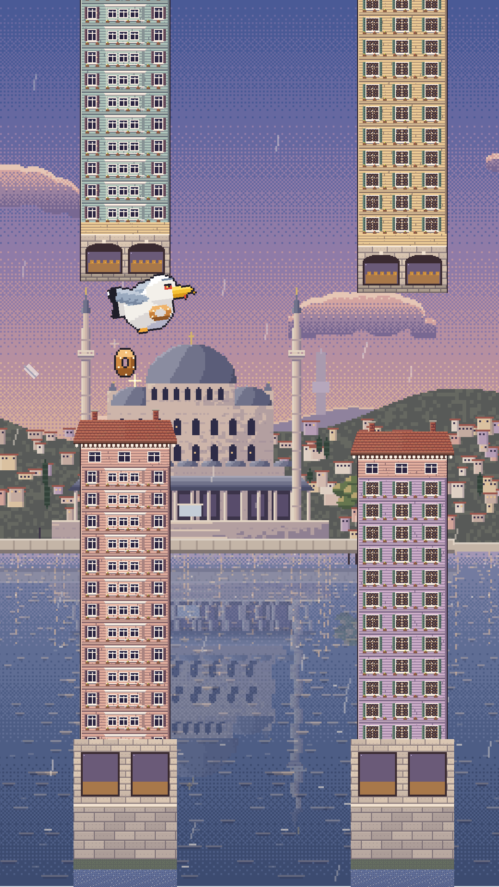 |
| Ortaköy: koyu sırtlı sürü sağdan Simit'e doğru geliyor | Yükselen hava akımı: yukarı kemerlenen rüzgâr şeritleri | Üsküdar, yağmur: damlalar engellerin arkasında |
| 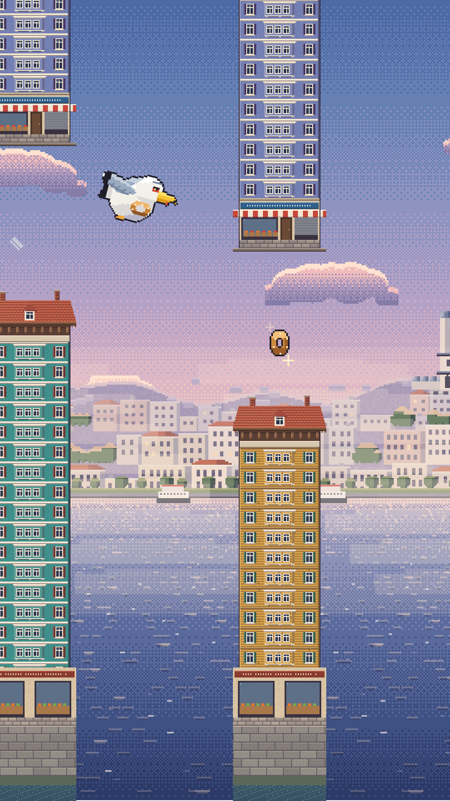 | 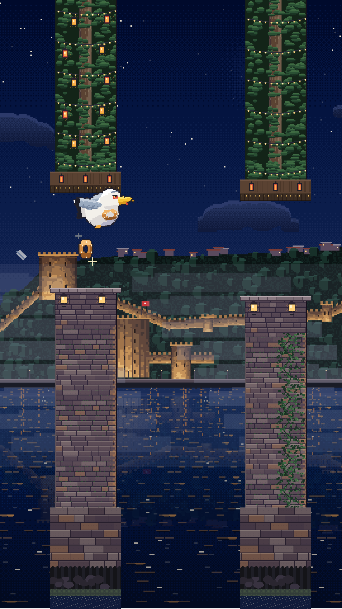 | 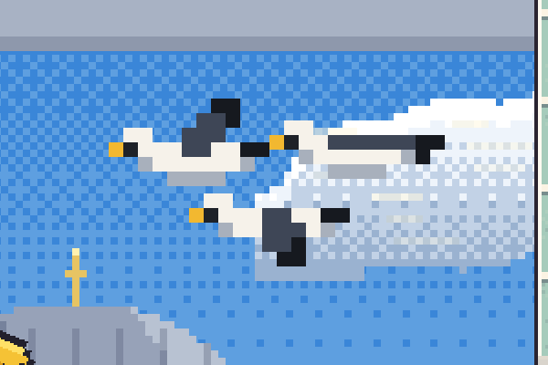 |
| Haliç, şafak sisi | Rumeli, gece sisi | Sürü ×2: yandan, Simit'e dönük, hız çizgileri |

**Eski ve yeni bölge karşılaştırması:**
- **Ölçek:** Piksel ölçeği eski bölgelerle aynı; arka plan 1 px = 4 birim, engel 1 px = 2 birim.
- **Ayrıntı:** Ortaköy simgesi, Süleymaniye ve Rumeli Hisarı simgeleriyle aynı ayrıntı düzeyinde: tonlu taş, pencere kayıtları, kurşun levha dikişleri.
- **Engeller:** Ortaköy kiti docs/18'deki v3 kitleriyle aynı standartta.

## 11. iPhone test planı (2.6.4; hepsi NOT RUN)

**Nasıl yapılır:** Geliştirme Windows'ta; iOS derlemesi Codemagic'te yapılıyor, bu yüzden cihazda profil modu (`flutter run --profile`) kullanılamıyor. Cihaz testi için yeni bir TestFlight derlemesi gerekir (**kullanıcı onayıyla**; yalnızca dahili test grubu). FPS ölçümü için iki seçenek:
- **A:** Ayrı bir dahili derleme, `--dart-define=MARTI_STATS=true` ile (ekranda FPS ve nesne sayısı).
- **B:** Normal derleme ve iOS'un kendi ölçümü (Xcode Instruments yok). Bu durumda yalnızca gözle akıcılık değerlendirilir.

**Cihazlar:** En eski desteklenen iPhone (varsa iPhone SE 2. nesil veya 8), güncel bir iPhone.

**Performans (geçme ölçütü):**

| # | Test | Ölçüt |
|---|---|---|
| P1 | Soğuk açılış: uygulama simgesi → menü | 1.5.0 (8)'e göre en fazla +0,5 sn |
| P2 | Haliç'ten Üsküdar'a tek uçuş (demo değil; yüksek skor ya da çok deneme) | FPS ≥ 58 çoğu zaman; bölge geçişinde gözle görülür takılma yok |
| P3 | Yağmur + sürü + rüzgâr aynı anda (Üsküdar/Galata) | FPS düşüşü ≤ 2; takılma yok |
| P4 | 10 dakika ardışık oyun | Kademeli yavaşlama ya da aşırı ısınma yok; uygulama kapanmıyor (Xcode olmadan bellek ölçülemez) |
| P5 | Düşük Güç Modu açık | Oyun oynanabilir; 30 FPS'e kilitlenmesi kabul edilebilir |

**Oynanış ve görünüm:**
1. Dört yeni bölgeye ulaşma: geçişler yumuşak mı, rota çubuğunda 9 durak var mı?
2. Yeni engeller göğe karşı net mi (özellikle Emirgan'ın pembe erguvanı ve Dolmabahçe'nin mermeri); "çarpmadım ama öldüm" anı var mı?
3. Simgenin su yansıması rahatsız edici mi?
4. Keşif haritasında Ortaköy–Köprü ve Üsküdar–Kız Kulesi işaretleri parmakla ayrı ayrı seçilebiliyor mu?
5. Eski kayıtlı cihazda albüm %55, İznik görünümü ve rozetler duruyor mu?
6. Günün Uçuşu 150'yi geçince Rumeli görünümünde kalıyor mu; hiç sürü/rüzgâr ve hava efekti yok mu?
7. iPhone SE'de menü, kartpostal ve harita taşmıyor mu?
8. Martı sürüsü küçük ekranda da tehlike olarak anlaşılıyor mu? Kanat ucuna sürtünce ölüm "haksız" hissettiriyor mu? (Web'de kullanıcı onayladı: "Martılar güzel olmuş".)
9. Hava akımı şeritleri yeterince erken fark ediliyor mu; itme doğal mı? (Web'de kullanıcı onayladı.)
10. Yağmur ve sis küçük ekranda göz yoruyor mu; engel kenarları her zaman net mi?
11. Yağmur sesi döngüsünde dikiş/tık duyuluyor mu; martı çığlığı sürü başına bir kez mi; sessiz modda ve ses ayarı 0'da hiç çalmıyor mu?

## 12. Bilinen eksikler

- **Oyun içi doğrulama:** 2.6.3'te Ortaköy, Üsküdar, Emirgan, Rumeli, Galata ve Haliç oyunun kendi çiziminde görüldü (test ortamı kareleri; Emirgan ayrıca tarayıcıda). **Dolmabahçe oyun içinde hâlâ görülmedi** (yalnızca önizleme aracında). Tarayıcı paneli arka planda kalınca oyun kendini duraklatıyor.
- **Mekanikler:** Vapur engeli, sallanan nesne ve vapur düdüğü yapılmadı (§6a, §6c).
- **Yeniden tasarım doğrulaması:** Yeni sürü ve hava akımı yerel web denemesinde kullanıcı tarafından onaylandı; küçük ekranda (iPhone) henüz denenmedi (§11/8–9).
- **Adalet ölçümü:** Simülatör alt sınır verir; gerçek oyuncu hissi cihaz testinde doğrulanmalı.
- **Ölçüm:** Performans yalnızca masaüstünde ölçüldü (§8); gerçek cihaz testi yok.
- **Game Center:** Yeni bölgeler için başarım yok; Game Center öğeleri değişmedi.
- **Commit:** 2.6.1–2.6.3 `f9f5703` (push yok). 2.6.4 değişiklikleri henüz commit edilmedi. TestFlight yüklemesi yok.
