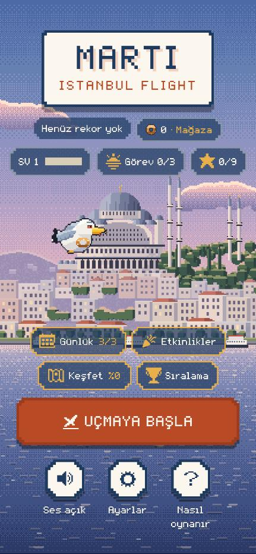
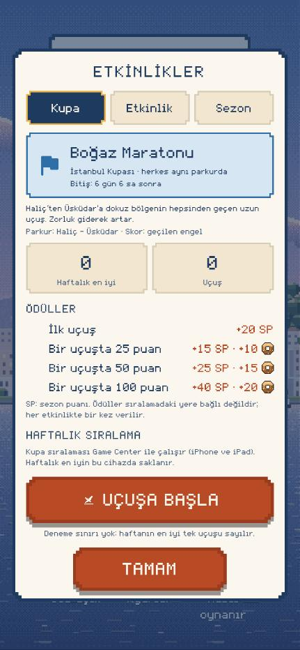
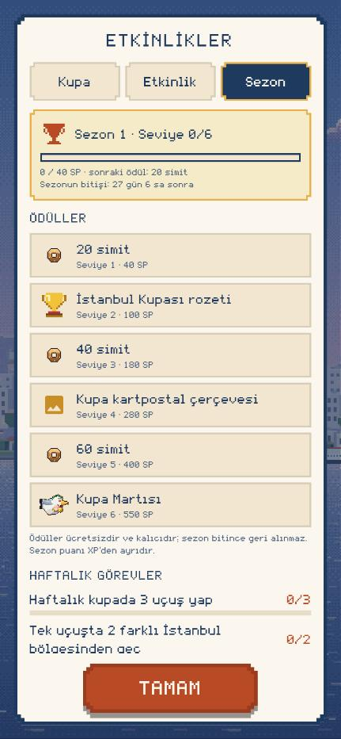
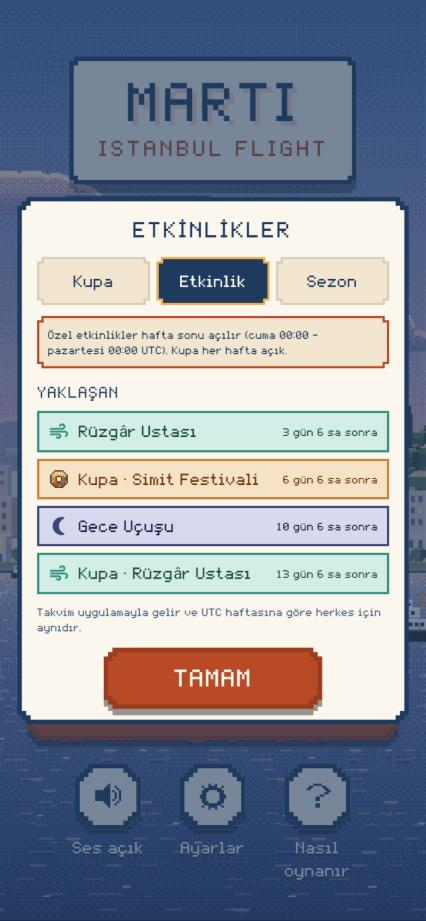
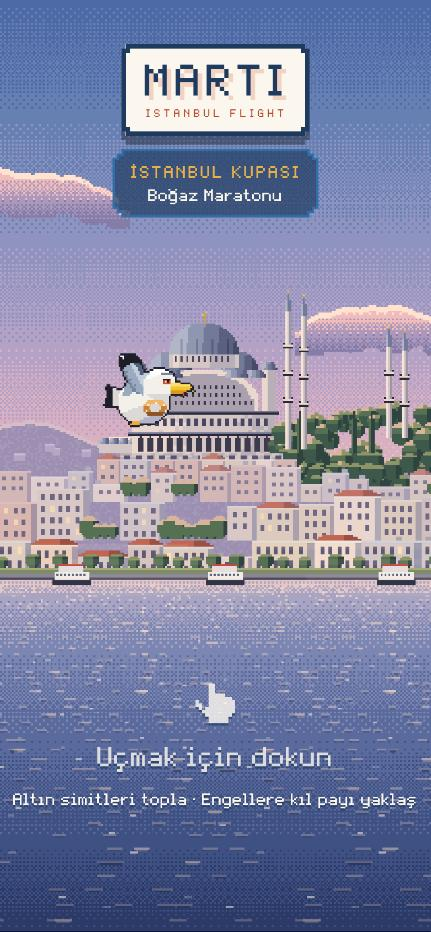
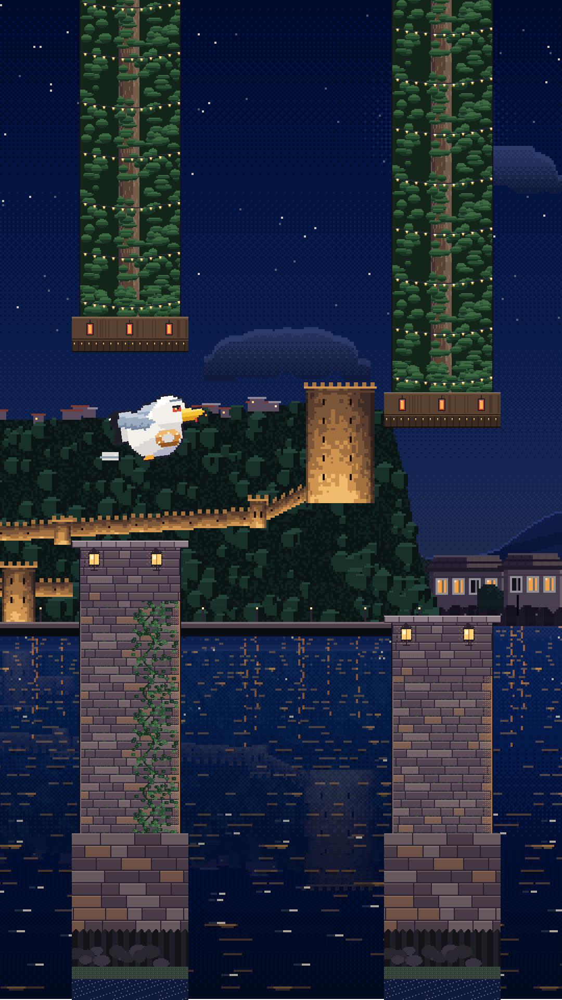
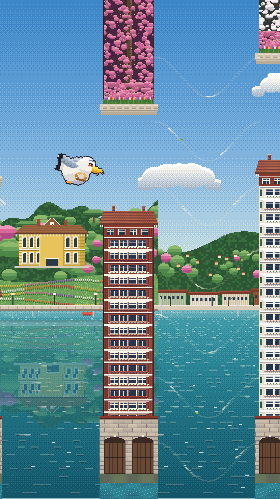
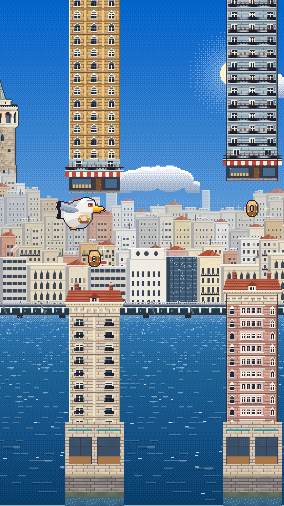

# 20 · Phase 2.7: İstanbul Kupası, haftalık etkinlikler ve sezon

> **Dosya adı:** İstekte `docs/19_phase2_7_weekly_events.md` geçiyordu. 19 numara Phase 2.6 raporunda kullanıldığı için bu rapor 20 numaralı.
>
> **Dal:** `feature/phase2-7-weekly-events`, `feature/phase2-6-expanded-istanbul` üzerine açıldı (1.6.0 (9), commit `2f95459`). Sürüm numarası değiştirilmedi.
>
> **Yapılmayanlar:** TestFlight yüklemesi, App Review gönderimi, App Store Connect'te tablo oluşturma ve yayın **yapılmadı** (izin gerekiyor). Gerçek iPhone testi **yapılmadı** (§13).

## 0. Özet

| Konu | Durum |
|---|---|
| Etkinlik veri modeli (`EventDefinition`) | **Tamam.** Veri odaklı; JSON ile uzaktan yapılandırmaya hazır. Motor etkinlik türüne göre dallanmıyor |
| Haftalık İstanbul Kupası | **Tamam.** Pazartesi 00:00 UTC → pazartesi 00:00 UTC. Herkes aynı parkur, sınırsız deneme, en iyi **tek** uçuş |
| 4 etkinlik türü | **Tamam.** Boğaz Maratonu, Simit Festivali, Gece Uçuşu, Rüzgâr Ustası. Hepsi mevcut motorun değiştiricileri |
| Hafta sonu özel etkinliği | **Tamam.** Cuma 00:00 → pazartesi 00:00 UTC, kupadan farklı tür, yalnızca yerel en iyi skor |
| Game Center haftalık kupa tablosu | **Kod tamam, Apple tarafı YOK.** `istanbul_flight_weekly_cup` App Store Connect'te oluşturulmadı (§6) |
| Sezon (4 hafta), 6 seviye ödülü | **Tamam.** Sezon puanı XP'den ayrı; ödüller ücretsiz ve kalıcı |
| Haftalık görevler | **Tamam.** Günlük görevlerden ayrı kayıt ve ödül defteri |
| Etkinlik Merkezi (Kupa / Etkinlik / Sezon) | **Tamam.** Menüde tek "Etkinlikler" girişi |
| Yeni görseller | Kupa Martısı görünümü (sprite sheet) ve kupa kartpostal çerçevesi: mevcut pixel art üreticisiyle. Etkinlik ikonları mevcut piksel ikon dilinden (§12) |
| Testler | `flutter analyze` temiz; **428 / 428** (66 yeni) |
| Gerçek iPhone | **NOT RUN** (§13) |

## 1. Mevcut mimari ve önceki fazların gerçek durumu

Yeni sistem, mevcut sistemlerin üstüne kuruldu; hiçbiri yeniden yazılmadı.

| Sistem | Kodda | Gerçek durum |
|---|---|---|
| 2.1 XP, seviye, günlük görev, başarım | `progression/` | Tamam, testli |
| 2.2 Simit mağazası, kozmetik sahiplik | `progression/cosmetics.dart` | Tamam, testli |
| 2.3 Keşif albümü | `progression/discovery.dart` | Tamam, testli |
| 2.4 Game Center | `services/game_center/` + Swift `GameCenterPlugin` | Kod tamam. ASC'de 2 tablo + 9 başarım "Prepare for Submission". **Gerçek cihazda hiç denenmedi** |
| 2.5 Günün Uçuşu | `challenge/` | Kod tamam. Günlük tablo ASC'de "Prepare for Submission". Gerçek cihazda denenmedi |
| 2.6 Yeni bölgeler, dinamik engeller, hava | `game/`, `events` değil | Kod tamam, 1.6.0 (9) TestFlight'ta işlendi; hesap sorunu yüzünden telefona **kurulamıyor** (Apple talebi 103007198858) |

Yeniden kullanılanlar:

- **Deterministik parkur:** Günün Uçuşu'nun `DailyCourse` üreticisi (v2: klasik `GapGenerator`, kendi Mulberry32 RNG'si). Etkinlik parkuru bunun üstüne kurulu; ayrı bir üretici yok.
- **Erişilebilirlik simülasyonu:** `CourseValidator` (dinamik engellerle; Phase 2.6.3).
- **Oynanış ve görsel RNG ayrımı:** Parkur `DailyRng(hash('gaps:…'))`, simit `('pickups:…')`, dinamik engel `('hazards:…')`. Görsel rastgelelik (`_ambientRandom`) parkuru etkilemez; etkinlikte hava hep açık.
- **Game Center:** Aynı adaptör, aynı tekrarlayan tablo mantığı (`occurrenceStart` kontrolü Swift'te zaten vardı; native değişiklik yok).
- **İlerleme:** `PlayerProgress` + `ProgressController` (tek yazma, idempotent uçuş hesabı), kozmetik sahiplik sistemi, simit cüzdanı (yeni cüzdan yok).
- **Arayüz:** `ModalCard`, `BoardToggle`, `BoardList`, `pixelBox`, `PixelIcon`, `MartiButton`.

## 2. Etkinlik veri modeli (`lib/events/`)

| Dosya | İçerik |
|---|---|
| `event_definition.dart` | `EventDefinition`, `EventKind`, `EventType`, `ZoneSelection`, `GameplayModifiers`, `ScoringPolicy`, `EventRewardPolicy`, `EventPresets` |
| `event_calendar.dart` | `EventCalendar` (takvim v1), `EventSlot`, `SeasonDefinition`, `SeasonRules`, `EventCourse`, `EventGenerators` |
| `event_state.dart` | Kalıcı kayıt (`EventProgressState`) ve saf, idempotent hesap fonksiyonları |
| `weekly_missions.dart` | Haftalık görevler |
| `event_service.dart` | Açık etkinlikler, saat güvenilirliği, Apple dönemi |

`EventDefinition` alanları (istenen alanların hepsi): `eventId`, `kind` (eventType), `type`, `title`, `description`, `startAtUtc`, `endAtUtc`, `seed`, `generatorVersion`, `zoneSelection`, `modifiers` (gameplayModifiers), `scoring` (scoringPolicy), `rewards` (rewardPolicy), `leaderboardId`, `enabled`; ayrıca tanılama için `candidate` ve `validatedDepth`.

**Motorda dallanma yok.** Oyun yalnızca tanımı uygular:

- `zoneSelection` → `DayCycle.route` (hangi skorda hangi bölge; ör. Gece Uçuşu yalnızca Rumeli Hisarı);
- `modifiers` → parkurun geçit kayması ve simit sıklığı + `HazardPlanner` profili;
- `scoring` → canlı ve kayıtlı etkinlik skoru.

Yeni bir etkinlik türü = `EventType`'a bir değer + `EventPresets`'te bir satır.

**Uzaktan yapılandırma:** `toJson` / `fromJson` var ve bozuk tanımı reddediyor. Ödül miktarları uzaktan değiştirilemez; türden gelir. **Şu anda uzaktan etkinlik yayımlanamaz:** sunucu yok, takvim uygulamayla geliyor (§10).

## 3. Haftalık İstanbul Kupası

- **Süre:** Pazartesi 00:00 UTC'de başlar, sonraki pazartesi 00:00 UTC'de biter (yerel saat diliminden bağımsız; test).
- **Kimlik:** ISO hafta (`cup_2026_w46`). Yıl sınırı doğru (2026'nın 53. haftası, 2027-W01; test).
- **Parkur:** Haftanın türüne göre değişir; aynı haftada herkes aynı tohum, aynı üretici sürümü, aynı kurallar.
- **Deneme:** Sınırsız. Günlük üç hak kuralı uygulanmadı.
- **Skor:** Haftanın **en iyi tek uçuşu**. Toplam deneme puanı yok: çok oynayan, yalnızca en iyisini geliştirebilir.
- **Tür dönüşü (takvim v1):** Maraton → Festival → Rüzgâr → Gece (4 haftada her tür bir kez kupa olur).

## 4. Etkinlik türleri

Hepsi mevcut motorun kontrollü değiştiricileri. Fizik, hız ve çarpışma her zaman klasik modla aynı.

| Tür | Bölgeler | Değiştiriciler | Skor |
|---|---|---|---|
| **Boğaz Maratonu** | Haliç → Üsküdar, 9 bölge, klasik eşiklerle | Klasik geçit eğrisi (giderek zorlaşır). Dinamik engeller klasik kuralla, 120'den sonra (değerler donduruldu) | Geçilen engel |
| **Simit Festivali** | Galata → Kız Kulesi → Dolmabahçe → Ortaköy | Simit olasılığı ×2,2 (~her geçit). İlk geçitler biraz geniş (eğri −10) | Engel + 2 × simit |
| **Gece Uçuşu** | Yalnızca Rumeli Hisarı (gece) | Klasik eğri, dinamik engel yok, hava hep açık | Geçilen engel |
| **Rüzgâr Ustası** | Emirgan → Ortaköy → Boğaz Köprüsü | Yalnızca hava akımı (sürü yok). 3. koridordan itibaren %40, iki akım arasında en az 1 boş koridor. Geçitler biraz geniş (eğri −6) | Geçilen engel |

- **Gece Uçuşu görünümü:** Var olan gece sanatı kullanılıyor: ışıklı hisar surları, fenerler, ay ışığında su. Engeller her zaman net, sis yok. Yeni gece varyantı **çizilmedi** (diğer bölgelerin gece hâli yok; §12).
- **Rüzgâr işaretleri:** Phase 2.6.3'ün kavisli şeritleri: itiş önceden görünür, koridor ortasında en güçlü, kenarlarda sıfır.
- **Simit Festivali skoru:** Açık ve tutarlı kural. Game Center'a gönderilmeden önce "simit ≤ geçilen engel" kontrolü yapılır (imkânsız uçuş reddedilir).

## 5. Deterministik ve adil rekabet

- **Aynı etkinlikte aynı her şey:** Tohum, üretici sürümü, zorluk profili, engel sırası, simit yerleşimi ve dinamik engeller. Hepsi yalnızca tohuma ve engel sırasına bağlı; kare hızına, ekran genişliğine ve oyuncunun skoruna bağlı değil.
  - Test: 30/60/120 FPS ve 1080/1440 genişlikte aynı 30 engel ve aynı hava akımları.
  - Test: JSON gidiş-dönüşte aynı parkur.
- **Kuşun konumu sabit:** Etkinlikte kuşun yatay konumu Günün Uçuşu'ndaki gibi her ekranda aynı (`DailyCourse.birdX`).
- **Değişmez kurallar:** Etkinlik kuralları `EventPresets`'te sabit. `EventGenerators.schedule` sürüm takvimi var: oynanış değişirse yeni sürüm yalnızca yayından sonraki bir haftadan başlar. Bilinmeyen sürüm oynanmaz (eski uygulama yeni etkinliği yanlış oynamasın; test).
- **Günün Uçuşu değişmedi:** Sürüm takvimi aynı (test).
- **Doğrulama:** Her etkinlik dinamik engelleriyle birlikte 100 engel derinliğe kadar doğrulanır (aday tohumlar; Günün Uçuşu ölçütü).
  - Ölçüm: 8 haftanın 16 etkinliği 150 engel boyunca geçilebilir. Engel başına iki karar aralığının büyüğüyle en dar bant ≥ 120 (test eşiği 90).
  - Hepsi ilk adayda geçti. Masaüstünde etkinlik başına ~0,15 sn; açılışta arka planda hazırlanıyor.
- **Phase 2.6 dengesi korunuyor:** Minimum geçit ve kayma kuralları değişmedi.

## 6. Game Center yapılandırması

**Tablo:** `istanbul_flight_weekly_cup` (`GcBoard.weeklyCup`, tekrarlayan).

**Neden tek tablo yeterli:**
- Tekrarlayan tablonun her dönemi tek bir haftadır ve o haftanın bütün uçuşları aynı kuralla puanlanır.
- Simit Festivali haftasında herkes festival puanıyla yarışır. Farklı kurallı haftalar aynı dönemde karşılaşmaz.
- Özel etkinliklerin tablosu yok, yalnızca yerel en iyi skor tutulur. Böylece aynı dönemde farklı kural karışmaz.
- Apple'ın kalıcı "tüm zamanlar" görünümü bu tabloda yok (yalnızca dönemler).

**Gönderim kuralları** (`GameCenterController._queueEvent` / `_flushEvents`):
- Yalnızca dereceli kupa uçuşları gönderilir. Antrenman ve özel etkinlik gönderilmez; klasik tablolara gitmez (test).
- Skor, etkinliğin kendi haftasının Apple dönemine gönderilir (`occurrenceStart` = pazartesi 00:00 UTC). Apple'ın açık dönemi başka haftaysa düşer (test).
- Bağlantı yoksa kalıcı kuyrukta (`game_center_v1`, `eventPending`) bekler. Hafta bittikten 1 gün sonra düşer; yeni haftaya taşınmaz (test).
- Apple'ın kupa dönemi haftalık saat denetimine girer. Cihaz haftası farklıysa dereceli oyun kapanır (test).
- **Sahte sıralama yok:** Game Center bağlı değilse yalnızca durum metni gösterilir.
- **Hile koruması:** Sunucu doğrulaması olmadığı için kesin hile koruması **iddia edilmez** (§14).

**App Store Connect'te yapılması gereken** (yapılmadı; izin gerekiyor):

| Alan | Değer |
|---|---|
| Tür | Recurring leaderboard |
| Leaderboard ID | `istanbul_flight_weekly_cup` |
| Reference name | İstanbul Kupası |
| Biçim / sıralama | Integer, büyük olan iyi, en iyi skor tutulur |
| Başlangıç | **Pazartesi 00:00 UTC** (ör. 2026-11-16T00:00:00Z). Mevcut "Haftalık" tablo İstanbul saatine göre kurulu; bu tablo UTC olmalı, yoksa dönem eşleşmez ve gönderimler düşer |
| Süre / tekrar | 7 gün / 7 gün |
| Skor aralığı | 0 – 9999 |
| Yerelleştirme | TR "İstanbul Kupası" · "X puan"; EN "Istanbul Cup" · "X points" |

- **Apple incelemesi:** Yeni tablolar bir uygulama sürümüyle birlikte incelemeye girer. TestFlight'ta sandbox ortamında çalışır.
- **Doğrulanamadı:** App Store Connect oturumu kapalı olduğu için kimliğin Apple tarafında henüz olmadığı bu turda yeniden doğrulanamadı.

## 7. Sezon ilerlemesi

- **Süre:** Sezon 4 hafta. İlk sezon takvimin ilk haftasıyla (2026-11-09) başlar. Kimlik `season_1`, `season_2`, …
- **Kayıt** (`SeasonProgress`): sezon puanı, ödülü verilmiş seviyeler, tamamlanan etkinlikler. Sezon kimliği, başlangıç ve bitiş takvimden gelir.
- **XP'den ayrı:** Sezon puanı (SP) XP'ye karışmaz; XP kalıcı seviyeyi gösterir (test).
- **SP kaynakları:**
  - **Etkinlik:** İlk dereceli uçuş ve 3 skor eşiği; her biri etkinlik başına bir kez.
  - **Haftalık görevler:** Görev başına 20 SP.
- **Hangi sezona yazılır:**
  - Etkinlik SP'si, etkinliğin başladığı sezona yazılır.
  - Görev SP'si, o anki sezona yazılır.

## 8. Ödül dengesi

| Seviye | SP | Ödül | Daha önceki bir sezonda alındıysa |
|---|---|---|---|
| 1 | 40 | 20 simit | – |
| 2 | 100 | İstanbul Kupası rozeti (sezona özel) | – (her sezonun kendi rozeti) |
| 3 | 180 | 40 simit | – |
| 4 | 280 | Kupa kartpostal çerçevesi | Yerine 40 simit |
| 5 | 400 | 60 simit | – |
| 6 | 550 | Kupa Martısı (görünüm) | Yerine 80 simit |

**Etkinlik ödülleri** (etkinlik başına bir kez; sıralamadaki yere bağlı değil):

| | Katılım | Eşik 1 | Eşik 2 | Eşik 3 | Haftalık en fazla |
|---|---|---|---|---|---|
| Kupa | 20 SP | 25 puan: 15 SP + 10 simit | 50: 25 SP + 15 | 100: 40 SP + 20 | 100 SP · 45 simit |
| Özel | 15 SP | 20: 10 SP + 5 | 40: 20 SP + 10 | 80: 30 SP + 15 | 75 SP · 30 simit |

- **Festival eşikleri:** Simit Festivali'nde eşikler ×2,5 (festival puanı engelin ~2,5 katı).
- **Haftalık görevler:** 4 görev × (20 SP + 10 simit) = 80 SP + 40 simit.

**Denge:**
- Tam oynayan bir hafta ~255 SP; 6. seviye ~2,2 haftada.
- Hafif oynayan (kupaya katılım + bir eşik + iki görev) haftada ~75 SP → sezonda ~300 (4. seviye).
- Etkinlikler haftada en fazla ~115 simit ekler (Günün Uçuşu tek başına günde 45'e kadar veriyor). Sezon simidi 120. Mağaza fiyatları 50–350: kısa yol açmıyor.

**Simit Festivali cüzdan sınırı:** Uçuşta toplanan simitlerden cüzdana geçen kısım etkinlik başına sınırlı: kupada 100, özel etkinlikte 60 (sayaç `creditedSimits`). Simit görevleri de bu sınırlı sayıyı görür.

**Bilinçli olarak yapılmayanlar:** Ücretli sezon bileti, gerçek para, reklam, sıralamaya göre otomatik ödül (sunucu doğrulaması yok).

## 9. Haftalık görevler

- **Görev havuzu:**
  - haftalık kupada N uçuş (3/5/8),
  - tek uçuşta N puan (40/70/100),
  - etkinliklerde N simit (15/30/45),
  - tek uçuşta N farklı bölge (2/3/4),
  - haftalık en iyiyi N kez geliştir (1/2/3).
- **Seçim:** Haftada 4 görev; hafta anahtarından deterministik (her cihazda aynı). Hedef oyuncu seviyesine göre.
- **Ayrı kayıt:** Günlük görevlerden ayrı (`events.weekly`) ve ayrı ödül defteri (`week:<ISO hafta>:<görev>`). Aynı uçuş sonu olayından beslenir.
- **Sayılmayanlar:** Antrenman uçuşları görev ilerletmez. Saat geri alınmışsa görev ilerlemez.
- **Hafta değişince:** Yeni görevler gelir; eski haftanın ödülü yeni haftada verilmez (test).

## 10. Etkinlik takvimi (sunucusuz)

- Takvim **uygulamayla gelir ve sürümlüdür** (`EventCalendar.version = 1`).
- Hangi hafta hangi etkinlik olduğu yalnızca UTC tarihten hesaplanır:
  - takvim başlangıcı 2026-11-09;
  - kupa türü = dönüş listesinde hafta sırası;
  - özel etkinlik = iki adım ilerideki tür.
- **Ekranda:** aktif kupa, aktif özel etkinlik, yaklaşan etkinlikler (geri sayımla), bitiş zamanı, ödüller, katılım (en iyi skor, uçuş sayısı), tamamlanan etkinlikler.
- **Uzaktan yönetim yok:** Uzaktan yeni etkinlik yayımlanamaz. Veri modeli (`EventDefinition` JSON) ileride uzaktan yapılandırma eklenirse aynen taşınabilir. Bunun için imza doğrulaması ve takvim kayması kuralı ayrıca tasarlanmalı.

## 11. Arayüz

- **Ana menü:** Tek giriş noktası, "Günlük" ile aynı satırda **"Etkinlikler"**. Menü yüksekliği değişmedi.
  - İkon "Sıralama"nın kupasından ayrı.
  - Sezon seviyesi ilk ödülden sonra "n/6" olarak görünür.
- **Etkinlik Merkezi**, üç sekme:
  - **Kupa:** tür, süre, parkur, en iyi skor, uçuş sayısı, ödüller, dünya/arkadaş sıralaması ve kendi derecen (Game Center), "Uçuşa başla".
  - **Etkinlik:** hafta sonu etkinliği, yaklaşan ve tamamlanan etkinlikler; tür başına ayrı renk paleti.
  - **Sezon:** seviye çubuğu, 6 ödül kartı, kalan süre, haftalık görevler, kupa çerçevesi anahtarı.
- **Uçuş öncesi ve sonrası:**
  - "Uçmak için dokun" ekranında etkinlik şeridi.
  - Oyun sonunda etkinlik paneli: puan, en iyi, alınan ödüller, sezon puanı, görevler, sezon seviyeleri, kupa sırası.
  - Kartpostalda "PUAN / EN İYİ" ve "HAFTANIN REKORU!".
- **Pop-up yok:** Yeni pop-up eklenmedi. Ödüller oyun sonu panelinde ve sezon ekranında gösteriliyor.
- **Küçük ekran:** Safe Area ve 320×568 / 375×667 / 390×844 / 430×932'de taşma yok (test). Düğmelerde semantik etiketler var.

| | | |
|---|---|---|
|  |  |  |
| Menü: "Etkinlikler" girişi | Kupa sekmesi | Sezon sekmesi |
|  |  |  |
| Etkinlik sekmesi (tür renkleri) | Kupa şeridi | Gece Uçuşu (Rumeli, oyunun kendi çizimi) |
|  |  | |
| Rüzgâr Ustası: hava akımı şeritleri | Simit Festivali: her geçitte simit | |

- **Ekran görüntüleri:** 01–05 web derlemesinden (390×844), 06–08 oyunun gerçek görsellerle test ortamında çizilen kareleri.
- **Doğrulanamayan akış:** Uçuş ve oyun sonu paneli tarayıcı panelinde görülemedi (panel arka plana geçince oyun duraklıyor). Bu akış widget testleriyle doğrulandı.

## 12. Görsel kalite ve eksikler

**Yeni (mevcut pixel art üreticisiyle, aynı ölçek ve konturla):**
- **Kupa Martısı** (`art/_source/pixel/characters.js` → `skins/kupa.png`): başta defne tacı, göğüste kırmızı-beyaz kurdeleli altın madalya. 12 kare, mevcut animasyonla aynı.
- **Kupa kartpostal çerçevesi:** altın kenar ve köşede piksel kupa rozeti (kod çizimi, 12×12 piksel). Sezon ekranından açılıp kapatılıyor.
- **İstanbul Kupası rozeti:** aynı piksel kupa.

**Yeniden kullanılan:** Etkinlik ikonları (bayrak, ay, rüzgâr, simit; mevcut `PixelIcon` dili), bölge sanatı, gece sanatı.

**Eksik (açıkça):**
- Etkinliğe özel yeni sahne ya da afiş görseli **çizilmedi**.
- Gece Uçuşu yalnızca mevcut gece bölgesini (Rumeli Hisarı) kullanıyor; diğer bölgelerin gece hâli yok.
- Ödül kartlarındaki görseller oyun içi sprite ve ikonlar; ayrı tasarlanmış kart illüstrasyonu yok.

## 13. Kalıcı kayıt ve migration

**Biçim:**
- `PlayerProgress` sürüm 5: yeni alan `events` (aynı anahtar `progress_v2`, tek yazma).
- Yedek anahtar `events_backup_v1`: Alanı tanımayan eski bir sürüm (1.6.0) ana kaydı yazarsa sezon puanı, ödül defteri, rozet ve çerçeveler geri gelir; ödüller ikinci kez verilmez (test).
- v4 kaydı aynen okunur, etkinlikler boş başlar (test).

**Korunanlar** (testler):
- rekor (`best_score_v1`, ayrı),
- XP ve seviye, simit bakiyesi, kozmetikler ve seçili görünüm,
- başarımlar, günlük görevler, keşif albümü, Günün Uçuşu geçmişi,
- Game Center kuyruğu (v3; eski alanlar aynen).

**İdempotent:**
- Aynı `runId` ikinci kez işlenmez: genel uçuş defteri + etkinliğin kendi defteri.
- Her ödülün kalıcı anahtarı var: etkinlik `claimed`, `week:…`, `season_n:level_k`.

**Cihaz saati:**
- **Geri almak:** Dereceli oynanan en ileri hafta tutulur (`highWaterWeek`). Saat geri alınırsa dereceli oyun kapanır; uçuşlar ödül, görev ve sıralamaya sayılmaz (test).
- **İleri almak:** Gelecek haftanın etkinliği oynanabilir ve ödülü alınabilir. Ama ödül anahtarları etkinlik ve sezon kimliğine bağlı olduğu için **iki kez** alınamaz (test).
- **Game Center bağlıyken** Apple'ın kupa dönemi cihaz haftasından farklıysa dereceli oyun kapanır.
- **Sınır:** Çevrimdışı bir istemcide güvenilir zaman ve ödül güvenliği **kesin olarak sağlanamaz**.

**Sıralamaya dayalı ödül yok:** Küresel sıradaki yere göre otomatik ödül kapsam dışı; güvenilir sunucu doğrulaması gerekir.

## 14. Test sonuçları

| Komut | Sonuç |
|---|---|
| `flutter analyze` | No issues found |
| `flutter test` | **428 / 428** |

**Yeni testler (66):**

| Dosya | Test | Kapsam |
|---|---|---|
| `event_calendar_test.dart` | 16 | Haftalık etkinlik oluşturma, UTC hafta geçişi (yerel saatten bağımsız), başlangıç ve bitiş, kimlik ↔ slot ve yıl sınırı, tür dönüşü, sezon tanımı, veri modeli JSON'u, aynı tohum → aynı parkur, farklı hafta farklı parkur, üretici sürümü, Günün Uçuşu takvimi değişmedi, Festival simit sıklığı, Rüzgâr Ustası kuralları, 16 etkinlikte adalet |
| `event_state_test.dart` | 26 | Etkinliğin bölge atlamayı keşif ödülüne çevirmemesi, en iyi tek uçuş, sınırsız deneme, tek seferlik ödüller, çift hesap engeli, antrenman, etkinlik sonu toleransı, özel etkinlik, Festival skoru ve cüzdan sınırı, sezon puanı ve XP ayrımı, seviye ödülleri, kozmetiğin kalıcılığı, sonraki sezonda tekrar ödül yok, çerçeve seçimi, haftalık görev determinizmi ve günlükten ayrımı, hafta değişimi, saat geri/ileri, Apple haftası uyuşmazlığı, v4 → v5, yedekten geri yükleme, bozuk alan, kayıt sınırı |
| `event_game_test.dart` | 15 | Gece Uçuşu bölgesi, 30/60/120 FPS ve iki ekran genişliğinde aynı parkur ve aynı hava akımları, etkinlikte hava açık ve sürü yok, RunResult ve kayıt, saat geri alınınca antrenman, klasik ve Günün Uçuşu regresyonu, 2. sezon. Game Center: kupa tablosuna kendi dönemiyle gönderim, Festival skoru, yanlış döneme gönderim engeli, özel etkinlik / antrenman / imkânsız festival skoru, çevrimdışı kuyruk, süresi geçen skor, Apple dönemi → saat denetimi |
| `event_ui_test.dart` | 9 | 4 ekran boyutunda menü ve üç sekme taşmadan, takvim öncesi, Game Center yok ya da bağlı, uçuş başlat → şerit → oyun sonu paneli → "Tekrar uç", kupa çerçevesi kartpostalda |

**Mevcut testler:**
- Klasik mod, Günün Uçuşu, Game Center, keşif, kozmetik, Phase 2.6 testlerinin hepsi geçiyor.
- İki testte yalnızca kayıt sürümü beklentisi güncellendi: ilerleme v4 → v5, Game Center kuyruğu v2 → v3.

## 15. Gerçek iPhone test planı (hepsi NOT RUN)

**Ön koşullar:**
- `istanbul_flight_weekly_cup` App Store Connect'te kurulmuş olmalı (§6).
- Yeni bir TestFlight derlemesi (izinle).
- TestFlight kurulum sorunu çözülmüş olmalı (Apple talebi 103007198858).

| # | Test | Beklenen |
|---|---|---|
| 1 | Menü → Etkinlikler (SE ve büyük ekran) | Taşma yok; üç sekme; sayaçlar akıyor |
| 2 | Kupa uçuşu | Şerit doğru; oyun sonunda puan, en iyi, ödüller, sezon puanı |
| 3 | Aynı hafta iki cihaz | İlk 10 engel ve simitler aynı |
| 4 | Game Center bağlı kupa skoru | Kupa tablosunda görünür; dünya ve arkadaş listesi, kendi derecen |
| 5 | Uçak modunda kupa uçuşu, sonra bağlantı | Skor sonra gönderilir |
| 6 | Saat elle bir hafta ileri, sonra geri | Geri alınca dereceli kapanır; ödül tekrar gelmez |
| 7 | Gece Uçuşu ve Rüzgâr Ustası | Engeller net; hava akımı önceden fark ediliyor, adil |
| 8 | Simit Festivali | Simit sınırı mesajı; puan formülü anlaşılır |
| 9 | Sezon 4. ve 6. seviye | Çerçeve anahtarı ve Kupa Martısı mağaza / görünüm ekranında |
| 10 | 1.6.0 kaydının üstüne güncelleme | Rekor, simit, kozmetik, albüm, günlük kayıt yerinde |
| 11 | 10 dakika etkinlik oynama | Akıcılık 1.6.0 ile aynı (yeni çizim maliyeti yok, aynı katmanlar) |

## 16. Bilinen sınırlamalar

1. **Kupa tablosu Apple'da yok:**
   - Kurulana kadar Game Center `not_configured` döner; skor yalnızca cihazda kalır, oyun etkilenmez.
   - Mevcut "Haftalık" tablo İstanbul saatine göre kurulu; kupa tablosu UTC kurulmalı.
2. **Sunucu doğrulaması yok:** Değiştirilmiş bir istemci sahte skor gönderebilir. Yalnızca tutarlılık kontrolleri var: süre, skor = engel, festival simidi ≤ engel. Apple'ın skor aralığı sınırı ve App Store Connect'ten skor silme ek önlem olarak kalıyor.
3. **Zaman:** Çevrimdışıyken saati ileri almak tespit edilemez. Kazanç, gelecek haftanın etkinliğini erken oynamakla sınırlı; ödül iki kez alınamaz.
4. **Takvim:** Uzaktan değiştirilemez; yeni etkinlik türü uygulama güncellemesi gerektirir.
5. **Görseller:** Etkinliğe özel afiş ve sahne yok; Gece Uçuşu tek bölge (§12).
6. **Keşif ve bölge görevleri:** Etkinlik bölge dizisi rotanın ortasından başlayabilir (Gece Uçuşu: Rumeli Hisarı). Keşif albümü ve günlük "bölgeye ulaş" görevi için etkinlik uçuşu **klasik rotadaki karşılığıyla** sayılır: bölge, skor o bölgenin eşiğine ulaşınca keşfedilir. Bu, 0 puanlık bir Gece Uçuşu'nun Haliç–Rumeli arasındaki bütün bölgeleri ve ödüllerini açmasını engeller (bu turda bulunup düzeltildi; test). Keşfedilmiş bir bölgenin hedefleri etkinlik uçuşunda da ilerler.
7. **Doğrulama:** Gerçek cihaz testi yok; Game Center akışı yalnızca sahte GameKit ile test edildi.

## 17. Sonraki faz önerileri

1. **App Store Connect:** `istanbul_flight_weekly_cup` tablosunu UTC pazartesi başlangıçlı kur; mevcut haftalık tablonun başlangıcını gözden geçir.
2. **Sunucu:** Hafif bir sunucu (ör. CloudKit / Firebase) ile skor doğrulaması ve uzaktan takvim. Ancak bundan sonra sıralamaya göre ödül.
3. **Görsel:** Etkinliklere özel afiş (pixel art), diğer bölgelerin gece varyantı.
4. **Etkinlik türleri:** Vapur engelli "Vapur Rotası", yalnızca kıl payı puanlı "Kıl Payı Ustası".
5. **Sezon:** 2. sezondan itibaren yeni kozmetik ödüller; sezon geçmişi ekranı.
6. **Game Center:** Kupa ve sezon başarımları (örn. "İlk kupa", "Sezon 6. seviye").
