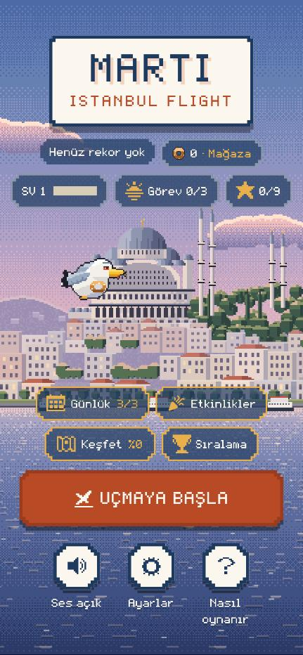
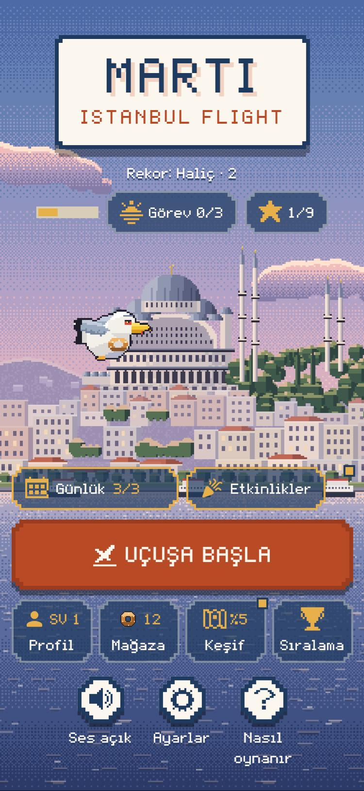
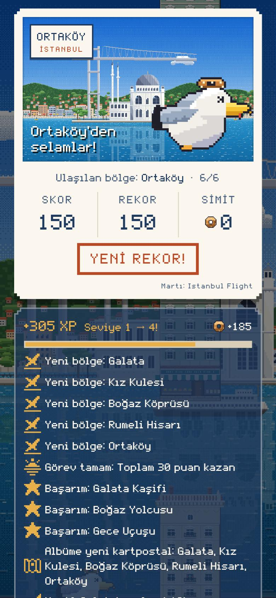
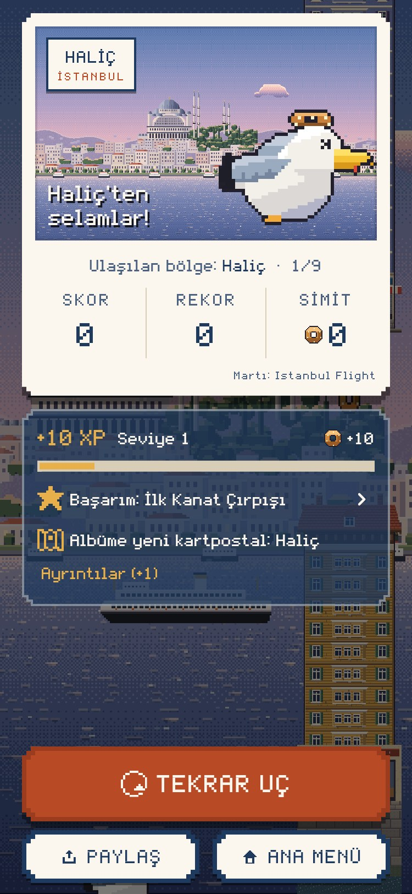
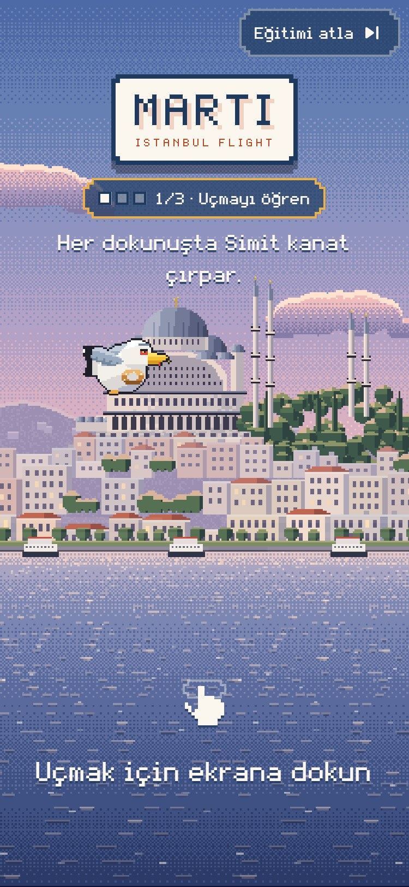
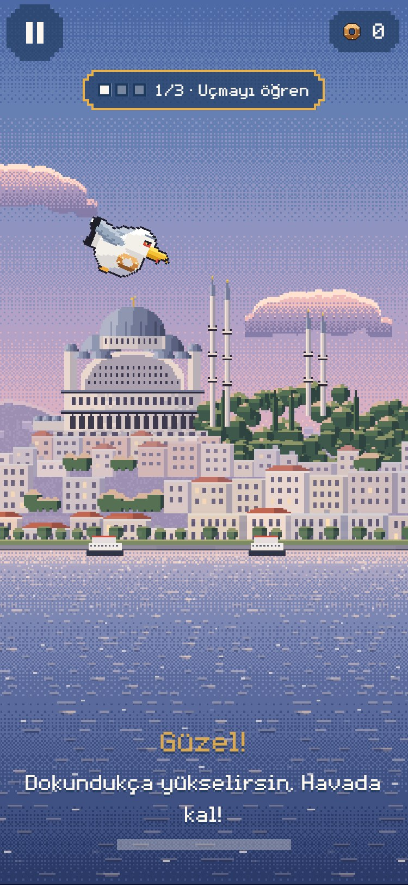
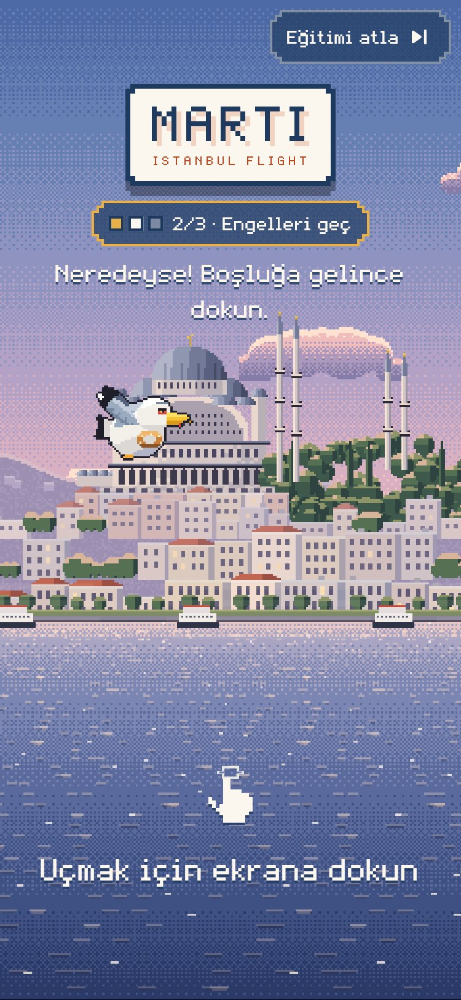
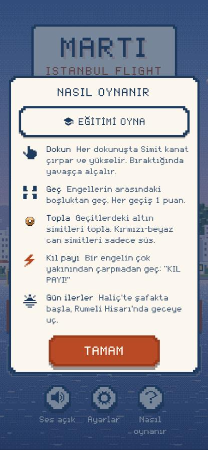

# 21 · Phase 2.8: Oyuncu deneyimi, ilk uçuş eğitimi ve arayüz cilası

> **Dosya adı:** İstekte `docs/20_phase2_8_player_experience.md` geçiyordu; 20 numara Phase 2.7'de kullanıldığı için 21.
> **Dal:** `feature/phase2-8-player-experience`, `main` (`42e774a`, Phase 2.7 dahil) üzerine; `main`e PR #2 ve #3 ile birleşti. **Sürüm: 1.7.0+10** (Phase 2.7 + 2.8; App Store'daki son kayıt 1.2.0, TestFlight'taki önceki derleme 1.6.0 (9)). TestFlight notları: [testflight/beta_1_7_0.md](testflight/beta_1_7_0.md).
> TestFlight: 1.7.0 yüklemesi kullanıcı onayıyla başlatıldı (10 Kasım 2026). App Review ve yayın **yapılmadı**. Gerçek iPhone testi **yapılmadı** (§10).

## 1. Denetim ve önceki UX

- **Dallar:** Bütün fazlar `main`'de birleşik (PR #1). Phase 2.7 doğrulanmış taban.
- **Önceki menü:** Logo; üstte rekor ve "· Mağaza" kutucukları; seviye/görev/başarım şeridi; Günlük + Etkinlikler satırı; Keşfet + Sıralama satırı; "UÇMAYA BAŞLA"; Ses / Ayarlar / Nasıl oynanır.
  - **Sorunlar:**
    - Aynı görünümde çok sayıda giriş: Profil "SV 1" çubuğunun içinde gizli, Mağaza bir bakiye kutucuğunda.
    - Rekor kutusu düğme gibi görünüyor ama dokunulmuyor.
    - Yeni oyuncu için ilk dakikada yönlendirme yok; yalnızca "Nasıl oynanır" metni var.
- **Önceki oyun sonu:** "Tekrar uç" kartpostal ve özetin altında. Küçük ekranda kaydırma gerektiriyordu. Özet bütün satırları aynı anda gösteriyordu.
- **Var olan geri bildirimler** (yeniden üretilmedi):
  - Skor ve simit sayacında büyüme, simit parçacıkları.
  - "KIL PAYI!", "REKOR GEÇİLDİ!", bölge damgası.
  - Rekor konfetisi ve damgası, satın alma damgası, seviye satırı.

**Sorunlar, önem sırasıyla:**

| Önem | Sorun | Etkisi | Çözüm |
|---|---|---|---|
| Yüksek | Yeni oyuncuya yönlendirme yok; ilk uçuş birkaç saniyede bitiyor | İlk dakikada oyunu bırakma | Etkileşimli eğitim (§3) |
| Yüksek | Oyun sonunda "Tekrar uç" küçük ekranda görünmüyor | Yeniden uçmak için kaydırmak gerekiyor | Sabit eylem çubuğu (§6) |
| Orta | Menüde eşit ağırlıkta çok giriş; Profil ve Mağaza başka öğelerin içinde gizli | Özellikler zor bulunuyor | Menü hiyerarşisi ve karolar (§4) |
| Orta | Oyun sonu özeti bütün satırları gösteriyor (uzun uçuşta 10'dan fazla) | Asıl bilgi kayboluyor | İlk iki satır ve "Ayrıntılar" (§6) |
| Orta | Dipnotlar 10 pt | Küçük ekranda zor okunuyor | 11 pt (§8) |
| Düşük | Rekor kutusu düğme gibi görünüyor ama dokunulmuyor | Yanıltıcı | Düz yazı (§4) |
| Düşük | Yeni görünüm, kartpostal ya da etkinlik için işaret yok | Geri dönen oyuncu yeniliği görmüyor | Küçük "yeni" işaretleri (§4) |
| Düşük | Görev ekranı çizim sırasında durum değiştiriyordu (hata) | Hata ayıklama modunda istisna | İlk kareden sonraya alındı (§8) |
| Düşük | Düğme yükseklikleri (6 farklı) ve animasyon süreleri ekranlar arasında dağınık | Ekranlar birbirinden kopuk | Ortak tasarım değerleri (§7) |

## 2. Ekran akışı (yeni)

```
İlk açılış (yeni oyuncu) → Eğitim 1/3 → 2/3 → 3/3 → "Eğitim tamam" → dokun → klasik uçuş
İlk açılış (eski oyuncu) → Ana menü
Ana menü → Uçuşa başla → dokun → uçuş → oyun sonu → Tekrar uç (tek dokunuş)
Ana menü → Günün Uçuşu | Etkinlikler | Profil | Mağaza | Keşif | Sıralama | Görevler | Başarımlar | Ayarlar | Nasıl oynanır   (hepsi tek dokunuş)
Mağaza → görünüm seç (2. adım) · Nasıl oynanır → Eğitimi oyna
```

## 3. Etkileşimli eğitim

- **Durum makinesi** (`lib/game/tutorial.dart`, saf): `fly → obstacle → simit → done`; ipuçları `crashed`, `missedSimit`.
  1. **Uçmayı öğren:** Oyuncunun dokunması beklenir; parmak animasyonu ve "Uçmak için ekrana dokun" gösterilir. Uçuşta "Güzel!" ve havada kalma çubuğu (2,5 sn).
  2. **Engelleri geç:** Tek, geniş geçit (560; klasik 370).
  3. **Simit topla:** Geçidin ortasında simit; gerçek toplama efekti ve sesi. Kaçırılırsa bir tane daha gelir.
  - **Çarpınca** oyun sonu yok: aynı aşama "dokun" ekranından yeniden başlar ("Neredeyse!").
- **Ayrı uçuş türü** `RunMode.tutorial`: uçuş olayı yayınlanmaz (başladı / bitti / yarıda bırakıldı / simit / engel). Bu yüzden:
  - XP, simit, görev, başarım ve rekor yok; ilerleme kaydı değişmez.
  - Game Center'a gönderim yok.
  - Günlük hak ve kupa kaydı tüketilmez; tohumlar etkilenmez.
  - Hepsi testle doğrulandı.
- **Kayıt** (`ux_v1`, ilerlemeden ayrı, sürümlü): `pending | completed | skipped | legacy`.
  - **Yeni oyuncu:** Hiç ilerlemesi yoksa ilk açılış doğrudan eğitime gider.
  - **Eski oyuncu:** `legacy`; eğitim zorlanmaz.
  - **Atlama ya da yarıda çıkış:** `skipped`; bir daha zorlanmaz.
  - **Silinmez:** Tamamlanan eğitim hiçbir koşulda geri alınmaz.
  - **Bozuk kayıt:** Eğitim zorlanmaz.
  - **Tekrar oynama:** "Nasıl oynanır → Eğitimi oyna"; durum değişmez.

## 4. Menü ve navigasyon

| Seviye | İçerik |
|---|---|
| Kimlik | Logo; rekor (kutusuz yazı); bugünün özeti: seviye çubuğu, Görev n/3, Başarım n/9 |
| İkincil | Günün Uçuşu · Etkinlikler (eşit genişlik) |
| **Birincil** | **UÇUŞA BAŞLA**, en büyük düğme |
| Oyuncu alanı | Profil (SV) · Mağaza (bakiye) · Keşif (%) · Sıralama: eşit karolar |
| Yardımcı | Ses · Ayarlar · Nasıl oynanır (küçültülmüş) |

- **"Yeni" işaretleri:** Görülmemiş görünüm (Mağaza), yeni kartpostal (Keşif) ve yeni açık etkinlik (Etkinlikler) için karonun köşesinde küçük kare. Pop-up yok; ekran açılınca söner.
- **"Alınabilir ödül" göstergesi (istek §8):** Eklenmedi, çünkü oyunda elle alınan ödül yok. Günlük, görev, başarım ve sezon ödülleri uçuş sonunda otomatik veriliyor ve oyun sonu özetinde görünüyor. Yeni bir ödül sistemi kurmak bu fazın kapsamı dışında.
  - Eski oyuncu güncellemede işaret yığınıyla karşılaşmaz.
  - Ceza ya da zorunlu günlük giriş yok.
- **Ölü kod silindi:** Eski Keşfet, Sıralama ve Mağaza düğmeleri, bilgi rozeti.

## 5. HUD

**Öncelik sırası** (yerleşim buna göre; bütün kalıcı öğeler üst şeritte, parmağın olduğu alt üçte birlik alan boş):

| Sıra | Öğe | Yer | Ne zaman |
|---|---|---|---|
| 1 | Martı, engeller, simitler | Oyun alanı | Her zaman. Üzerine kalıcı bir öğe binmez |
| 2 | Skor | Üst orta, büyük | Her uçuşta (eğitimde yok) |
| 3 | Duraklat · simit sayacı | Sol üst · sağ üst köşe | Her uçuşta |
| 4 | Rota çubuğu | Skorun üstünde ince şerit | Çok bölgeli rotalarda |
| 5 | Mod etiketi | En üst kenar, 11 pt | Yalnızca günlük, etkinlik, antrenman |
| 6 | Bölge damgası, "KIL PAYI!", "REKOR GEÇİLDİ!", "+1" | Üst bölge | Olay anında 0,8–1,6 sn, sonra söner |

- **Eğitimde:** Skor, rota ve vurgular yerine aşama, tek satır yönerge ve çubuk.
  - **Yerleşim:** Aşama etiketi üstte. Yönerge, çubuk ve "Güzel!" ekranın alt kısmında (su). Geçitlerin bulunduğu orta bant (≈ %30–60) boş kalıyor; test bunu doğruluyor.
  - **İlk sürümdeki hata:** Hepsi üstte bir bloktu ve martı yükselince etiketin arkasında kalıyordu. Görsel kontrolde fark edildi ve düzeltildi.
  - **"Eğitimi atla":** Logoya biniyordu; düzeltildi. Üç ekran boyutunda örtüşmeme testi var.
- **Mod etiketi:** Günlük, etkinlik ve antrenmanda en üstte küçük bir mod etiketi; Simit Festivali'nde canlı puan. Oyun alanına inmiyor.
- **Simit:** Sayacın altında "+1" (festivalde "+1 · +2 puan"), ses kapalıyken de görünür.
- **Kıl payı:** "KIL PAYI!" altında "+5 XP" (ayardan okunuyor).

## 6. Oyun sonu

- **Sabit eylem çubuğu:** "Tekrar uç" (birincil), altında daha alçak "Paylaş · Ana menü".
  - Kartpostal ve özet üstte kaydırılabilir alanda.
  - "Tekrar uç" 320×568, 375×667 ve 430×932'de kaydırmadan görünüyor (test).
- **Özet:** XP, seviye ve simit üstte.
  - XP çubuğu uçuş öncesinden dolar; seviye atlanınca "SEVİYE n!" damgası çıkar.
  - Görev, başarım ve keşif satırlarının ilk ikisi görünür, gerisi "Ayrıntılar"da.
  - Başarım satırı başarımlar ekranını açar.
- **Kartpostal görseli değişmedi.**

## 7. Game feel

- **Mağaza:** Bakiye eski değerden yenisine sayar, yanında kısa süre "−50" görünür.
- **Yeni geri bildirimler:** Seviye damgası, "+1", "+5 XP", eğitimde "Güzel!" ve dokunma animasyonu.
- **Kısıtlamalar:** Yeni sarsıntı ya da flaş yok. Hepsi azaltılmış harekette sabit.
- **Tasarım değerleri** (`theme.dart`):
  - `UiSpace`: 4/8/12/16/24 ve 44 pt dokunma hedefi.
  - `UiDur`: basma 90, hızlı 160, normal 220, vurgu 420, dolum 700, anlık yazı 800 ms.
  - `UiText`: dipnot 11 / gövde 15 / başlık 20.
  - `UiButtonH`: satır içi 44, ikincil 48, ekran içi ana eylem 56, ekranın ana eylemi 68.
- **Eski ekranlara uygulama:**
  - **Düğmeler:** Altı farklı yükseklik (44, 48, 52, 56, 60, 68) dört boya indi; 24 düğme ortak değere bağlandı.
    - 52 → 48: Profildeki "Martı görünümü" ve "Başarımlar".
    - 52 → 56: Mağazadaki "Hemen kullan".
    - 60 → 56: Günün Uçuşu ve etkinlikteki "Uçuşa başla" / "Antrenman yap"; ekranın "Tamam" düğmesiyle aynı boy.
    - Ana menüdeki "Uçuşa başla" bilerek ayrı: ekran boyuna göre 56–72 arasında ölçekleniyor.
    - Test: Bütün ekranlardaki ve oyun sonundaki düğmeler bu dört yükseklikten birinde.
  - **Yazılar:** Elle yazılmış 40 dipnot, gövde ve başlık stili ortak `UiText` değerine bağlandı (görüntü aynı).
  - **Süreler:** 8 sabit süre ortak değere bağlandı. En büyük fark: mağaza damgası 500 → 420 ms, ayar anahtarı 120 → 160 ms.
- **Geri dönüş davranışı:** Bütün ekranlar aynı kart iskeletini (`ModalCard`) kullanıyor:
  - Başlık üstte, kapatma her zaman alttaki "Tamam" düğmesi.
  - Kart dışına dokunmak ekranı kapatmıyor (yanlışlıkla kapanma yok).
  - Keşif'in alt sayfasında ayrıca "Geri" düğmesi var.
  - Bu yapı zaten tutarlıydı; değiştirilmedi.
- **Türkçe karakterler:** MartiPixel fontunda ğ, ü, ş, ı, İ, ö, ç, Ğ, Ş, Ç ekran görüntülerinde okunaklı ("Eğitimi atla", "UÇUŞA BAŞLA", "Uçmayı öğren", "Sıralama", "İSTANBUL", "Başarım: İlk Kanat Çırpışı"). Büyük harfe çevirmede Türkçe kural (`trUpper`: i → İ) kullanılıyor.

## 8. Erişilebilirlik

- **VoiceOver:** Bütün menü karoları, eğitim aşaması, "Eğitimi atla" ve tıklanabilir özet satırları etiketli. `labeledTapTargetGuideline` testi geçiyor.
- **Dokunma hedefi:** ≥ 44 pt (`iOSTapTargetGuideline` testi).
- **Hareketi Azalt:** iOS ayarı oyunun azaltılmış hareketine eşleniyor; fizik ve çarpışma aynı (test).
- **Büyük metin:** 1,3×'e kadar uygulanıyor (piksel font ve düzen daha büyükte taşar); 375×667'de menü ve oyun sonu taşmıyor (test).
- **Küçük yazılar:** Bütün ekranlardaki 10 puntoluk dipnotlar 11 punktoya çıkarıldı (Apple'ın önerdiği en küçük boyut; 9 dosya, `UiText.caption` dahil). İki istisna:
  - Kartpostal içindeki yazılar: kartpostal görseli korunuyor.
  - Hata ayıklama sayacı.
  - Bu değişiklik Etkinlikler → "Yaklaşan" satırında 320 pt genişlikte 4,5 piksel taşma yaptı. Süre yazısı satırın %40'ıyla sınırlandı; gerekirse iki satıra iniyor.
- **Ekran taraması (test):** Menü, 10 ekranın hepsi (Etkinlikler'in üç sekmesi dahil) ve oyun sonu taşmadan açılıyor:
  - 320×568, 1,0×
  - 375×667, 1,3× büyük metin
- **Kontrast (test):** `textContrastGuideline` (WCAG AA: normal metin 4,5:1, büyük metin 3:1) eğitim, menü ve oyun sonunda geçiyor.
  - Sınır: Testlerde sahne görselleri yüklenmiyor. Panellerin kendi zeminleri ölçülüyor, oyun sahnesinin önündeki yazılar ölçülmüyor.
- **Renk körlüğü:** "Yeni" işareti biçimle (kare) ve sesli etiketle ayrılıyor; tamamlanma onay ikonu ve metinle.
- **Bulunan ve düzeltilen hata:** Görev ekranı ilk açılışta görevleri oluşturma (build) sırasında üretiyordu; ilk kareden sonraya alındı.

## 9. Performans ve testler

### Performans

**Gerçek iPhone ölçümü yok; FPS iddiası yok.** Aşağıdakiler masaüstünde, test ortamında yapılan karşılaştırmalı ölçümler.

**1. HUD ve overlay yeniden kurulumu.**
- **Yöntem:** `flutter test tool/hud_rebuild_bench_test.dart` (yeni). Otomatik pilotla 1200 kare (20 sn) uçuş; Flutter katmanında yeniden kurulan widget'lar sayıldı. Aynı test Phase 2.7 commit'inde (`42e774a`) ayrı bir çalışma kopyasında da çalıştırıldı.

| Mod | Phase 2.7 | Phase 2.8 | Fark |
|---|---|---|---|
| Klasik | 0,50 / kare | 0,67 / kare | Simit "+1" yazısı, yalnızca görünürken (~0,4 sn) her kare 1 widget |
| Günün Uçuşu | 0,40 / kare | 0,40 / kare | Yok (mod etiketi değişmiyor, yeniden kurulmuyor) |
| Eğitim | yok | 0,69 / kare | Neredeyse tamamı 1. aşamadaki havada kalma çubuğu |

- **Sonuç:** Uçuş sırasında Flutter katmanı karede ortalama 1'den az widget yeniden kuruyor. Skor ve sayaçlar `ValueListenableBuilder` ile yalnızca değer değişince yenileniyor. Menü karoları uçuşta yeniden kurulmuyor.

**2. Oyun sahnesi** (`flutter test tool/perf_bench_test.dart`; 1170×2532, 1800 kare; güncelleme + çizim komutlarının kaydı, GPU hariç).
- **Yöntem:** 2.7 ve 2.8 aynı makinede dönüşümlü çalıştırıldı (2.7, 2.8, 2.7, 2.8).
- **Kayıt süresi** (ort., ms; iki koşu):

| Sahne | Phase 2.7 | Phase 2.8 |
|---|---|---|
| Haliç, açık | 0,09 · 0,12 | 0,20 · 0,09 |
| Ortaköy, rüzgârlı | 0,18 · 0,31 | 0,21 · 0,16 |
| Üsküdar, yağmur | 0,19 · 0,37 | 0,21 · 0,15 |
| Rumeli, sis | 0,18 · 0,21 | 0,21 · 0,17 |

- **Sonuç:** Aynı sürüm iki koşu arasında 2 kata kadar oynuyor; 2.7 ile 2.8 arasındaki farklar bu gürültünün içinde. Ölçülebilir bir gerileme yok; sahne çizim kodu bu fazda değişmedi. Bütçe 16,7 ms (60 FPS); ölçülen CPU tarafı bunun çok altında. GPU, AOT ve gerçek cihaz bu ölçüme girmiyor.
- **İlk koşuda yanıltıcı bir sonuç:** 2.8 yağmurlu sahnede 0,50 ms, 2.7 0,17 ms çıktı. Dönüşümlü tekrarda fark kayboldu; ilk koşu makine yüküne denk gelmişti.

**3. Diğer:**
- Görsel ve ses yükü değişmedi: 109 PNG (289 KB, çözülmüş 13,9 MB), ses 3,2 MB.
- Yeni animasyonlar kısa (160–800 ms) ve tek seferlik. Sürekli tekrarlanan animasyonlar yalnızca uçuş dışında çalışıyor:
  - Menü logosu, "dokun" ipucu, mağaza önizlemesi (önceden vardı).
  - Eğitimdeki dokunma eli (yeni, yalnızca hazır ekranında).
  - Azaltılmış harekette hiçbiri çalışmıyor.
- Eğitim yeni bileşen yüklemiyor; mevcut engel ve simit bileşenlerini kullanıyor.
- Overlay geçişleri: Ekranlar Flame overlay'i olarak açılıp kapanıyor; geçiş animasyonu yok, açılış tek kare. Bu yapı değişmedi.
- **Testler:**

| Komut | Sonuç |
|---|---|
| `flutter analyze` | No issues found |
| `flutter test` | **461 / 461** (33 yeni) |
| `flutter test tool/hud_rebuild_bench_test.dart` | 3 / 3 (ölçüm, yukarıda) |
| `flutter test tool/perf_bench_test.dart` | 2 / 2 (ölçüm, yukarıda) |

- **`tutorial_test.dart` (14):**
  - Durum makinesi; ux kaydı (yeni / eski, geri alınamaz tamamlama, bozuk kayıt).
  - İlk açılış; eğitimi baştan sona tamamlama, ödül / olay / kayıt / Game Center yok.
  - Çarpma, atlama, yarıda çıkış, tekrar oynama.
  - Günlük hak ve kupa güvenliği, hava ve engel; klasik / günlük / etkinlik regresyonu.
- **`player_experience_ui_test.dart` (19):**
  - Bütün ekranlarda düğmeler dört yükseklikten birinde.
  - İlk açılış ekranı, eğitim HUD'u (orta bant boş), "Eğitimi oyna".
  - "Eğitimi atla" logoya binmiyor (3 boyut).
  - Menüden 10 özelliğe tek dokunuş.
  - 3 ekran boyutunda "Tekrar uç" görünürlüğü ve tek dokunuş.
  - "Yeni" işaretleri; VoiceOver ve dokunma hedefi yönergeleri; büyük metin; Hareketi Azalt.
  - Bütün ekranların taşma taraması (2 boyut / ölçek); metin kontrastı.
- **Güncellenen mevcut testler:** "UÇUŞA BAŞLA" metni, Mağaza karosu, "Ayrıntılar" açılımı.

**Kabul ölçütleri:**

| Ölçüt | Durum |
|---|---|
| Tek eylemle uçuş | Menüden tek dokunuş, sonra ilk dokunuş uçuşu başlatır |
| Oyun sonundan tek eylemle yeniden uçuş | Doğrulandı (otomatik) |
| Özellikler en fazla iki adımda | Hepsi bir adım (otomatik) |
| İlk 30 saniyede uçmayı öğrenme | Eğitim ~10–20 sn'de bitiyor (test pilotu). **Gerçek kullanıcıyla ölçülmedi** |

## 10. Gerçek cihaz test planı (hepsi NOT RUN)

1. Temiz kurulum: eğitim açılıyor, üç aşama anlaşılır, çarpınca aynı aşamadan dönüyor, "Atla" çalışıyor.
2. 1.6.0'dan güncelleme: eğitim zorlanmıyor; rekor, simit, görünüm ve albüm duruyor; işaret yağmuru yok.
3. VoiceOver ile menü ve eğitim; Hareketi Azalt; Büyük Metin.
4. iPhone SE'de menü, oyun sonu ve "Tekrar uç".
5. Ses kapalıyken simit ve kıl payı görsel geri bildirimi.
6. Akıcılık 1.6.0 ile aynı.

## 11. Ekran görüntüleri

Web derlemesi, 375×812 (iPhone boyutu, tarayıcı). Gerçek cihaz görüntüsü değil.

- **"Önce" görüntüleri:** Önceki fazlardan alındı:
  - Menü: Phase 2.7.
  - Oyun sonu: Phase 2.6. Özet bütün satırları gösteriyor, "Tekrar uç" ekranın dışında.
- **Yeni oyun sonu:** Yeni bir oyuncunun ilk uçuşu (skor 0).

| Önce: menü | Sonra: menü | Önce: oyun sonu | Sonra: oyun sonu |
|---|---|---|---|
|  |  |  |  |

| Eğitim: başlangıç | Eğitim: uçuş | Eğitim: çarpınca | Nasıl oynanır |
|---|---|---|---|
|  |  |  |  |

## 12. Bilinen eksikler

- **Kullanıcı testi:** Gerçek kullanıcı testi yok; 30 saniye hedefi doğrulanmadı.
- **Kontrast:** Oyun sahnesinin önündeki yazılar (yönerge, "Uçmak için ekrana dokun") otomatik ölçülmedi. Hepsinde koyu gölge var; gerçek cihazda göz kontrolü gerekiyor.
- **Gerçek cihaz:** §10'daki maddelerin hepsi gerçek cihazda denenmedi.
- **Performans:** Yalnızca masaüstünde ve göreli ölçüldü. Cihazda Instruments ya da Flutter DevTools ile kare süresi ölçülmeli (§10 madde 6).
- **Büyük metin:** 1,3 katında sınırlı. iOS'un erişilebilirlik boyutları (3 kata kadar) tam uygulanmıyor; piksel font ve sabit yükseklikli düğmeler daha büyükte taşıyor.
- **Tasarım değerleri:** Düğme, yazı stili ve süreler ortak değerlere bağlandı. Ekran içi boşluklar (`SizedBox` 6/8/10/12) tek tek `UiSpace`'e çevrilmedi; görüntüde fark yaratmadığı için bırakıldı.
- **Eğitim 2. aşama:** Yönlendirme geniş geçit ve tek satır yazıyla yapılıyor; geçidi gösteren ok gibi bir görsel ipucu yok. Gerçek kullanıcı testinde ihtiyaç görülürse eklenmeli.
