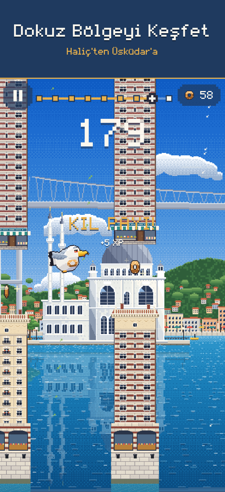
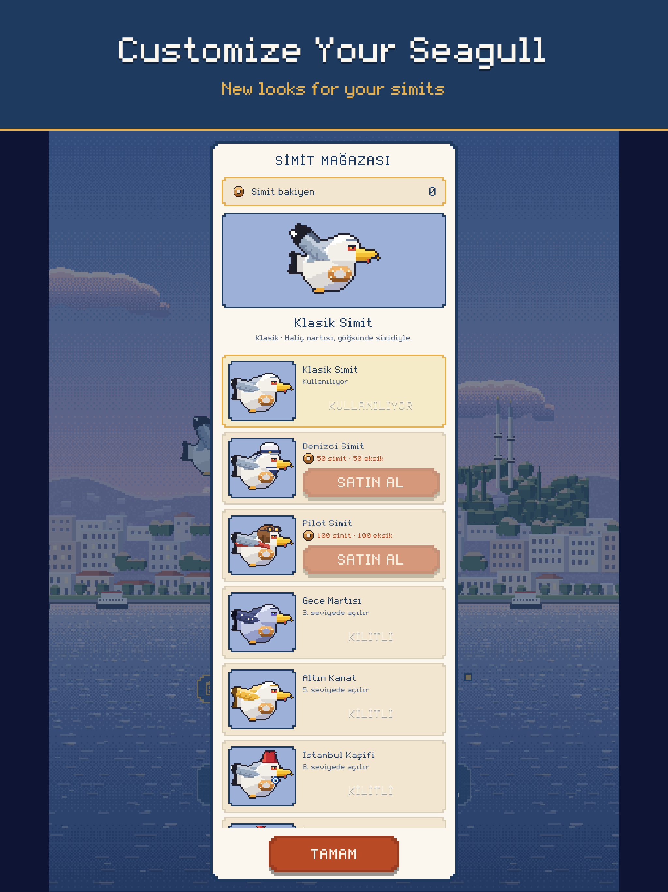

# 23 · Phase 3.0: Yayın hazırlığı, mağaza paketi ve kalite denetimi

> **Dosya adı:** İstekte `docs/22_phase3_0_premium_release.md` geçiyordu; 22 numara Phase 2.9'da kullanıldığı için 23.
> **Dal:** `feature/phase3-0-premium-release`, `main` `56898e5` üzerine. pubspec **1.8.0+11** (değiştirilmedi).
> **Yapılmayanlar:** Yükleme, App Review gönderimi ve yayın **yapılmadı**. Gerçek iPhone testi **yapılamadı** (TestFlight kurulumu hesap sorunu yüzünden açılmıyor).

**İlgili belgeler:**
- Kalite matrisi: [phase3_0_qa_matrix.md](phase3_0_qa_matrix.md)
- Sürüm notları: [phase3_0_release_notes.md](phase3_0_release_notes.md)
- Yayın planı: [phase3_0_launch_plan.md](phase3_0_launch_plan.md)
- Mağaza paketi: [store/phase3_0/](store/phase3_0/README.md)

## 1. Güncel durum

| Konu | Durum (11 Kasım 2026) |
|---|---|
| `main` | `56898e5` (1.8.0+11, Phase 2.9 + TestFlight belgeleri). Etiket: `v1.2.0+3`. Yayın dalları `release/1.2.0`, `release/1.7.0`, `release/1.8.0` korundu |
| App Store (herkese açık) | **Yayında değil.** Apple arama servisi bütün ülkelerde 0 sonuç; TR mağaza sayfası 404 |
| Son App Review | 1.2.0 (3), 22 Ekim 2026'da gönderildi; 23 Ekim'de "There's an issue with your submission": Guideline 2.1 Information Needed, fiziksel iPhone'da ekran kaydı istendi. Sonra sürüm kaydı 1.4.0'a çevrildi ("Prepare for Submission"); yeniden gönderilmedi |
| TestFlight | En son 1.8.0 (11), 11 Kasım. Dahili ve harici gruplarda. Harici beta incelemesine gönderim 422; telefona kurulum açılmıyor (Apple talebi 103007198858) |
| App Store Connect erişimi | Bu fazda oturum kapalıydı. Durum herkese açık App Store, e-postalar ve önceki belgelerden doğrulandı |
| `APP_STORE_RELEASE_CHECKLIST.md` | **1.2.0 (3)** için (22 Ekim 2026). Başına bunun tarihî olduğu notu eklendi |
| Bundle ID ve imzalama | `com.burakhamzali.istanbulFlight`; Codemagic "Zar ASC Key", App Store dağıtım profili. Değiştirilmedi |
| Cihaz ailesi | iPhone ve iPad (`TARGETED_DEVICE_FAMILY = 1,2`) → 13 inç iPad görüntüsü zorunlu |
| Şifreleme beyanı | `ITSAppUsesNonExemptEncryption = false` |
| Sürüm önerisi | İlk halka açık sürüm **1.8.0**, derleme **(11)**. 3.0.0 değil (§phase3_0_release_notes) |

## 2. Kalite denetimi

Ayrıntılar: [phase3_0_qa_matrix.md](phase3_0_qa_matrix.md).
- **Kritik hata yok:** P0 ve P1 bulgu yok (489 otomatik test, web derlemesinde 9 bölgelik 7 dakikalık uçuş, bütün ekranlar).
- **Düzeltilen P2'ler:** Eski mağaza metinleri ve eski mağaza görüntüleri.
- **Açık P3'ler:** iPad yatay koyu şeritler, iPhone'da Etkinlikler düğmesinin kesik görünmesi, iPad'de küçük arayüz, isteğe bağlı gizlilik bildirimi.

**Oynanış değişmedi:** Yerçekimi, fizik, engel açıklıkları, çarpışma, tohum algoritması, günlük üretici sürümü, skor, ekonomi, sezon ödülleri ve kayıt anahtarlarına **dokunulmadı**.

## 3. Görsel kimlik

- **Bütünlük:** Bütün ekranlar tek bir tasarım sisteminde (Phase 2.8: renkler, `UiText`, `UiButtonH`, `UiDur`, piksel kenarlıklar, MartiPixel yazı tipi). Mağaza görüntülerinde de aynı renkler ve aynı font kullanıldı.
- **Yeni görsel yok:** Bu fazda yeni sanat eseri üretilmedi; mevcut pixel art'a dokunulmadı.
- **Görüntü kaynağı:** Mağaza görüntüleri oyunun gerçek çiziminden alındı.

## 4. Uygulama simgesi

[store/phase3_0/README.md](store/phase3_0/README.md) §3:
- Simge 180'den 40 piksele kadar ve iOS köşe maskesiyle incelendi; martı her boyutta tanınıyor.
- **Değişiklik önerilmiyor; simge değiştirilmedi.**

## 5. Mağaza görüntüleri

24 görüntü: TR ve EN, her birinde iPhone 1206×2622 ve iPad 2048×2732'den 6'şar. Hepsi PNG, 24 bit RGB, alfa yok.
- **Kurallar:** Apple'ın 11 Kasım 2026'daki resmî sayfasına göre zorunlu sınıflar: Dynamic Island orta iPhone ve iPad 13 inç.
- **Gerçek cihaz görüntüsü değil:** Görüntüler Flutter **web** derlemesinden alındı.
- **Skorlar gerçek:** Uçuş görüntülerindeki skorlar otomatik pilotun tek bir uçuşta gerçekten ulaştığı değerler.
- **Ölçekleme yok:** Hiçbir görüntü ölçeklenmedi.
- **Ayrıntılar ve yeniden üretme:** [store/phase3_0/README.md](store/phase3_0/README.md) §1.

| TR iPhone | EN iPad |
|---|---|
|  |  |

**Önce / sonra:**
- **Önceki paket:** `docs/store/screenshots/`, 1.2.0 döneminden, 5 bölgeli.
- **Yeni paket:** 9 bölge, Günün Uçuşu ve kupa ekranlarıyla `docs/store/phase3_0/screenshots/`.

**Üretim yöntemi:**
- `MARTI_DEMO` web derlemesi yerel sunucuda çalıştırıldı.
- Başsız Edge, Chrome DevTools Protocol ile cihaz ölçüsü ve ölçeğiyle açıldı.
  - Oyun: `?play=1`, otomatik pilot, her 25 sn görüntü.
  - Ekranlar: `?modal=shop|events|daily` ile açıldı.
- Görüntüler, başlık şeridini çizen bir HTML şablonuyla birleştirildi.
- `System.Drawing` ile 24 bit RGB'ye çevrildi.

## 6. Tanıtım videosu

**Üretilmedi.** Bu bilgisayarda video kodlayıcı yok ve Apple uygulamanın kendi kaydını bekliyor.
- **Hazır olan:** 30 saniyelik senaryo, sahne listesi ve kurgu notları ([store/phase3_0/README.md](store/phase3_0/README.md) §4).
- **Apple kuralları:** 15–30 sn, en fazla 30 fps. iPhone için 886×1920, iPad için 1200×1600.

## 7. Mağaza metinleri

[store/phase3_0/metadata.json](store/phase3_0/metadata.json), TR ve EN.
- **Sınırlar:** `node tool/store_check.js` ile denetlendi; hepsi Apple sınırları içinde. Anahtar kelimeler bayt olarak sayıldı.
- **İçerik:** Metinler yalnızca oyunda olan özellikleri anlatıyor. İngilizce açıklamada arayüzün Türkçe olduğu yazıyor. Anahtar kelimelerde rakip ya da marka adı yok.

## 8. Analitik ve büyüme ölçümü

**Önerilen: App Store Connect Analytics yeterli.** Yeni SDK eklenmedi.

| İstenen ölçüm | Apple aracı |
|---|---|
| İndirme | App Analytics → Acquisition |
| Ürün sayfası dönüşümü | App Analytics (Impressions → Product Page Views → Downloads) |
| Aktif cihaz, oturum | App Analytics → Usage (kullanıcı paylaşımı açıksa) |
| 1. ve 7. gün geri dönüş | App Analytics → Retention |
| Çökme oranı, sürüm bazlı | App Analytics → Crashes; Xcode Organizer (dSYM Codemagic'te) |
| Ülkeler | Bütün raporlarda ülke kırılımı |

**Oyun içi olay analitiği (yalnızca tasarım, uygulanmadı, onay gerektirir):**
- **Olaylar:** `tutorial_started`, `tutorial_completed`, `run_started`, `run_finished`, `daily_challenge_started`, `cosmetic_purchased`, `zone_discovered`.
- **Kaynak:** Oyunda bunların hepsi zaten `GameEvent` olarak var (`progression/game_events.dart`). Bir analitik dinleyicisi `services.listeners`'a eklenebilir.
- **Veri:** Olay adı, mod, skor, bölge, süre ve uygulama sürümü. Cihaz kimliği, reklam kimliği ya da konum yok.
- **Gizlilik etkisi:**
  - Veri bir sunucuya gönderilirse App Store'daki gizlilik beyanı "Data Not Collected" olmaktan çıkar. "Usage Data → Product Interaction, Not Linked to You" eklenmesi gerekir.
  - Gizlilik politikası güncellenmeli.
  - Kullanıcıyı uygulamalar arasında izlemiyorsa ATT izni gerekmez.
- **Öneri:** İlk sürümde eklenmesin. Apple verisi ilk 30 günde yeterli. Gerekirse, kendi sunucusu olmayan bir çözümle ayrıca tasarlanır.

## 9. Gizlilik ve uyumluluk

| Konu | Durum |
|---|---|
| App Privacy | "Data Not Collected", Tracking: No (22 Ekim 2026'da yayımlandı). **Hâlâ doğru:** uygulama veri toplamıyor, kendi sunucusu, analitiği ya da reklamı yok; Game Center Apple'ın hizmeti |
| Gizlilik politikası | https://burakhamzalidev.github.io/istanbul_flight/privacy.html, yayında; Game Center bölümü var (23 Ekim 2026) |
| Destek adresi | https://burakhamzalidev.github.io/istanbul_flight/support.html, yayında (HTTP 200) |
| Gizlilik bildirimi (privacy manifest) | Uygulamanın kendi dosyası yok. Gerekçe isteyen API'yi kullanan eklentiler ve Flutter motoru kendi bildirimini taşıyor. Apple 14 yüklemede uyarı göndermedi (§phase3_0_qa_matrix #7) |
| Game Center | Sıralama, başarım ve isteğe bağlı arkadaş listesi (`NSGKFriendListUsageDescription`). Liste saklanmaz |
| Paylaşım | Kullanıcının başlattığı iOS paylaşım menüsü. Fotoğraflar'a kaydetme izni yalnızca ekleme için (`NSPhotoLibraryAddUsageDescription`) |
| Yerel kayıt | UserDefaults (ilerleme, ayarlar, Game Center kuyruğu); cihazdan çıkmaz |
| Çökme ve analitik | Yalnızca Apple'ın kendi verisi; ek SDK yok |
| Yaş derecesi | 4+ (anket, 22 Ekim) |

**Sonuç:** Veri akışı 1.2.0'dan bu yana yalnızca Game Center ile genişledi; politika bunu kapsıyor. App Privacy yanıtlarının değişmesi gerekmiyor.

## 10. Testler ve performans

| Komut | Sonuç |
|---|---|
| `flutter analyze` | No issues found |
| `flutter test` | **489 / 489** |
| `node tool/store_check.js` | Bütün sınırlar uygun |

**Performans:** Bu fazın tek kod değişikliği (`lib/main.dart`, `&modal=`) `MARTI_DEMO` sabitinin içinde.
- **Normal derleme:** Sabit false olduğu için kod derlenmiyor. Oyun döngüsü, çizim, bellek, ses ve açılış Phase 2.9 ile aynı.
- **Yeniden ölçüm:** Yapılmadı; değişen bir şey yok. Ölçüm sonuçları için [22_phase2_9_performance_optimization.md](22_phase2_9_performance_optimization.md).

**Gerçek cihaz:** Hiçbir şey test edilmedi (§2).

## 11. Yayın adayı durumu ve kullanıcı onayı gerektirenler

**Yayın adayı: 1.8.0 (11).**
- **Kod tarafı:** Hazır.
- **Henüz onaylanamaz, çünkü:**
  1. Apple hesap sorunu yüzünden telefona kurulamıyor.
  2. Gerçek cihaz testi yapılmadı.
  3. App Review için fiziksel iPhone ekran kaydı yok.

**Senin onayını bekleyenler:**
- App Store Connect'te sürüm kaydını 1.8.0 yapmak ve derleme 11'i bağlamak.
- 24 görüntüyü ve TR/EN metinleri yüklemek.
- App Review notunu girip gönderim yapmak.
- Halka açık yayın.
- İsteğe bağlı:
  - simge iyileştirmesi
  - gerçek cihazdan görüntü ve video
  - Etkinlikler düğmesi düzeltmesi (P3)
  - analitik SDK'sı

Yayın planı: [phase3_0_launch_plan.md](phase3_0_launch_plan.md).
